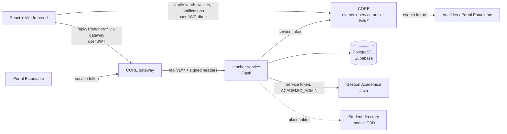

# Portal Docente (UADEnet) — Backend Design & Architecture

**Service:** `teacher-service` · **Stack:** Flask 3 · SQLAlchemy 2 · Alembic · PostgreSQL 16 · Pydantic v2
**Audience:** Claude Code (implementer) and the team. Read top to bottom once, then use the section index as reference.
**Status of sources:** derived from `CLAUDE.md`, `docs/*`, `db/schema.sql`, `db/seed.sql`, the Spring Boot entity layer, `CONTRATO_PORTALES_ALUMNOS_Y_DOCENCIA.md`, `FlujoDatos.xlsx`, and the React frontend (`portal-docente-uadenet.zip`).

> **How to read confidence markers.** Every rule or fact is tagged where it matters:
> - **[SRC]** stated in a source file (cited).
> - **[DERIVED]** logically follows from sources (e.g. the frontend's current behavior).
> - **[PROPOSED]** my design decision; not in any source. Change freely, but change it in one place (see §20 Decision Log).
> - **[OPEN]** unknown; needs an answer from another team. A default is given so work is not blocked.

---

## 0. Index

1. Goals, scope, non-goals
2. Findings that shape the design (read this first)
3. System context & integration map
4. Architecture & project layout
5. Configuration
6. Database (schema, models, migrations)
7. API conventions
8. Security
9. Integration adapters
10. Endpoint catalog (full contracts)
11. Business rules & algorithms
12. Domain events & outbox
13. Error model
14. Cross-cutting: logging, caching, concurrency, time
15. Testing strategy & acceptance cases
16. Local dev, Docker, deployment
17. Frontend migration guide
18. Implementation roadmap (phased, with Definition of Done)
19. Open questions per team
20. Decision log
21. Appendix A: repo `CLAUDE.md` to drop in the new project · B: mock fixtures · C: source-contract cross-reference

---

## 0.1 Alignment update — 2026-10-26 (supersedes older text where they disagree)

Sources re-read together: the TPO statement (`data/TPO - DEA II 2Q 2026.pdf`), the data-flow sheets of modules
4, 6, 7, 8, 9, 10 and Biblioteca (`data/*.xlsx`), and CORE's live OpenAPI
(`https://core-api-production-e458.up.railway.app/docs`, `/docs-json`). **Scope of this delivery: backend +
frontend + DB working WITHOUT any connection to other modules.** Every integration runs in `mock` mode, but
mocks and live adapters use the shapes those modules published, so going live is configuration only.

| Topic | Before | Now (source) |
|---|---|---|
| Auth | opaque bearer, introspection via `/auth/me` | **RS256 JWT verified locally with JWKS** (`AUTH_VERIFIER=jwt`). CORE: "User and service tokens use the same scheme"; Analítica/Backoffice sheets validate locally. Claims: `sub`, `email`, `roles[]`, `permissions[]`, `careerIds[]`, `kind` (`user`/`service`), `service`, `status`. |
| Login without CORE | — | **Local CORE simulator** (`app/mock_core`, `MOCK_CORE_ENABLED=true`): same paths and payloads as CORE for `/api/v1/auth/{login,refresh,logout,me}`, `/.well-known/jwks.json`, `/internal/v1/service-auth/token`, `/api/v1/wallets/me[/transactions|/top-ups]`, `/api/v1/notifications[...]`, `/internal/v1/notifications`. Key persisted in DB (shared by all workers). Tables `mock_core_*` (migration `0003`). |
| Role names | `ROLE_DOCENTE`, `ROLE_ADMINISTRATIVO` | CORE/Backoffice catalog: `TEACHER`, `STUDENT`, `ACADEMIC_ADMIN`, `ADMIN_STAFF`, `ADMIN_IT`. Permissions `{module}:{resource}:{action}`. |
| Identity ↔ docenteId | heuristic `sub`/email/email-local | **`sub` only**. Backoffice generates the user UUID; it is the JWT `sub`, the gateway `X-User-Id` and GA's `docentes[].docenteId` ("ningún módulo referencia gente por email o legajo"). |
| Ids in fixtures/seed | `docente-123`, `alumno-456` | UUID v4 (`5f0a8e21-…` María Gómez, `ba310c57-…` Juan Pérez — the ids used in the other teams' sheets). Course/subject/period ids stay numeric (GA). |
| Student directory | unknown owner, `GET /students?ids=` | **Backoffice** `GET /api/v1/users/{userId}` → `{userId,email,firstName,lastName,documentId,fileNumber,roles,status,siteId,careerId}` (fetched in parallel; 404 = unknown). Also used for the teacher's own name (`GET /me`, acta `teacherName`) — professor's correction to other teams: "Falta consumir los datos del usuario logueado (Backoffice)". |
| GA periods | had enrollment dates | GA `/planificacion/periodos` returns `{id,anio,numero,fechaInicio,fechaFin}` → `enrollmentFrom/Until` are now optional. GA routes live under `/api`. |
| Event envelope | `correlationId` any string | CORE requires `correlationId` **UUID**, `actor.type ∈ {user,service,system}`, `source` = token module (`teacher`). Inbound non-UUID `X-Correlation-Id` is replaced. |
| Events | 5 | + **`teacher.course-result-published.v1`**, one per student with `APROBADO`/`DESAPROBADO` in a FINAL acta: `{studentId, courseId, subjectId, periodId, siteId, teacherId, finalGrade, status, resultDate, actaNumber}` — the shape Analítica asked for ("tasa de aprobación por materia, por docente y por cuatrimestre"). |
| Student notification | not done | TPO §1: "Cuando se carga el resultado de un examen el portal debe mostrar una notificación en tiempo real". On every new/changed numeric grade we queue `POST /internal/v1/notifications` (type `TEACHER_EXAM_RESULT_PUBLISHED`, `actionUrl` `/student/courses/{courseId}/exams/{examId}`, `sourceReference` idempotent per grade value). Same outbox, `outbox_event.kind = NOTIFICATION`. |
| Calendar / purchases | Phase-4 placeholders | `GET /calendar?from&to` = own exams + GA exam turns + academic events (module 6 shape) + dining reservations (module 4 `dining.reservation.created.v1`). `GET /purchases` = store purchases (module 7's `store.purchase.completed.v1` shape). Mock data (`integrations/campus_mock.py`). Wallet balance/top-up and notifications are **CORE** endpoints (frontend → CORE, here → simulator). |
| Errors | problem+json | + `instance` field (CORE returns it). |

New endpoints: `GET /calendar`, `GET /purchases` (teacher) and the CORE-simulator routes above (tag *Mock CORE*).
Test suite: 142 tests; three end-to-end tests (`tests/integration/test_e2e_*.py`) run with real JWTs and assert
that **every** registered route is exercised.

---

## 1. Goals, scope, non-goals

**What this service is.** The `teacher` microservice of UADEnet, a course project (Desarrollo de Aplicaciones II, UADE) where each group builds one module of a microservice platform. This service owns four kinds of data: **attendance, exams, grades, and actas** (official grade records). **[SRC: CLAUDE.md, modelo-de-datos.md]**

**Goals**
1. Port the intended behavior of the (data-layer-only) Spring Boot project to Flask, keeping the existing PostgreSQL schema compatible.
2. Replace the frontend's `localStorage` store (`teacherStore.ts`) with a real API.
3. Act as a **backend-for-frontend (BFF)** for data owned by other modules (Gestión Académica, student directory), with `mock` and `live` implementations behind interfaces.
4. Publish domain events to CORE reliably (transactional outbox).
5. Expose a read API for the Student Portal (final results per student).
6. Ship Swagger/OpenAPI docs (the course requires it).

**Non-goals**
- No course creation (Gestión Académica creates courses; the teacher never does). **[SRC: CLAUDE.md "corrección del profe"]**
- No login, wallet, notifications: the frontend keeps calling CORE directly for those (already working live). **[SRC: CLAUDE.md]**
- No replication of student/teacher personal data. Only ids are stored; names/legajo are copied into actas as a snapshot. **[SRC: modelo-de-datos.md]**
- No PDF generation server-side (frontend `jspdf` does it). Optional later.

---

## 2. Findings that shape the design

These are discoveries from reading all the sources together. Several change what a naive port would do.

### 2.1 The "legacy backend" is only a data layer
The Spring Boot project has entities, enums, repositories, `schema.sql`, `seed.sql`. **No services, controllers, security, or integrations exist.** The behavior to port is specified in prose in `CLAUDE.md`, `modelo-de-datos.md`, `guia-backend-entities.md`, and in the *frontend's current logic* (`teacherStore.ts`, `actaSync.ts`, `ActaNew.tsx`). This document turns all of that into explicit rules (§11).

### 2.2 The browser cannot call Gestión Académica directly (BFF is mandatory)
The GA contract says its endpoints require `ACADEMIC_ADMIN` or `ACADEMIC_ADMIN`, and that "el Portal de Docencia consume estas rutas con ACADEMIC_ADMIN". **[SRC: contract §Alcance]** A logged-in teacher has a teacher role, not an administrative one. Today's frontend (`api/academic.ts`) calls GA with the *user's* token. That will return 403 in production. Therefore:

- `teacher-service` calls GA **with a service credential**, and the frontend calls `teacher-service` instead. **[DERIVED]**
- This also lets the backend absorb the **N+1 problem**: GA has no `?docenteId=` filter, so the frontend currently fetches every course detail to find the teacher's own. The backend does it once, with bounded concurrency and caching, behind one method (`list_courses_for_teacher`) that can switch to a native filter when GA ships it. **[DERIVED + SRC: contract table]**

### 2.3 The sources disagree; here is the precedence
| Topic | `FlujoDatos.xlsx` (pre-correction) | Real / newer source | **Use** |
|---|---|---|---|
| Token validation | `POST /api/v1/auth/validate` | Doesn't exist. Use `GET /api/v1/auth/me` or verify JWT via JWKS | JWKS verification **[SRC: CLAUDE.md, plan §4]** |
| Balance | `GET /accounts/{id}/balance` | `GET /api/v1/wallets/me` | Frontend → CORE directly; not this service |
| Event transport | Message queues (`asistencia.registrada`…) | `POST /internal/v1/events` with a 15-min service token | HTTP outbox to CORE **[SRC: CLAUDE.md]** |
| IDs | Strings like `C-101`, `SUB-101`, `D-404`, `E-9912` | GA: `bigint` for course/subject/period; `varchar(50)` for student/teacher (`ba310c57-a684-4dbf-a4a4-905fcfbefa08`, `5f0a8e21-4c7b-4d19-9a3e-61b2c8d7f034`) | GA contract + `schema.sql` **[SRC]** |
| GA routes | `/api/v1/academic/courses...` (English) | `/planificacion/cursos...`, `/academica/...` (Spanish) | GA contract **[SRC]** |
| Event names | `acta.generada`, `calificacion.publicada`… | `teacher.acta-generated.v1`… (CORE convention `source.entity-action.v1`, **provisional**) | Provisional names, centralised in one constants file **[OPEN]** |

`CLAUDE.md` says the Excel still needs the professor's corrections. **Treat the Excel as informational only.** Its payload *field names* (English: `courseId`, `studentId`, `grade`, `status`) are still useful as the basis for event payloads (§12).

### 2.4 The frontend is already React 19 + TypeScript + Vite
Not Tailwind, not Axios; it has its own `fetch` wrapper (`api/http.ts`) with refresh-token retry and an `ApiError` that already parses `{code, detail|title|message, correlationId}`. The "frontend work" is replacing a store with an API client, not building a UI. Details in §17.

### 2.5 Business rules already decided (all **[SRC: CLAUDE.md / modelo-de-datos.md]**)
- Regularity: **≥ 75 %** attendance → `REGULAR`, else `LIBRE`. `JUSTIFICADO` is **not** an absence. Computed over classes registered so far.
- Passing grade: **≥ 4**. Grades `numeric(4,2)` in `[0,10]`.
- One **active** exam per `(curso_id, tipo)`; cancelled exams don't count. Exam `tipo` is **free text**.
- Actas: number `YYYY-NNN`; **one valid (`GENERADA`) acta per `(curso, tipo, examen)`**; actas are **never edited**, only **annulled with a reason**, then a new one is generated. They snapshot subject, commission, period, teacher, and each student's name/legajo.
- Actas are the **official source of final grade and condition**; GA does not take responsibility for them. Still, results are pushed to GA via `PUT …/inscripciones/{alumnoId}`; if that fails the acta stays and `sync_error` is incremented.
- No foreign keys to external ids.

### 2.6 Things not specified anywhere (defaults in §11 and §19)
*(Resolved since the first draft: CURSADA = attendance only; APROBADO = attendance + passing grade; auth = opaque bearer behind a swappable verifier.)* Still open: whether an `AUSENTE` student is sent to GA; whether annulling reverts GA; the JWT algorithm/claims; how CORE user UUID maps to GA `docenteId`; the gateway's HMAC header format; the service-token request/response shape; the student-directory endpoint.

### 2.7 A naming conflict to resolve once
Code and DB are in Spanish; the course's API guideline asks for **English, plural, lowercase resources, `lowerCamelCase` JSON keys, `/api/v1`**, and the professor grades against it. **[SRC: CLAUDE.md "pendiente decidir"]** Decision **[PROPOSED, recommended in the source]**: **API in English; DB columns and enum *values* unchanged.** Rationale for keeping enum values: they are shared vocabulary with GA (`APROBADO`, `REGULAR`, …) and the Student Portal; translating them would add a lossy mapping layer. Keys are English, values are domain constants. The mapping lives in `app/schemas/` only (§7.3).

---

## 3. System context & integration map



### 3.1 Path routing **[SRC: CLAUDE.md, plan §3]**
CORE's gateway forwards `/api/v1/teacher/X` → our `/api/v1/X`. So **teacher-service implements `/api/v1/...`** and the frontend calls `/api/v1/teacher/...`. In local dev, the Vite proxy rewrites `/api/v1/teacher` → `http://localhost:8080/api/v1`.

### 3.2 Who calls whom
| From → To | Purpose | Auth | Mode |
|---|---|---|---|
| FE → CORE | login, refresh, `/auth/me`, wallet, notifications | user JWT / refresh cookie | live (frontend, unchanged) |
| FE → teacher-service | everything in §10 | user bearer token (verified by asking CORE, §8.2) | **new** |
| teacher-service → GA | courses, roster, periods, turns, prerequisites, **`PUT` enrollment result** | service token | mock \| live |
| teacher-service → CORE | `POST /internal/v1/service-auth/token`, `POST /internal/v1/events`, `GET /.well-known/jwks.json` | client credentials | mock \| live |
| teacher-service → Student directory | name/legajo/email by ids | service token | mock \| live **[OPEN: owner]** |
| Portal Estudiante → teacher-service | results per student (§10.9) | service token | live |

### 3.3 Modules that are placeholders today **[SRC: endpoints.ts, plan §6]**
Events (academic), Dining, Store purchases, Teacher profile, Student personal data. Their routes in the frontend were marked **non-existent by the professor**. They stay out of the MVP; Phase 4 adds BFF adapters with `mock` implementations so the frontend can drop its own `placeholders.ts` fallbacks. The `calendar` aggregation (§10.10) is the one that matters.

---

## 4. Architecture & project layout

**Style:** modular monolith, layered (routes → services → models/integrations). One deployable. Folders are domain cuts so it could be split later. **[SRC: guia-backend-entities §1, same reasoning]**

```
backend/
├── pyproject.toml                 # deps + tool config (ruff, pytest, mypy)
├── Dockerfile
├── docker-compose.yml             # postgres + api + outbox-worker (+ optional pgadmin)
├── .env.example
├── wsgi.py                        # app = create_app()
├── migrations/                    # Alembic (hand-written; see §6.5)
│   └── versions/
│       ├── 0001_baseline.py       # tables + views from db/schema.sql
│       └── 0002_outbox.py         # outbox_event
├── app/
│   ├── __init__.py                # create_app(): config, extensions, blueprints, errors, spec
│   ├── config.py                  # Base/Dev/Test/Prod classes, env parsing, fail-fast validation
│   ├── extensions.py              # db, migrate, spec (SpecTree)
│   ├── errors.py                  # AppError hierarchy + handlers → problem+json
│   ├── logging.py                 # JSON logs, correlation id filter
│   ├── time.py                    # now_utc(), today_local(), TZ helpers
│   ├── constants.py               # enums, EVENT_TYPES, PASSING_GRADE, REGULAR_THRESHOLD
│   ├── security/
│   │   ├── principal.py           # Principal dataclass
│   │   ├── verifiers/             # TokenVerifier strategies: introspect.py (now), jwt.py (future), dev.py
│   │   ├── gateway_hmac.py        # optional signed-header check
│   │   ├── decorators.py          # @require_auth, @require_roles, @require_service
│   │   └── course_access.py       # "does this teacher teach course X?"
│   ├── models/
│   │   ├── base.py                # Base, mixins
│   │   ├── asistencia.py          # Clase, Asistencia, AsistenciaPorAlumno (view)
│   │   ├── examen.py              # Examen, Calificacion
│   │   ├── acta.py                # Acta, ActaDetalle, ResultadoPorAlumno (view)
│   │   └── outbox.py              # OutboxEvent
│   ├── schemas/                   # Pydantic v2 DTOs (English camelCase) + enum re-exports
│   │   ├── common.py              # ProblemDetail, Page
│   │   ├── courses.py
│   │   ├── exams.py
│   │   ├── grades.py
│   │   ├── attendance.py
│   │   ├── actas.py
│   │   ├── results.py
│   │   └── events.py
│   ├── routes/                    # thin Flask blueprints
│   │   ├── health.py
│   │   ├── courses.py
│   │   ├── exams.py
│   │   ├── grades.py
│   │   ├── attendance.py
│   │   ├── actas.py
│   │   ├── results.py             # service-to-service
│   │   └── calendar.py            # phase 4
│   ├── services/                  # business rules, one transaction per use case
│   │   ├── course_service.py
│   │   ├── exam_service.py
│   │   ├── attendance_service.py
│   │   ├── grade_service.py
│   │   ├── acta_service.py
│   │   ├── acta_sync_service.py
│   │   ├── result_service.py
│   │   └── event_service.py       # enqueue to outbox
│   ├── integrations/
│   │   ├── base.py                # ABCs + DTOs (AcademicClient, CoreEventsClient, StudentDirectoryClient)
│   │   ├── factory.py             # picks mock|live per config
│   │   ├── http.py                # HttpClient: Session, timeouts, retries, error mapping
│   │   ├── outbound_auth.py       # OutboundAuth strategies: StaticBearer, ServiceTokenAuth, NoAuth
│   │   ├── token_provider.py      # CORE service-token cache
│   │   ├── academic_live.py
│   │   ├── academic_mock.py
│   │   ├── core_events_live.py
│   │   ├── core_events_mock.py
│   │   ├── student_directory_live.py
│   │   ├── student_directory_mock.py
│   │   └── fixtures.py            # mock data (Appendix B)
│   └── cli.py                     # flask outbox-worker, flask outbox-once, flask seed
└── tests/
    ├── conftest.py                # PG container, app, client, fakes, auth helpers
    ├── factories.py
    ├── unit/                      # pure rules: regularity, grade→result, numbering
    ├── integration/               # DB + routes with fake integrations
    ├── contract/                  # upstream HTTP stubs (requests-mock) + OpenAPI conformance
    └── test_schema_matches_models.py
```

### 4.1 Layer rules (enforce in review)
1. **Routes** parse/validate input (Pydantic), call **exactly one service function**, serialize output. No SQL, no business logic, no upstream calls.
2. **Services** own transactions (`db.session`), business rules, and orchestration. They take a `Principal` (and plain values), never a Flask `request`.
3. **Models** hold mapping only. No business logic beyond trivial helpers.
4. **Integrations** are called only from services, only through the ABCs in `integrations/base.py`. Services never import `requests`.
5. **ORM objects never leave the service layer.** Services return Pydantic DTOs or plain dataclasses. **[SRC: "Las entities no salen por la API"]**
6. Transaction boundary = service function. Commit once at the end; side-effects that must not roll back the business transaction (GA sync, event dispatch) run **after commit** (§11.6, §12).

### 4.2 Dependency choices **[PROPOSED]**
| Need | Choice | Why |
|---|---|---|
| Web | Flask 3.x + gunicorn | requested |
| ORM/migrations | SQLAlchemy 2.x (typed `Mapped[]`), Flask-SQLAlchemy 3.1, Flask-Migrate (Alembic) | requested |
| Driver | `psycopg[binary]` 3.x | modern, works with Supabase pooler |
| Validation + OpenAPI | **Pydantic v2 + SpecTree** (`spectree`) | Pydantic models validate input and generate Swagger; no Marshmallow double-definition. *Verify the installed SpecTree version's Flask + Pydantic v2 support; fallback: `flask-openapi3`.* |
| JWT | `PyJWT[crypto]` (`PyJWKClient`) | JWKS fetch + cache + key rotation |
| HTTP out | `requests` + `urllib3.Retry` | simple, sync, well-known |
| Cache | `cachetools.TTLCache` (per process) | no Redis needed at this scale |
| Money/decimals | `decimal.Decimal` | grades are `numeric(4,2)`; never `float` in rules |
| Tests | pytest, `testcontainers[postgresql]`, `requests-mock`, `factory-boy`, `freezegun` | real PG required (partial indexes, views) |
| Lint/type | ruff, mypy (strict-ish on `services/`, `security/`) | |

---

## 5. Configuration

All via environment variables; `.env` for local only (never committed). `config.py` parses once and **fails fast** on missing/invalid values (e.g. `AUTH_VERIFIER=dev` in production aborts boot).

```dotenv
# ── Runtime ──────────────────────────────────────────────
APP_ENV=development                # development | test | production
PORT=8080
APP_TIMEZONE=America/Argentina/Buenos_Aires   # business "today" (acta date, attendance future check)
LOG_LEVEL=INFO
CORS_ORIGINS=                      # empty = CORS disabled (same-origin via gateway/Vite proxy)

# ── Database ─────────────────────────────────────────────
# Supabase: use the SESSION POOLER, user is postgres.<project-id>, sslmode=require
DATABASE_URL=postgresql+psycopg://postgres.<id>:<pwd>@aws-1-ca-central-1.pooler.supabase.com:5432/postgres?sslmode=require
DB_POOL_SIZE=5
DB_POOL_RECYCLE=1800

# ── Auth ─────────────────────────────────────────────────
AUTH_VERIFIER=introspect           # introspect | jwt | dev   (dev refused when APP_ENV=production)
                                   #   introspect = opaque bearer token, validated by asking CORE (GET /api/v1/auth/me)  <- CURRENT
                                   #   jwt        = verify signature locally via JWKS                                     <- FUTURE
TOKEN_CACHE_TTL_SECONDS=60         # introspect: how long a positive answer is cached (this is also the revocation delay)
TOKEN_CACHE_MAX_ENTRIES=2000
CORE_ME_PATH=/api/v1/auth/me
SERVICE_TOKENS=                    # comma-separated static tokens accepted from other modules on service-only routes (/results)
# --- only used when AUTH_VERIFIER=jwt (future) ---
CORE_JWKS_URL=https://core-api-production-e458.up.railway.app/.well-known/jwks.json
JWT_ALGORITHMS=RS256               # [OPEN] confirm with CORE (the old Excel showed HS256-looking token; JWKS implies RS/ES)
JWT_ISSUER=                        # [OPEN] if CORE sets `iss`; empty = skip check
JWT_AUDIENCE=                      # [OPEN] idem
JWT_LEEWAY_SECONDS=30
TEACHER_ROLES=TEACHER       # [OPEN] real role names; any-of
SERVICE_ROLES=SERVICE  # [OPEN] who may call /results (service-to-service)
DOCENTE_ID_CLAIMS=sub,email,email_local       # candidate keys to match GA docenteId (see §8.4)
GATEWAY_HMAC_ENABLED=false         # [OPEN] enable when CORE documents the signed headers
GATEWAY_HMAC_SECRET=

# ── Outbound auth (how WE authenticate to other modules) ─────────────
ACADEMIC_AUTH_VERIFIER=static_bearer   # static_bearer | service_token | none
ACADEMIC_STATIC_TOKEN=             # simple bearer required by GA today
CORE_EVENTS_AUTH_VERIFIER=service_token   # service_token | static_bearer
CORE_EVENTS_STATIC_TOKEN=
STUDENT_DIRECTORY_AUTH_VERIFIER=static_bearer
STUDENT_DIRECTORY_STATIC_TOKEN=

# ── Integrations (global default + per-integration override) ─────────
INTEGRATIONS_MODE=mock             # mock | live
ACADEMIC_MODE=                     # empty → INTEGRATIONS_MODE
CORE_EVENTS_MODE=
STUDENT_DIRECTORY_MODE=

CORE_BASE_URL=https://core-api-production-e458.up.railway.app
CORE_SERVICE_CLIENT_ID=            # from CORE team
CORE_SERVICE_CLIENT_SECRET=
ACADEMIC_BASE_URL=                 # gateway prefix, e.g. https://<gateway>/api/v1/academic  [OPEN: /api vs /api/v1]
ACADEMIC_SUPPORTS_TEACHER_FILTER=false   # flip to true once GA ships ?docenteId=
STUDENT_DIRECTORY_BASE_URL=        # [OPEN]
HTTP_TIMEOUT_CONNECT=3
HTTP_TIMEOUT_READ=8
HTTP_MAX_RETRIES=2                 # idempotent methods only (GET, PUT)
ACADEMIC_COURSE_CACHE_TTL=60       # seconds
ACADEMIC_FANOUT_CONCURRENCY=6

# ── Business ─────────────────────────────────────────────
PASSING_GRADE=4.0
REGULAR_THRESHOLD=75.0
FINAL_EXAM_TYPES=FINAL             # exam types eligible for a FINAL acta
FINAL_REQUIRES_REGULAR=true        # APROBADO needs attendance >= 75% AND grade >= PASSING_GRADE
LOCK_AFTER_ACTA=true               # [PROPOSED] block grade/attendance edits once a valid acta covers them

# ── Outbox / events ──────────────────────────────────────
OUTBOX_POLL_SECONDS=5
OUTBOX_BATCH_SIZE=20
OUTBOX_MAX_ATTEMPTS=10
EVENTS_INLINE_DISPATCH=true        # try once right after commit; worker retries the rest
```

**Config object contract** (`app/config.py`): typed attributes (`cfg.academic_mode`, `cfg.passing_grade: Decimal`, …); `Settings.from_env()` raises `ConfigError` listing *all* problems at once. Test config uses an in-memory-ish PG container URL and `INTEGRATIONS_MODE=mock`, `AUTH_VERIFIER=dev`.

---

## 6. Database

### 6.1 Principles **[SRC]**
- Tables were created by `db/schema.sql`; **it is the source of truth for columns and rules.** In the Flask project that role passes to **Alembic migrations** whose baseline is equivalent to `schema.sql`.
- No FKs to external ids (`curso_id`, `asignatura_id`, `periodo_id`, `alumno_id`, `docente_id`).
- Internal FKs: `asistencia→clase` (cascade), `calificacion→examen`, `acta→examen`, `acta_detalle→acta` (cascade).
- RLS is enabled with **no policies** (Supabase anon key can't read). The backend connects as the DB owner, which bypasses RLS. Keep those `ALTER TABLE … ENABLE ROW LEVEL SECURITY` lines in the baseline.
- Views use `security_invoker = true` → requires PostgreSQL ≥ 15. Use `postgres:16` in tests.

### 6.2 ER summary
```
clase 1─* asistencia          (unique clase_id+alumno_id; unique curso_id+fecha on clase)
examen 1─* calificacion       (unique examen_id+alumno_id; ausente ⇒ nota null)
examen 0..1─* acta            (only FINAL actas reference an exam)
acta 1─* acta_detalle         (unique acta_id+alumno_id; unique acta_id+orden)
views: asistencia_por_alumno (curso_id, alumno_id) · resultado_por_alumno (curso_id, alumno_id)
new:   outbox_event           (migration 0002)
```

### 6.3 Constraints that the service layer must pre-validate **[SRC: guia §10]**
| Rule | DB object | Service pre-check → HTTP |
|---|---|---|
| One attendance record per course+date | `clase_curso_fecha_uk` | upsert semantics (PUT replaces) → never 409 in normal flow |
| One row per student per class | `asistencia_clase_alumno_uk` | duplicate `studentId` in body → 400 |
| One active exam per type per course | `examen_curso_tipo_activo_uk` (partial, `estado <> 'CANCELADO'`) | 409 `EXAM_TYPE_ALREADY_EXISTS` |
| Grade in [0,10] | `check (nota between 0 and 10)` | 400 |
| Absent ⇒ no grade | `calificacion_ausente_sin_nota_ck` | 400 |
| FINAL acta ⇔ has exam | `acta_examen_segun_tipo_ck` | 400 |
| One valid acta per course+type(+exam) | `acta_vigente_uk` (partial, `estado='GENERADA'`, `coalesce(examen_id,0)`) | 409 `ACTA_ALREADY_EXISTS` (+ existing id) |
| Annulled ⇔ has `anulada_en` | `acta_anulacion_ck` | service guarantees |
| Acta number unique | `acta.numero` unique | generated under advisory lock (§11.5) |
| Safety net | any `IntegrityError` | global handler → 409 `CONFLICT` |

### 6.4 SQLAlchemy models (reference implementation)

Conventions: `Mapped[]` typing; table/column names exactly as `schema.sql`; `Identity(always=False)` ≙ `generated by default as identity`; `Numeric(4,2)` → `Decimal`; timestamps `DateTime(timezone=True)`; enums stored as `String` with Python `StrEnum` + DB check constraints mirrored (so tests can detect drift).

```python
# app/models/base.py
from sqlalchemy import BigInteger, Identity
from sqlalchemy.orm import DeclarativeBase, mapped_column


class Base(DeclarativeBase):
    pass


def pk():
    return mapped_column(BigInteger, Identity(always=False), primary_key=True)
```

```python
# app/models/asistencia.py
from __future__ import annotations
from datetime import date, datetime
from decimal import Decimal
from sqlalchemy import (
    BigInteger,
    CheckConstraint,
    Date,
    DateTime,
    ForeignKey,
    Index,
    Integer,
    Numeric,
    String,
    Text,
    UniqueConstraint,
    func,
)
from sqlalchemy.orm import Mapped, mapped_column, relationship
from .base import Base, pk


class Clase(Base):
    __tablename__ = "clase"
    __table_args__ = (UniqueConstraint("curso_id", "fecha", name="clase_curso_fecha_uk"),)
    id: Mapped[int] = pk()
    curso_id: Mapped[int] = mapped_column(BigInteger, nullable=False)
    fecha: Mapped[date] = mapped_column(Date, nullable=False)
    observaciones: Mapped[str | None] = mapped_column(Text)
    creado_por: Mapped[str] = mapped_column(String(50), nullable=False)
    creado_en: Mapped[datetime] = mapped_column(
        DateTime(timezone=True), nullable=False, server_default=func.now()
    )
    actualizado_en: Mapped[datetime] = mapped_column(
        DateTime(timezone=True), nullable=False, server_default=func.now(), onupdate=func.now()
    )
    asistencias: Mapped[list["Asistencia"]] = relationship(
        back_populates="clase", cascade="all, delete-orphan", passive_deletes=True
    )


class Asistencia(Base):
    __tablename__ = "asistencia"
    __table_args__ = (
        UniqueConstraint("clase_id", "alumno_id", name="asistencia_clase_alumno_uk"),
        CheckConstraint("estado in ('PRESENTE','AUSENTE','JUSTIFICADO')"),
        Index("asistencia_alumno_idx", "alumno_id"),
    )
    id: Mapped[int] = pk()
    clase_id: Mapped[int] = mapped_column(ForeignKey("clase.id", ondelete="CASCADE"), nullable=False)
    alumno_id: Mapped[str] = mapped_column(String(50), nullable=False)
    estado: Mapped[str] = mapped_column(String(15), nullable=False)
    observacion: Mapped[str | None] = mapped_column(String(255))
    clase: Mapped[Clase] = relationship(back_populates="asistencias")


class AsistenciaPorAlumno(Base):  # VIEW — read-only
    __tablename__ = "asistencia_por_alumno"
    __table_args__ = {"info": {"is_view": True}}
    curso_id: Mapped[int] = mapped_column(BigInteger, primary_key=True)
    alumno_id: Mapped[str] = mapped_column(String(50), primary_key=True)
    clases_registradas: Mapped[int] = mapped_column(Integer)
    presentes: Mapped[int] = mapped_column(Integer)
    justificados: Mapped[int] = mapped_column(Integer)
    inasistencias: Mapped[int] = mapped_column(Integer)
    porcentaje_asistencia: Mapped[Decimal] = mapped_column(Numeric)
    condicion: Mapped[str] = mapped_column(String)  # REGULAR | LIBRE
```

```python
# app/models/examen.py
class Examen(Base):
    __tablename__ = "examen"
    __table_args__ = (
        CheckConstraint("duracion_minutos > 0"),
        CheckConstraint("modalidad in ('PRESENCIAL','VIRTUAL')"),
        CheckConstraint("estado in ('PROGRAMADO','CANCELADO')"),
        Index(
            "examen_curso_tipo_activo_uk",
            "curso_id",
            "tipo",
            unique=True,
            postgresql_where=text("estado <> 'CANCELADO'"),
        ),
        Index("examen_curso_idx", "curso_id"),
    )
    id: Mapped[int] = pk()
    curso_id: Mapped[int] = mapped_column(BigInteger, nullable=False)
    tipo: Mapped[str] = mapped_column(String(50), nullable=False)  # free text
    nombre: Mapped[str] = mapped_column(String(100), nullable=False)
    descripcion: Mapped[str | None] = mapped_column(String(500))
    fecha: Mapped[date] = mapped_column(Date, nullable=False)
    hora_inicio: Mapped[time] = mapped_column(Time, nullable=False)
    duracion_minutos: Mapped[int] = mapped_column(Integer, nullable=False)
    modalidad: Mapped[str] = mapped_column(String(15), nullable=False)
    estado: Mapped[str] = mapped_column(String(15), nullable=False, server_default="PROGRAMADO")
    creado_por: Mapped[str] = mapped_column(String(50), nullable=False)
    creado_en: ...
    actualizado_en: ...  # as in Clase


class Calificacion(Base):
    __tablename__ = "calificacion"
    __table_args__ = (
        UniqueConstraint("examen_id", "alumno_id", name="calificacion_examen_alumno_uk"),
        CheckConstraint("nota between 0 and 10"),
        CheckConstraint("not (ausente and nota is not null)", name="calificacion_ausente_sin_nota_ck"),
        Index("calificacion_alumno_idx", "alumno_id"),
    )
    id: Mapped[int] = pk()
    examen_id: Mapped[int] = mapped_column(ForeignKey("examen.id"), nullable=False)
    alumno_id: Mapped[str] = mapped_column(String(50), nullable=False)
    nota: Mapped[Decimal | None] = mapped_column(Numeric(4, 2))
    ausente: Mapped[bool] = mapped_column(nullable=False, server_default=text("false"))
    cargada_por: Mapped[str] = mapped_column(String(50), nullable=False)
    cargada_en: Mapped[datetime] = mapped_column(
        DateTime(timezone=True), nullable=False, server_default=func.now(), onupdate=func.now()
    )
```

```python
# app/models/acta.py
class Acta(Base):
    __tablename__ = "acta"
    __table_args__ = (
        CheckConstraint("tipo in ('CURSADA','FINAL')"),
        CheckConstraint("estado in ('GENERADA','ANULADA')"),
        CheckConstraint("(tipo = 'FINAL') = (examen_id is not null)", name="acta_examen_segun_tipo_ck"),
        CheckConstraint("(estado = 'ANULADA') = (anulada_en is not null)", name="acta_anulacion_ck"),
        Index(
            "acta_vigente_uk",
            "curso_id",
            "tipo",
            text("coalesce(examen_id, 0)"),
            unique=True,
            postgresql_where=text("estado = 'GENERADA'"),
        ),
        Index("acta_curso_idx", "curso_id"),
        Index("acta_periodo_idx", "periodo_id"),
        Index("acta_docente_idx", "docente_id"),
    )
    id: Mapped[int] = pk()
    numero: Mapped[str] = mapped_column(String(20), nullable=False, unique=True)
    tipo: Mapped[str] = mapped_column(String(10), nullable=False)
    curso_id: Mapped[int] = mapped_column(BigInteger, nullable=False)
    asignatura_id: Mapped[int] = mapped_column(BigInteger, nullable=False)
    periodo_id: Mapped[int] = mapped_column(BigInteger, nullable=False)
    examen_id: Mapped[int | None] = mapped_column(ForeignKey("examen.id"))
    materia: Mapped[str] = mapped_column(String(150), nullable=False)  # snapshot
    comision: Mapped[str] = mapped_column(String(50), nullable=False)  # snapshot
    periodo: Mapped[str] = mapped_column(String(50), nullable=False)  # snapshot
    docente_id: Mapped[str] = mapped_column(String(50), nullable=False)
    docente_nombre: Mapped[str] = mapped_column(String(150), nullable=False)  # snapshot
    fecha: Mapped[date] = mapped_column(Date, nullable=False)
    observaciones: Mapped[str | None] = mapped_column(Text)
    estado: Mapped[str] = mapped_column(String(10), nullable=False, server_default="GENERADA")
    generada_en: Mapped[datetime] = mapped_column(
        DateTime(timezone=True), nullable=False, server_default=func.now()
    )
    anulada_en: Mapped[datetime | None] = mapped_column(DateTime(timezone=True))
    motivo_anulacion: Mapped[str | None] = mapped_column(Text)
    sync_ok: Mapped[int] = mapped_column(Integer, nullable=False, server_default="0")
    sync_error: Mapped[int] = mapped_column(Integer, nullable=False, server_default="0")
    sync_en: Mapped[datetime | None] = mapped_column(DateTime(timezone=True))
    detalles: Mapped[list["ActaDetalle"]] = relationship(
        back_populates="acta",
        cascade="all, delete-orphan",
        order_by="ActaDetalle.orden",
        passive_deletes=True,
    )


class ActaDetalle(Base):
    __tablename__ = "acta_detalle"
    __table_args__ = (
        UniqueConstraint("acta_id", "alumno_id", name="acta_detalle_alumno_uk"),
        UniqueConstraint("acta_id", "orden", name="acta_detalle_orden_uk"),
        CheckConstraint("orden > 0"),
        CheckConstraint("nota between 0 and 10"),
        CheckConstraint("resultado in ('APROBADO','DESAPROBADO','REGULAR','LIBRE','AUSENTE')"),
        Index("acta_detalle_alumno_idx", "alumno_id"),
    )
    id: Mapped[int] = pk()
    acta_id: Mapped[int] = mapped_column(ForeignKey("acta.id", ondelete="CASCADE"), nullable=False)
    orden: Mapped[int] = mapped_column(Integer, nullable=False)
    alumno_id: Mapped[str] = mapped_column(String(50), nullable=False)
    alumno_nombre: Mapped[str] = mapped_column(String(150), nullable=False)  # snapshot
    alumno_legajo: Mapped[str] = mapped_column(String(20), nullable=False)  # snapshot
    nota: Mapped[Decimal | None] = mapped_column(Numeric(4, 2))
    resultado: Mapped[str] = mapped_column(String(15), nullable=False)
    acta: Mapped[Acta] = relationship(back_populates="detalles")


class ResultadoPorAlumno(Base):  # VIEW — read-only, PK (curso_id, alumno_id)
    __tablename__ = "resultado_por_alumno"
    __table_args__ = {"info": {"is_view": True}}
    alumno_id
    curso_id
    asignatura_id
    periodo_id
    materia
    comision
    periodo
    nota
    resultado
    tipo_acta
    acta_numero
    fecha_resultado  # same types as the view
```

> **Gotchas for the implementer**
> - `actualizado_en`/`cargada_en` have **no DB trigger**; `onupdate=func.now()` only fires on ORM updates. Bulk/Core updates must set them explicitly.
> - Use `Decimal` end-to-end for grades; Pydantic models use `condecimal(max_digits=4, decimal_places=2, ge=0, le=10)`; JSON serializes grades as **numbers** (e.g. `8.5`), not strings, to match what the frontend and GA's `notaFinal` use. Convert at the schema boundary only.
> - `resultado_por_alumno` is `DISTINCT ON (curso_id, alumno_id)` ordered by `generada_en desc` → latest valid acta wins. Because annulled actas are excluded, annulling the latest acta makes the previous valid one visible again.
> - The `FINAL` acta uniqueness includes `examen_id`; the `CURSADA` one uses `coalesce(examen_id,0)=0`.

### 6.5 Migrations
- **`0001_baseline`**: hand-written `op.execute(...)` containing the full `schema.sql` (tables, indexes, constraints, views, RLS). Do **not** rely on Alembic autogenerate for partial/expression indexes or views.
- **Existing Supabase database** (already created from `schema.sql`): run `flask db stamp 0001` instead of upgrading.
- **`0002_outbox`**: new table (below).
- `migrations/env.py`: `include_object` returns `False` for objects with `info["is_view"]`, so autogenerate never tries to create the views as tables.
- **Drift guard:** `tests/test_schema_matches_models.py` migrates an empty PG, reflects it with `sqlalchemy.inspect`, and asserts every model column exists with a compatible type/nullability — the Python equivalent of Hibernate's `ddl-auto: validate` that the Spring project relied on.

```sql
-- 0002_outbox (new; additive)
create table outbox_event (
  id              uuid primary key,                 -- = eventId in the envelope (consumer dedupe key)
  event_type      varchar(100) not null,
  subject         varchar(200) not null,
  payload         jsonb        not null,            -- full envelope
  status          varchar(10)  not null default 'PENDING'
                  check (status in ('PENDING','SENT','FAILED')),
  attempts        integer      not null default 0,
  next_attempt_at timestamptz  not null default now(),
  last_error      text,
  created_at      timestamptz  not null default now(),
  sent_at         timestamptz
);
create index outbox_event_due_idx on outbox_event (next_attempt_at) where status = 'PENDING';
alter table outbox_event enable row level security;
```

---

## 7. API conventions

### 7.1 Basics **[SRC: CLAUDE.md guideline] + [PROPOSED]**
- Base path: `/api/v1`. Through CORE's gateway the public path is `/api/v1/teacher/...`.
- Resources: English, plural, lowercase, kebab-case for multiword (`/exam-turns`). JSON keys: English `lowerCamelCase`.
- JSON only: `Content-Type: application/json`; errors `application/problem+json` (§13).
- Dates `YYYY-MM-DD`; times `HH:mm` (seconds accepted, emitted as `HH:mm`); instants ISO-8601 UTC with `Z`.
- **Enum values are the stored Spanish constants** (`PRESENTE`, `APROBADO`, …) — see §2.7.
- Grades are JSON numbers with ≤ 2 decimals.
- IDs: `bigint` ids as JSON numbers (`courseId`, `examId`, `actaId`); external string ids (`studentId`, `teacherId`) as strings.
- Lists of bounded size return a plain array. `GET /actas` returns `{ items, total, limit, offset }`.
- Every response carries `X-Correlation-Id` (echo the inbound one, else generate a UUIDv4). It is also placed in error bodies and logs.
- PUT = idempotent full replace of the addressed resource. POST that creates returns `201` + `Location`. Actions that aren't creates (`cancellation`, `annulment`, `sync`) are POSTs to a sub-resource noun.
- Unknown JSON fields → 400 (`extra="forbid"` on request models).

### 7.2 Status code policy **[SRC: CLAUDE.md]**
| Situation | Code |
|---|---|
| Malformed JSON / validation error | `400` |
| Missing/invalid token | `401` |
| Authenticated but not allowed (not your course, wrong role) | `403` |
| Not found (or not visible to you) | `404` |
| Business-rule conflict / uniqueness / state | `409` |
| Upstream (GA, CORE, directory) failure or timeout | `502` / `504`; circuit/unavailable `503` |
| Created | `201` ; updated/queried `200` ; no content `204` |

> Frontend caveat: `ApiError.isUnavailable` treats 404/501/502/503/504 as "module down → use demo data". That fallback exists for placeholder modules and **must not wrap calls to this service** (§17.4), otherwise a legitimate 404 would silently show fake data.

### 7.3 DB ↔ API field mapping (single source of truth; implement in `app/schemas/`)

| Entity | DB column | API key | Notes |
|---|---|---|---|
| clase (attendance session) | `curso_id` | `courseId` | |
| | `fecha` | `date` | |
| | `observaciones` | `notes` | |
| | `creado_por` / `creado_en` / `actualizado_en` | `createdBy` / `createdAt` / `updatedAt` | |
| asistencia | `alumno_id` | `studentId` | |
| | `estado` | `status` | `PRESENTE \| AUSENTE \| JUSTIFICADO` |
| | `observacion` | `note` | ≤ 255 |
| examen | `tipo` | `type` | free text, normalised `^[A-Z0-9_]{1,50}$` |
| | `nombre` | `name` | ≤ 100 |
| | `descripcion` | `description` | ≤ 500 |
| | `fecha` | `date` | |
| | `hora_inicio` | `startTime` | |
| | `duracion_minutos` | `durationMinutes` | > 0 |
| | `modalidad` | `modality` | `PRESENCIAL \| VIRTUAL` |
| | `estado` | `status` | `PROGRAMADO \| CANCELADO` (stored). A separate **computed** `phase` (`UPCOMING \| COMPLETED \| CANCELLED`) is also exposed — see §11.2 |
| calificacion | `nota` | `grade` | number or `null` |
| | `ausente` | `absent` | boolean |
| | `cargada_por` / `cargada_en` | `gradedBy` / `gradedAt` | |
| acta | `numero` | `number` | `YYYY-NNN` |
| | `tipo` | `type` | `CURSADA \| FINAL` |
| | `materia` / `comision` / `periodo` | `subject` / `commission` / `period` | snapshots |
| | `docente_id` / `docente_nombre` | `teacherId` / `teacherName` | |
| | `fecha` | `date` | |
| | `observaciones` | `notes` | |
| | `estado` | `status` | `GENERADA \| ANULADA` |
| | `generada_en` / `anulada_en` / `motivo_anulacion` | `generatedAt` / `annulledAt` / `annulmentReason` | |
| | `sync_ok` / `sync_error` / `sync_en` | `sync.ok` / `sync.error` / `sync.lastAttemptAt` | nested object |
| acta_detalle | `orden` | `order` | |
| | `alumno_id` / `alumno_nombre` / `alumno_legajo` | `studentId` / `studentName` / `studentFileNumber` | legajo = file/ID number |
| | `nota` / `resultado` | `grade` / `result` | |
| asistencia_por_alumno | `clases_registradas` / `presentes` / `justificados` / `inasistencias` | `classesRecorded` / `present` / `justified` / `absences` | |
| | `porcentaje_asistencia` / `condicion` | `attendancePercentage` / `condition` | |

Implementation: Pydantic models use `alias_generator=to_camel` + `populate_by_name`; services build DTOs explicitly from ORM rows (no `from_attributes` magic across the Spanish→English boundary).

### 7.4 Pagination & filtering
`limit` (default 50, max 200), `offset` (default 0) on `GET /actas` only. Other lists are bounded by course and unpaginated.

---

## 8. Security

### 8.1 Principal
```python
@dataclass(frozen=True)
class Principal:
    user_id: str  # CORE user id (JWT `sub`)
    email: str | None
    roles: frozenset[str]
    permissions: frozenset[str]
    is_service: bool  # service-to-service caller
    raw_claims: Mapping[str, Any]

    def docente_keys(self) -> set[str]:
        """Candidate identifiers to match GA `docentes[].docenteId` (see §8.4)."""
```
Stored in `flask.g.principal` by `@require_auth`.

### 8.2 Token verification — pluggable strategy **[DECIDED: opaque bearer now, JWT later]**

**Decision.** Other modules' APIs only accept a plain bearer token, so that is what we use today. The tokens are treated as **opaque**: we do not assume they are JWTs and do not parse them. Verification sits behind one interface, so moving to real JWT later is a config change plus one new class, with **no change in routes or services**.

```python
# security/verifiers/base.py
class TokenVerifier(ABC):
    @abstractmethod
    def verify(self, token: str) -> Principal: ...      # raises Unauthorized / ServiceUnavailable

# security/verifiers/introspect.py   (AUTH_VERIFIER=introspect  ← current)
class CoreIntrospectionVerifier(TokenVerifier):
    """Asks CORE who owns this token: GET {CORE_BASE_URL}/api/v1/auth/me  with  Authorization: Bearer <token>."""
    def verify(self, token):
        key = sha256(token.encode()).hexdigest()              # never store/log the raw token
        if (hit := self._cache.get(key)): return hit
        resp = self._http.get(cfg.core_me_path, bearer=token, timeout=(2, 4))
        if resp.status in (401, 403): raise Unauthorized("TOKEN_INVALID")
        if resp.status >= 500 or resp.timeout: raise ServiceUnavailable("AUTH_UNAVAILABLE")   # fail CLOSED
        principal = principal_from_me(resp.json())            # {id, email, roles[], permissions[], status}
        if principal.status != "ACTIVE": raise Unauthorized("TOKEN_INVALID")
        self._cache.set(key, principal, ttl=cfg.token_cache_ttl)
        return principal

# security/verifiers/jwt.py          (AUTH_VERIFIER=jwt  ← future, same Principal output)
#   PyJWKClient + jwt.decode(...) exactly as in the previous design; claims → Principal in principal_from_claims().

# security/verifiers/dev.py          (AUTH_VERIFIER=dev, local only)
factory: build_verifier(cfg) -> TokenVerifier        # chosen once at startup
```

**Why `/auth/me`:** the frontend already uses it as the replacement for the non-existent `/auth/validate` (`endpoints.ts`: "Reemplaza al inexistente /auth/validate"), and it returns exactly what a `Principal` needs: `{id, email, roles, permissions, status}` (`types.ts::CoreUser`).

**Hardening for a "simple bearer" scheme** (this is what makes it acceptable):
- **Fail closed:** if CORE can't answer, return `503 AUTH_UNAVAILABLE`; never accept an unverified token.
- **Short cache** (`TOKEN_CACHE_TTL_SECONDS`, default 60 s), keyed by SHA-256 of the token, bounded size (LRU). The TTL is the **maximum delay before a revoked or logged-out token stops working**. Don't cache negative results for more than a few seconds.
- Never log, persist or echo tokens. Redact the `Authorization` header in all logs and error bodies.
- Accept tokens **only** in the `Authorization: Bearer` header (not query strings).
- Rate-limit repeated invalid tokens per IP (simple in-memory counter is enough) so we can't be used to hammer CORE.
- Constant-time comparison for static service tokens (`hmac.compare_digest`).
- `Principal` is verifier-agnostic: `principal_from_me()` and `principal_from_claims()` both produce the same dataclass, so nothing downstream knows which strategy ran.

**Service-to-service (inbound, e.g. Portal Estudiante calling `/results`).** Two accepted ways, evaluated in order by `@require_service`:
1. `Authorization: Bearer <token>` whose value is in `SERVICE_TOKENS` (static, constant-time compare) → `Principal(is_service=True)`.
2. Otherwise verified through the normal verifier and required to carry a role in `SERVICE_ROLES`.
Rotating a static token = add the new one, deploy, remove the old one (the list allows overlap).

**Migration path to JWT (when you decide to improve it):** (1) implement/enable `JwtVerifier`; (2) set `AUTH_VERIFIER=jwt`, `CORE_JWKS_URL`, `JWT_ALGORITHMS`; (3) drop the cache (signature checks are local and free); (4) done. A `AUTH_VERIFIER=chain` option (try JWT, fall back to introspection) can support a transition period without downtime. **[PROPOSED]**

### 8.3 Decorators
| Decorator | Behavior |
|---|---|
| `@require_auth` | verify token, set `g.principal`; 401 otherwise |
| `@require_teacher` | `principal.roles ∩ TEACHER_ROLES ≠ ∅` else 403 |
| `@require_service` | `principal.is_service` or roles ∩ `SERVICE_ROLES`; used by `/results` |
| `authorize_course(course_id)` (called in services) | see §8.4 |

`is_service` is true for a static token in `SERVICE_TOKENS` or a verified principal with a `SERVICE_ROLES` role (see §8.2). **[OPEN]** which roles CORE gives its service accounts.

### 8.4 Course ownership **[DERIVED]**
A teacher may touch a course only if they are listed in that course's `docentes[]` in GA.
```python
def authorize_course(principal, course_id) -> CourseDetail:
    detail = academic.get_course(course_id)  # cached ≤ ACADEMIC_COURSE_CACHE_TTL
    if not (principal.docente_keys() & {d.docente_id for d in detail.teachers}):
        raise Forbidden(
            "COURSE_NOT_ASSIGNED"
        )  # 403 (or 404 to avoid leaking existence — pick 404 if preferred)
    return detail
```
- **Identity mapping [OPEN, plan §4 "Confirmar cómo se relaciona el usuario de CORE (UUID) con docenteId"]:** until CORE answers, replicate the frontend's current heuristic: candidate keys = `{user.id, user.email, email-local-part}` (ordered per `DOCENTE_ID_CLAIMS`). Isolated in `Principal.docente_keys()` so one function changes later.
- Which id is stored in `creado_por` / `cargada_por` / `docente_id`? **[PROPOSED]** the **matched GA `docenteId`** (e.g. `5f0a8e21-4c7b-4d19-9a3e-61b2c8d7f034`, consistent with seed data), falling back to `principal.user_id` if there is no match (admin/service flows).
- Roles `ACADEMIC_ADMIN` / `ACADEMIC_ADMIN` **[PROPOSED]** bypass ownership for read endpoints (support staff) but not for writes.
- Services that act on a child resource (exam, acta) first load it, then call `authorize_course(resource.curso_id)`.

### 8.5 Dev auth (local only)
`AUTH_VERIFIER=dev` accepts `X-Dev-User: 5f0a8e21-4c7b-4d19-9a3e-61b2c8d7f034` (+ optional `X-Dev-Roles`). Boot **aborts** if `APP_ENV=production`. Lets the team run backend + frontend without CORE.

### 8.6 Gateway signed headers **[OPEN]**
Plan lists "validar las cabeceras firmadas (HMAC) que agrega el gateway". Format unknown. Build `security/gateway_hmac.py` as an optional `before_request` check, disabled by default (`GATEWAY_HMAC_ENABLED=false`), with a clearly isolated `verify(request) -> bool`. Don't invent the header names; leave a `TODO(CORE)` and a failing-closed implementation switch.

### 8.7 Other hardening
- No CORS unless configured. Security headers (`X-Content-Type-Options`, `Cache-Control: no-store` on API responses).
- Never log tokens or `Authorization`. Redact `password`, `secret`, `token` keys in structured logs.
- Request size cap (`MAX_CONTENT_LENGTH` 1 MB). Acta/attendance/grades bodies are small.
- SQL only via SQLAlchemy parameters. The one raw statement (advisory lock) uses bind params.

---

## 9. Integration adapters

### 9.1 Pattern **[SRC: guia §11]**
Each integration = **ABC + `mock` + `live`**, chosen in `integrations/factory.py` from config. Services depend on the ABC only. Switch with `INTEGRATIONS_MODE=live`; no code changes.

### 9.2 Interfaces (`integrations/base.py`)
```python
@dataclass(frozen=True)
class Subject: id: int; code: str; name: str
@dataclass(frozen=True)
class Period: id: int; year: int; number: int; start: date; end: date; enroll_from: date; enroll_until: date
    # .label -> "2° Cuatrimestre 2026"
@dataclass(frozen=True)
class CourseSummary: id: int; code: str; subject_id: int; period_id: int; campus_id: int; modality: str;
                     status: str; max_seats: int; start: date; end: date; active_enrolled: int
@dataclass(frozen=True)
class TeacherAssignment: id: int; teacher_id: str; role: str            # TITULAR|ADJUNTO|AUXILIAR
@dataclass(frozen=True)
class Enrollment: id: int; student_id: str; enrolled_on: date; status: str; final_grade: Decimal|None; result_date: date|None
@dataclass(frozen=True)
class Schedule: id: int; room_id: int; weekday: str; start: time; end: time
@dataclass(frozen=True)
class CourseDetail: course: CourseSummary; subject: Subject; period: Period
                    teachers: list[TeacherAssignment]; enrollments: list[Enrollment]; schedule: list[Schedule]
@dataclass(frozen=True)
class Prerequisite: id: int; subject_id: int; prerequisite_id: int; kind: str      # REGULAR|APROBADA
@dataclass(frozen=True)
class ExamTurn: id: int; name: str; start: date; end: date; enroll_from: date; enroll_until: date
@dataclass(frozen=True)
class StudentProfile: student_id: str; first_name: str; last_name: str; full_name: str; document: str|None; file_number: str; email: str|None

class AcademicClient(ABC):
    def list_periods(self) -> list[Period]: ...
    def list_exam_turns(self) -> list[ExamTurn]: ...
    def list_courses(self, period_id: int | None = None) -> list[CourseSummary]: ...
    def get_course(self, course_id: int, *, fresh: bool = False) -> CourseDetail: ...      # NotFound → CourseNotFound
    def list_courses_for_teacher(self, teacher_keys: set[str], period_id: int | None = None) -> list[CourseDetail]: ...
    def list_prerequisites(self, subject_id: int) -> list[Prerequisite]: ...
    def update_enrollment_result(self, course_id: int, student_id: str, *,
                                 status: str, final_grade: Decimal | None, result_date: date) -> None: ...   # idempotent PUT

class CoreEventsClient(ABC):
    def publish(self, envelope: dict) -> None: ...      # raises PublishError (retryable flag)

class StudentDirectoryClient(ABC):
    def get_profiles(self, student_ids: Sequence[str]) -> dict[str, StudentProfile]: ...   # missing ids absent from dict
```
Upstream DTOs are **internal dataclasses**, never the raw upstream JSON. Normalisation (Spanish → internal) happens in the `live` adapter only.

### 9.3 `HttpClient` (shared)
- One `requests.Session` per integration; `HTTPAdapter(pool_maxsize=…)`; `urllib3.Retry(total=HTTP_MAX_RETRIES, backoff_factor=0.3, status_forcelist=(502,503,504), allowed_methods=("GET","PUT"))` — **never retry POST** (events dedupe via `eventId`, but retries are the outbox's job).
- Timeouts `(HTTP_TIMEOUT_CONNECT, HTTP_TIMEOUT_READ)` on **every** call. No call without a timeout.
- Injects `Authorization: Bearer <service token>` and `X-Correlation-Id`.
- On `401` from upstream: invalidate cached service token and retry **once**.
- Error mapping to `UpstreamError(module, status, code)`: connection/timeout → `504 UPSTREAM_TIMEOUT`; 5xx → `502 UPSTREAM_ERROR`; 4xx that indicates our bug → `502 UPSTREAM_REJECTED`; 404 on a course → domain `CourseNotFound`.
- Log: module, method, path template (not full URL with ids), status, duration ms.

### 9.4 `TokenProvider` (CORE service token) **[SRC: CLAUDE.md]**
- `POST {CORE_BASE_URL}/internal/v1/service-auth/token` with the `clientId`/`clientSecret`; token lives **15 minutes**. **[OPEN]** exact request/response field names → verify in CORE's `/docs-json`; isolate in one function.
- Cache in memory with a lock; refresh when `< 60 s` to expiry; on failure raise `UpstreamError(\"core\", …)`.

**Outbound auth is a strategy too (`integrations/outbound_auth.py`) [DECIDED: simple bearer]**
```python
class OutboundAuth(ABC):
    def headers(self) -> dict[str, str]: ...  # {"Authorization": "Bearer …"}
    def on_unauthorized(self) -> None: ...  # e.g. drop cached service token


StaticBearer(token)  # ACADEMIC_AUTH_MODE=static_bearer  ← what other modules require today
ServiceTokenAuth(provider)  # CORE client-credentials token (15 min), used for POST /internal/v1/events
NoAuth()  # local/mock
```
Each live adapter receives an `OutboundAuth` from the factory; swapping to a better scheme later is a config value. Static tokens come from secrets, are never logged, and the adapters never put them in URLs.

### 9.5 Academic live adapter — endpoint map **[SRC: contract]**
| Method | GA endpoint | Notes |
|---|---|---|
| `list_periods` | `GET /planificacion/periodos` | |
| `list_exam_turns` | `GET /planificacion/turnos-examen` | response key is `nombre` (not `titulo`) |
| `list_courses` | `GET /planificacion/cursos?periodoId=` | list DTO has `asignaturaId` only (no subject name) |
| `get_course` | `GET /planificacion/cursos/{id}` | `{curso{asignatura{…},periodo{…}}, docentes[], inscripciones[], horarios[]}` |
| `list_courses_for_teacher` | (a) native `?docenteId=` when `ACADEMIC_SUPPORTS_TEACHER_FILTER`; else (b) `list_courses` + `get_course` fan-out filtered by `docentes[].docenteId ∈ keys` | fan-out uses a `ThreadPoolExecutor(ACADEMIC_FANOUT_CONCURRENCY)`; each result also warms the course cache |
| `list_prerequisites` | `GET /academica/asignaturas/{id}/correlatividades` | |
| `update_enrollment_result` | `PUT /planificacion/cursos/{cursoId}/inscripciones/{alumnoId}` body `{estado, notaFinal, fechaResultado}` | `notaFinal` null or 0..10; allowed `estado`: `INSCRIPTO,CURSANDO,BAJA,REGULAR,LIBRE,APROBADO,DESAPROBADO`; **URL-encode `alumnoId`** |

- `ACADEMIC_BASE_URL` includes the gateway prefix; paths above are appended. **[OPEN]** `/api` vs `/api/v1`.
- Roster excludes `estado == "BAJA"` (matches `listStudents` in the frontend).
- Day names arrive as English `DayOfWeek` (`MONDAY`); keep as-is internally, map labels in the frontend.
- Cache `get_course` by id in a `TTLCache(maxsize=512, ttl=ACADEMIC_COURSE_CACHE_TTL)`; `fresh=True` bypasses (used by acta generation).
- Course/room/campus: `sedeId` and `aulaId` are ids only (no lookup endpoint exists). Return ids; the frontend's `SEDES`/`AULAS` tables stay until GA adds endpoints **[OPEN]**.

### 9.6 Mocks **[SRC: guia §11, CLAUDE.md]**
- `AcademicMock`: serves **Appendix B** fixtures (course 42 `DDA2-A`, subject 15, period 8, `5f0a8e21-4c7b-4d19-9a3e-61b2c8d7f034`, students `ba310c57-a684-4dbf-a4a4-905fcfbefa08/457/458`) plus a few extra courses/students so the UI has volume. `update_enrollment_result` records calls in memory (assertable in tests) and can be told to fail for a given student (`mock.fail_for = {"c3a1e0d2-5b6f-4c7a-8d9e-0f1a2b3c4d57"}`) to exercise the `sync_error` path.
- `CoreEventsMock`: logs the envelope at INFO and appends to an in-memory list.
- `StudentDirectoryMock`: deterministic profile per id; unknown ids → absent (tests the "missing profile" branch).
- Mocks implement the **same exceptions** as live (e.g. `CourseNotFound`) — no `if mode == mock` anywhere in services.

### 9.7 Failure policy summary
| Dependency | If it fails during… | Behavior |
|---|---|---|
| GA | read endpoints (`/courses`, roster) | 502/504 to the client; **no stale-fallback to fake data** |
| GA | acta generation (course lookup) | abort, 502, nothing persisted |
| GA | acta **sync** (`PUT` after commit) | acta is **kept**; `sync_error++`; response 201 includes `sync` counters; retry endpoint |
| Student directory | acta generation | abort, 502 `STUDENT_DIRECTORY_UNAVAILABLE` (an official document must not be generated with missing names) |
| Student directory | roster/students listing | return rows with `studentId` only and `profile: null` + `X-Degraded: student-directory` header **[PROPOSED]** |
| CORE events | any write | never fails the request; event stays in outbox |
| CORE JWKS | auth | 503 `AUTH_UNAVAILABLE` |

---

## 10. Endpoint catalog

Paths are relative to `/api/v1` (public: `/api/v1/teacher/...`). Unless noted: auth = `@require_auth` + `@require_teacher`, and course-scoped routes enforce §8.4 ownership. "Event" lines refer to §12. Each endpoint lists **rules → errors** so tests can be derived directly.

**Route summary**

| # | Method & path | Purpose | Source |
|---|---|---|---|
| 1 | `GET /health`, `GET /health/ready` | liveness / readiness | new |
| 2 | `GET /me` | resolved identity | new |
| 3 | `GET /periods` · `GET /exam-turns` | pass-through GA | contract |
| 4 | `GET /courses?periodId=` | my courses | BFF over GA |
| 5 | `GET /courses/{courseId}` | course detail | BFF |
| 6 | `GET /courses/{courseId}/students` | roster + attendance + enrollment | BFF + own view |
| 7 | `GET /courses/{courseId}/prerequisites` | correlatividades | BFF |
| 8 | `GET /exam-types` | exam type catalog | new |
| 9 | `GET/POST /courses/{courseId}/exams` | list / create exams | plan §3 |
| 10 | `GET/PATCH /courses/{courseId}/exams/{examId}` | detail / edit | plan §3 |
| 11 | `POST /courses/{courseId}/exams/{examId}/cancellation` | cancel (never delete) | plan §3 |
| 12 | `GET /exams?from&to&phase` | my exams across courses | dashboard/calendar |
| 13 | `GET/PUT /courses/{courseId}/exams/{examId}/grades` | per-exam grades | plan §3 |
| 14 | `GET /courses/{courseId}/grades` | course grade matrix | UI |
| 15 | `GET /courses/{courseId}/attendances` | list classes | plan §3 |
| 16 | `GET/PUT /courses/{courseId}/attendances/{date}` | read / save a class | plan §3 |
| 17 | `GET /courses/{courseId}/attendance-summary` | regularity per student | view |
| 18 | `GET /actas` · `GET /actas/{actaId}` | list / detail | plan §3 |
| 19 | `POST /actas` | generate | plan §3 |
| 20 | `POST /actas/{actaId}/annulment` | annul with reason | CLAUDE.md |
| 21 | `POST /actas/{actaId}/sync` | retry publication to GA | UI (`ActaDetail`) |
| 22 | `GET /students/{studentId}/results` · `GET /courses/{courseId}/results` | for Portal Estudiante | plan §3 |
| 23 | Phase 4 BFF: `/calendar`, `/students?ids=`, `/profile`, `/events`, `/dining/shifts`, `/store/purchases` | placeholders | endpoints.ts |

### 10.1 Health
- `GET /health` → `200 {"status":"ok"}` (no DB access).
- `GET /health/ready` → `200` when DB answers `select 1`; body lists `integrations: {academic:"mock", coreEvents:"mock", studentDirectory:"mock"}`, `migrationHead`, `outboxPending`. `503` if DB is down. No auth.

### 10.2 `GET /me`
```json
{ "userId": "9f1c…", "email": "docente@uade.edu.ar", "roles": ["TEACHER"],
  "teacherIds": ["5f0a8e21-4c7b-4d19-9a3e-61b2c8d7f034"] }
```
`teacherIds` = candidate keys that matched at least one course (cached), else the candidate keys. Handy for the frontend and debugging identity mapping **[OPEN]**.

### 10.3 `GET /periods`, `GET /exam-turns`
Direct normalisation of GA:
```json
// /periods
[{ "id": 8, "year": 2026, "number": 2, "label": "2° Cuatrimestre 2026",
   "startDate": "2026-08-01", "endDate": "2026-11-30",
   "enrollmentFrom": "2026-07-01", "enrollmentUntil": "2026-07-31" }]
// /exam-turns
[{ "id": 7, "name": "Turno final diciembre", "startDate": "2026-12-01", "endDate": "2026-12-15",
   "enrollmentFrom": "2026-11-10", "enrollmentUntil": "2026-11-25" }]
```
`label` = `f"{number}° Cuatrimestre {year}"` (same as frontend `periodoLabel`).

### 10.4 Courses (BFF over GA)

**`GET /courses?periodId={id}`** → array of `CourseDto` for courses where the caller is a listed teacher.
```json
{ "id": 42, "code": "DDA2-A",
  "subject": { "id": 15, "code": "DDA2", "name": "Desarrollo de Aplicaciones II" },
  "period":  { "id": 8, "year": 2026, "number": 2, "label": "2° Cuatrimestre 2026",
               "startDate": "2026-08-01", "endDate": "2026-11-30",
               "enrollmentFrom": "2026-07-01", "enrollmentUntil": "2026-07-31" },
  "campusId": 2, "modality": "PRESENCIAL", "status": "EN_CURSO",
  "maxSeats": 45, "enrolled": 30, "startDate": "2026-08-10", "endDate": "2026-11-30",
  "schedule": [{ "roomId": 4, "weekday": "MONDAY", "startTime": "18:00", "endTime": "20:00" }],
  "teachers": [{ "teacherId": "5f0a8e21-4c7b-4d19-9a3e-61b2c8d7f034", "role": "TITULAR" }] }
```
- Rules: uses `list_courses_for_teacher(principal.docente_keys(), periodId)`. Cancelled courses are included (UI filters). Sorted by period desc, then subject name.
- Errors: 502/504 if GA fails. **Never returns demo data.**

**`GET /courses/{courseId}`** → `CourseDto`. 403 if not assigned, 404 if GA says not found.
(`teachers`, `schedule` included. The roster is **not** included here — use `/students`.)

**`GET /courses/{courseId}/students`** → roster (excludes `BAJA`), sorted by `fileNumber` (numeric-aware) then name (es locale).
```json
[{ "studentId": "ba310c57-a684-4dbf-a4a4-905fcfbefa08",
   "profile": { "firstName": "Juan", "lastName": "Pérez", "fullName": "Juan Pérez",
                "document": "40123456", "fileNumber": "123456", "email": "juan@uade.edu.ar" },
   "enrollmentStatus": "CURSANDO",
   "attendance": { "classesRecorded": 4, "present": 4, "justified": 0, "absences": 0,
                   "attendancePercentage": 100.0, "condition": "REGULAR" },
   "finalResult": { "grade": 8.0, "result": "APROBADO", "actaNumber": "2026-001", "date": "2026-12-03" } }]
```
- `profile` is `null` for ids the directory doesn't know (and the response has `X-Degraded: student-directory` if the directory itself failed).
- `attendance` is `null` when the student has no attendance rows. `finalResult` comes from `resultado_por_alumno` (null if no valid acta).
- One GA call (cached) + one directory batch call + two cheap DB queries.

**`GET /courses/{courseId}/prerequisites`**
```json
[{ "id": 5, "prerequisiteSubjectId": 12, "kind": "APROBADA" },
 { "id": 6, "prerequisiteSubjectId": 13, "kind": "REGULAR" }]
```
`APROBADA` = prerequisite must be passed; `REGULAR` = regular or passed. **[SRC: contract]** Read-only informational. This is consistent with §11.3: `CURSADA` acta ⇒ `REGULAR`; `FINAL` acta with attendance + passing grade ⇒ `APROBADO`.

### 10.5 `GET /exam-types`
Static catalog (mirrors the frontend's `EXAM_TYPES` but as free-text-compatible codes). The `type` field on exams is **not** restricted to this list.
```json
[{ "type": "PARCIAL_1", "name": "Parcial 1", "category": "PARCIAL" },
 { "type": "PARCIAL_2", "name": "Parcial 2", "category": "PARCIAL" },
 { "type": "RECUP_1", "name": "Recuperatorio Parcial 1", "category": "RECUPERATORIO" },
 { "type": "RECUP_2", "name": "Recuperatorio Parcial 2", "category": "RECUPERATORIO" },
 { "type": "TP_1", "name": "TP1", "category": "INTEGRADOR" },
 { "type": "TP_2", "name": "TP2", "category": "INTEGRADOR" },
 { "type": "FINAL", "name": "Final", "category": "FINAL" }]
```

### 10.6 Exams

`ExamDto`:
```json
{ "id": 11, "courseId": 42, "type": "PARCIAL_1", "name": "Primer Parcial",
  "description": "Unidades 1 a 4", "date": "2026-08-25", "startTime": "18:00",
  "durationMinutes": 120, "endTime": "20:00", "modality": "PRESENCIAL",
  "status": "PROGRAMADO", "phase": "COMPLETED", "gradedCount": 3,
  "createdAt": "2026-07-20T12:00:00Z", "updatedAt": "2026-07-20T12:00:00Z" }
```
`phase` is **computed** (never stored): `CANCELLED` if status `CANCELADO`; else `COMPLETED` if `date < today` or (`date == today` and `endTime <= now`) in `APP_TIMEZONE`; else `UPCOMING`. **[SRC: exams.ts `examStatus`]** `endTime = startTime + durationMinutes` (may roll past midnight; clamp display, compare with datetime).

**`GET /courses/{courseId}/exams`** → `ExamDto[]` ordered by `date, startTime`. Includes cancelled (`phase: CANCELLED`). The detail endpoint adds `gradingProgress`.

**`POST /courses/{courseId}/exams`**
```json
{ "type": "parcial_2", "name": "Segundo Parcial", "description": null,
  "date": "2026-10-14", "startTime": "18:00", "durationMinutes": 120, "modality": "PRESENCIAL" }
```
Rules:
1. `type` normalised: trim, uppercase, spaces/hyphens → `_`; must match `^[A-Z0-9_]{1,50}$`.
2. `name` optional (≤100); default = catalog name for `type`, else `type` title-cased.
3. `date >= today` (APP_TIMEZONE) **on create** (frontend: "La fecha no puede ser anterior a hoy."). **[SRC: ExamForm]**
4. `durationMinutes` integer `1..600` **[PROPOSED]** (UI offers 30–180); `startTime` valid; `modality ∈ {PRESENCIAL, VIRTUAL}`.
5. Course must exist, caller assigned, course `status != CANCELADO` → else 409 `COURSE_CANCELLED` **[PROPOSED]**.
6. No active exam with same `(courseId, type)` → else 409 `EXAM_TYPE_ALREADY_EXISTS`. Pre-check **and** rely on the partial unique index (race) → map `IntegrityError` to the same code.
7. `created_by` = resolved teacher id.

Response `201 ExamDto` + `Location: /api/v1/courses/42/exams/11`. **Event:** `teacher.exam-created.v1` (after commit).

**`GET /courses/{courseId}/exams/{examId}`** → `ExamDto` + `"gradingProgress": {"enrolled": 30, "graded": 22, "absent": 3, "pending": 5}` (`pending = enrolled - graded - absent`). 404 if exam not in this course (don't leak other courses' exams).

**`PATCH /courses/{courseId}/exams/{examId}`** — any subset of `{type, name, description, date, startTime, durationMinutes, modality}`.
- 409 `EXAM_CANCELLED` if cancelled (cancelled exams are immutable).
- Changing `type`: 409 `EXAM_HAS_GRADES` if any grade row exists **[PROPOSED]**; 409 `EXAM_TYPE_ALREADY_EXISTS` on duplicate; 409 `EXAM_HAS_ACTA` if a valid FINAL acta references it.
- **No** past-date check on edit (matches frontend: only creation validates it). `updatedAt` refreshed.
- No event defined for edits **[OPEN: Excel mentions an `EXAM_UPDATED` notification to CORE; unconfirmed]**.

**`POST /courses/{courseId}/exams/{examId}/cancellation`** body `{ "reason": "string?" }` (≤ 500, accepted but not stored — schema has no column; log it).
- Sets `estado = CANCELADO`. **Grades are kept.** Already cancelled → `200` unchanged (idempotent).
- 409 `EXAM_HAS_ACTA` if a valid FINAL acta references it (annul the acta first).
- Frees the `(course,type)` slot for a new exam (partial index).

**`GET /exams?from=YYYY-MM-DD&to=YYYY-MM-DD&phase=UPCOMING`** → exams across all my courses, each with `course: {id, code, subjectName}`. Used by Dashboard ("Próximos exámenes", limit via `limit` ≤ 50) and Calendar. Default `from = today` when `phase=UPCOMING`. Cancelled excluded unless `includeCancelled=true`.

### 10.7 Grades

**`GET /courses/{courseId}/exams/{examId}/grades`** → one entry per **enrolled** student (roster), including those without a row:
```json
{ "examId": 11,
  "entries": [
    { "studentId": "ba310c57-a684-4dbf-a4a4-905fcfbefa08", "studentName": "Juan Pérez", "fileNumber": "123456",
      "grade": 8.0, "absent": false, "gradedAt": "2026-09-01T13:15:00Z", "gradedBy": "5f0a8e21-4c7b-4d19-9a3e-61b2c8d7f034" },
    { "studentId": "d4b2f1e3-6c7a-4d8b-9eaf-102b3c4d5e58", "studentName": "Ana Rodríguez", "fileNumber": "123459",
      "grade": null, "absent": true, "gradedAt": "2026-09-01T13:16:00Z", "gradedBy": "5f0a8e21-4c7b-4d19-9a3e-61b2c8d7f034" },
    { "studentId": "00000000-0000-4000-8000-000000000999", "studentName": "…", "fileNumber": "…",
      "grade": null, "absent": false, "gradedAt": null, "gradedBy": null } ],
  "summary": { "enrolled": 3, "graded": 1, "absent": 1, "pending": 1, "average": 8.0, "passed": 1, "failed": 0 } }
```
`average` = mean of numeric grades (2 decimals) or `null`. `passed` = grade ≥ `PASSING_GRADE`.

**`PUT /courses/{courseId}/exams/{examId}/grades`** — batch **upsert** (only listed students are touched):
```json
{ "entries": [
  { "studentId": "ba310c57-a684-4dbf-a4a4-905fcfbefa08", "grade": 8.5, "absent": false },
  { "studentId": "c3a1e0d2-5b6f-4c7a-8d9e-0f1a2b3c4d57", "grade": null, "absent": true },
  { "studentId": "alumno-460", "grade": null, "absent": false } ] }
```
Semantics per entry:
| `grade` | `absent` | Effect |
|---|---|---|
| number | false | upsert row with the grade |
| null | true | upsert row as absent, grade null |
| null | false | **delete** the row (clears the grade) |
| number | true | 400 `GRADE_WITH_ABSENT` |

Rules (all-or-nothing in one transaction):
1. Exam belongs to the course; `status != CANCELADO` else 409 `EXAM_CANCELLED` **[SRC: plan]**.
2. `LOCK_AFTER_ACTA` and a valid acta covers this exam → 409 `EXAM_LOCKED_BY_ACTA` **[PROPOSED]**.
3. `0 ≤ grade ≤ 10`, at most 2 decimals; else 400.
4. No duplicate `studentId` in the body → 400 `DUPLICATE_STUDENT`.
5. Every `studentId` must be enrolled (non-`BAJA`) in the course → 400 `STUDENT_NOT_ENROLLED` with `errors[]` listing offenders.
6. Implementation: `INSERT … ON CONFLICT (examen_id, alumno_id) DO UPDATE SET nota=…, ausente=…, cargada_por=…, cargada_en=now()`; deletes for the clear case. Use one statement per kind (not per row).
7. Response `200 { "saved": 2, "cleared": 1, "entries": [ …changed entries… ] }`.

**Event:** one `teacher.grade-published.v1` per request containing all rows whose numeric grade is **new or changed** (unchanged re-saves emit nothing). Rows that are absent/cleared are not published as grades. **[DERIVED from `saveGrades`]**

**`GET /courses/{courseId}/grades`** — course matrix (replaces the frontend's fixed 5-column grid; plan §8 "Notas por examen en lugar de columnas fijas"):
```json
{ "exams": [ { "id": 11, "type": "PARCIAL_1", "name": "Primer Parcial", "date": "2026-08-25", "phase": "COMPLETED" } ],
  "rows": [ { "studentId": "ba310c57-a684-4dbf-a4a4-905fcfbefa08", "studentName": "Juan Pérez", "fileNumber": "123456",
              "grades": { "11": { "grade": 8.0, "absent": false } }, "average": 8.0 } ] }
```
- Only non-cancelled exams. `average` = arithmetic mean of numeric grades (1 decimal, `round-half-up`), `null` if none. Informational only.
- **[OPEN]** how a recuperatorio *replaces* its parcial in the average (today's frontend lets the recuperatorio overwrite the parcial's cell). Until decided, every exam counts independently.

### 10.8 Attendance

**`GET /courses/{courseId}/attendances`** →
```json
[{ "date": "2026-09-01", "notes": null, "total": 3, "present": 3, "absent": 0, "justified": 0,
   "updatedAt": "2026-09-01T22:00:00Z" }]
```
Ordered by `date desc`. Counts from `asistencia` grouped by class (no GA call).

**`GET /courses/{courseId}/attendances/{date}`**
```json
{ "date": "2026-08-18", "notes": null,
  "records": [ { "studentId": "ba310c57-a684-4dbf-a4a4-905fcfbefa08", "status": "PRESENTE", "note": null },
               { "studentId": "d4b2f1e3-6c7a-4d8b-9eaf-102b3c4d5e58", "status": "JUSTIFICADO", "note": "Certificado médico" } ] }
```
404 `ATTENDANCE_NOT_RECORDED` if no class exists for that date (the UI then starts from the roster with default `PRESENTE`).

**`PUT /courses/{courseId}/attendances/{date}`** — create **or replace** the whole class (idempotent):
```json
{ "notes": "Primer parcial en la segunda mitad",
  "records": [ { "studentId": "ba310c57-a684-4dbf-a4a4-905fcfbefa08", "status": "PRESENTE" },
               { "studentId": "c3a1e0d2-5b6f-4c7a-8d9e-0f1a2b3c4d57", "status": "AUSENTE" },
               { "studentId": "d4b2f1e3-6c7a-4d8b-9eaf-102b3c4d5e58", "status": "JUSTIFICADO", "note": "Certificado médico" } ] }
```
Rules:
1. `date` not in the future (APP_TIMEZONE) → 400 `DATE_IN_FUTURE` **[PROPOSED]**.
2. `status ∈ {PRESENTE, AUSENTE, JUSTIFICADO}`; `note` ≤ 255; `notes` free text.
3. No duplicate `studentId` → 400 `DUPLICATE_STUDENT`.
4. All `studentId` ∈ roster (non-`BAJA`) → else 400 `STUDENT_NOT_ENROLLED`.
5. **Records must cover the entire current roster** → else 400 `INCOMPLETE_ROSTER` (listing missing ids). **[PROPOSED]** Reason: the regularity view divides by the rows *a student has*; a partial save would inflate that student's percentage.
6. `LOCK_AFTER_ACTA` and a valid `CURSADA` acta exists → 409 `ATTENDANCE_LOCKED_BY_ACTA` **[PROPOSED]**.
7. Persistence: lock/insert `clase (curso_id, fecha)` (unique) → replace children via `delete-orphan` collection merge; `creado_por` set only on insert; `actualizado_en` refreshed.
8. Response `201` if the class was new, else `200`; body = same shape as GET.

**Event:** `teacher.attendance-recorded.v1` after commit.

**`GET /courses/{courseId}/attendance-summary`**
```json
{ "threshold": 75.0,
  "students": [ { "studentId": "c3a1e0d2-5b6f-4c7a-8d9e-0f1a2b3c4d57", "classesRecorded": 4, "present": 2, "justified": 0,
                  "absences": 2, "attendancePercentage": 50.0, "condition": "LIBRE" } ] }
```
Straight from `asistencia_por_alumno`; no GA call. Only students with ≥ 1 attendance row appear.

### 10.9 Actas

`ActaDto`:
```json
{ "id": 1, "number": "2026-001", "type": "FINAL", "status": "GENERADA",
  "courseId": 42, "subjectId": 15, "periodId": 8, "examId": 13,
  "subject": "Desarrollo de Aplicaciones II", "commission": "DDA2-A", "period": "2° Cuatrimestre 2026",
  "teacherId": "5f0a8e21-4c7b-4d19-9a3e-61b2c8d7f034", "teacherName": "María Gómez",
  "date": "2026-12-03", "notes": "Acta correspondiente al examen final…",
  "generatedAt": "2026-12-03T22:42:00Z", "annulledAt": null, "annulmentReason": null,
  "sync": { "ok": 2, "error": 0, "lastAttemptAt": "2026-12-03T22:43:00Z" },
  "counts": { "approved": 1, "failed": 1, "absent": 1, "regular": 0, "free": 0 },
  "rows": [ { "order": 1, "studentId": "ba310c57-a684-4dbf-a4a4-905fcfbefa08", "studentName": "Juan Pérez", "studentFileNumber": "123456", "grade": 8.0, "result": "APROBADO" },
            { "order": 2, "studentId": "c3a1e0d2-5b6f-4c7a-8d9e-0f1a2b3c4d57", "studentName": "Lucas Fernández", "studentFileNumber": "123458", "grade": 3.0, "result": "DESAPROBADO" },
            { "order": 3, "studentId": "d4b2f1e3-6c7a-4d8b-9eaf-102b3c4d5e58", "studentName": "Ana Rodríguez", "studentFileNumber": "123459", "grade": null, "result": "AUSENTE" } ] }
```
List items omit `rows`.

**`GET /actas?courseId=&periodId=&type=&status=&limit=&offset=`** → `{ items: ActaDto-without-rows[], total, limit, offset }`, newest `generatedAt` first. Scope: actas whose `docente_id ∈ principal.docente_keys()` (admin roles: all).

**`GET /actas/{actaId}`** → `ActaDto` with `rows`. 404 if not visible to the caller.

**`POST /actas`** — generate (full algorithm in §11.5–11.6)
```json
{ "courseId": 42, "type": "FINAL", "examId": 13, "notes": "…" }
```
- `type=FINAL` ⇒ `examId` required; `type=CURSADA` ⇒ `examId` must be absent → else 400.
- Success `201 ActaDto` (+`Location`) with the **sync outcome already populated** (sync runs right after commit, before responding; bounded by an overall deadline of ~20 s, remaining targets counted as errors and retriable).
- Errors: `403 COURSE_NOT_ASSIGNED` · `404 COURSE_NOT_FOUND` / `EXAM_NOT_FOUND` · `409 COURSE_CANCELLED` · `409 EXAM_CANCELLED` · `409 EXAM_NOT_FINAL_TYPE` · `409 ACTA_ALREADY_EXISTS` (body includes `existingActaId`) · `409 NO_GRADES` (FINAL with zero numeric grades) · `409 NO_ATTENDANCE_RECORDED` (CURSADA with zero classes) · `409 NO_STUDENTS` · `502 STUDENT_DIRECTORY_UNAVAILABLE` · `502/504` GA.
- **Event:** `teacher.acta-generated.v1` after commit.

**`POST /actas/{actaId}/annulment`** `{ "reason": "string (10–1000 chars)" }`
- 409 `ACTA_ALREADY_ANNULLED`. Sets `estado=ANULADA`, `anulada_en=now()`, `motivo_anulacion`. Rows untouched. Frees the uniqueness slot; unlocks grade/attendance edits.
- Does **not** call GA by default (`ANNUL_REVERTS_ACADEMIC=false`) **[OPEN: plan §5 asks GA whether annulment must revert]**. Emits `teacher.acta-annulled.v1` **[PROPOSED, 5th event, unconfirmed]**.
- Response `200 ActaDto`.

**`POST /actas/{actaId}/sync`** — retry publication to GA (the UI's "Reintentar publicación")
- Only for `GENERADA` (409 `ACTA_ANNULLED` otherwise). Re-sends **all** eligible rows (PUT is idempotent). Counters are overwritten with the outcome of **this** attempt; `sync_en = now()`.
- Response `200 { "sync": { "ok": 2, "error": 0, "lastAttemptAt": … } }`.

### 10.10 Results for the Student Portal (service-to-service) **[SRC: plan §3, modelo-de-datos]**
Auth: `@require_service`. Backed by `resultado_por_alumno`.

**`GET /students/{studentId}/results?courseId=`**
```json
[{ "courseId": 42, "subjectId": 15, "periodId": 8, "subject": "Desarrollo de Aplicaciones II",
   "commission": "DDA2-A", "period": "2° Cuatrimestre 2026", "grade": 8.0, "result": "APROBADO",
   "actaType": "FINAL", "actaNumber": "2026-001", "resultDate": "2026-12-03" }]
```
One row per course = most recent **valid** acta for that student. `GET /courses/{courseId}/results` returns the same shape for all students of a course (also service-only; teachers use `/students`). *(Route clash note: `GET /courses/{courseId}/results` is service-only while other `/courses/{courseId}/...` routes are teacher-only — enforce with the decorator per route, not per blueprint.)*

### 10.11 Phase-4 BFF (placeholders, mock-first)
| Route | Replaces frontend call | Upstream **[OPEN]** |
|---|---|---|
| `GET /calendar?from&to` | `CalendarPage` assembling 4 sources | composes my exams + `list_exam_turns` + events + dining |
| `GET /students?ids=` | `getStudentProfiles` | student directory |
| `GET /profile`, `PATCH /profile/contact` | `getTeacherProfile`, `updateTeacherContact` | teacher profile owner |
| `GET /events`, `GET /events/reminders` | `getAcademicEvents`, `getEventReminders` | Eventos module |
| `GET /dining/shifts` | `getDiningShifts` | Comedor |
| `GET /store/purchases` | `getTeacherPurchases` | Tienda |

All return the same shapes the frontend `parse` functions already expect, from `mock` implementations, until contracts exist. Mark each response with `X-Data-Source: mock|live`.

---

## 11. Business rules & algorithms

### 11.1 Regularity (attendance) **[SRC]**
```
classesRecorded = number of attendance rows for the student in the course
percentage      = round(100 * (rows where status != AUSENTE) / classesRecorded, 2)
condition       = REGULAR if 100*(non-absent)/classesRecorded >= 75 else LIBRE      # compare unrounded
```
- `JUSTIFICADO` counts as attended. Computed **only** over classes registered so far.
- The DB view `asistencia_por_alumno` is authoritative. A pure-Python mirror (`services/rules.py::regularity(present, justified, absences)`) exists **only for unit tests and for building mock data**; production code reads the view.
- Boundary check: 3 non-absent of 4 = 75.00 → `REGULAR`; 2 of 3 = 66.67 → `LIBRE`.

### 11.2 Exam phase and end time **[SRC: lib/exams.ts]**
```python
def phase(exam, now_local):
    if exam.estado == "CANCELADO":
        return "CANCELLED"
    end = datetime.combine(exam.fecha, exam.hora_inicio) + timedelta(minutes=exam.duracion_minutos)
    return "COMPLETED" if end <= now_local.replace(tzinfo=None) else "UPCOMING"
```
`now_local` = `now_utc().astimezone(ZoneInfo(APP_TIMEZONE))`. Always inject the clock (testable with freezegun).

### 11.3 Result semantics **[DECIDED]**
Two different outcomes, matching how Gestión Académica's prerequisites already work (`REGULAR` vs `APROBADA`):

| Outcome | Requirement | Where it is produced |
|---|---|---|
| **Cursada (`REGULAR` / `LIBRE`)** | **attendance only**: ≥ 75 % ⇒ `REGULAR`, else `LIBRE` | `CURSADA` acta |
| **Aprobada (`APROBADO`)** | **attendance ≥ 75 % (`REGULAR`) AND final grade ≥ 4** | `FINAL` acta |

Result for one student in a `FINAL` acta (evaluated in this order):
1. no grade row, or `absent` → `AUSENTE` (grade `null`)
2. `grade < 4` → `DESAPROBADO` (grade kept)
3. `grade >= 4` and condition `REGULAR` → `APROBADO`
4. `grade >= 4` and condition `LIBRE` (or no attendance rows) → **`LIBRE`** (grade kept) **[PROPOSED default; see §19]**: the student passed the exam but never met the attendance requirement, so the course is **not** approved.

`FINAL_REQUIRES_REGULAR=false` turns rule 4 off (pure grade-based, the previous behavior).
- Use `Decimal` comparisons. `3.99 → DESAPROBADO`, `4.00` with 75 % attendance → `APROBADO`, `4.00` with 74.99 % → `LIBRE`.
- "No grade row at all" for an enrolled student in a FINAL acta is treated as `AUSENTE` **[DERIVED: ActaNew warns "Sin calificación figurarán como Ausente"]**.
- The condition used is the one in `asistencia_por_alumno` **at generation time** and is frozen into the acta (rows are never recomputed).

### 11.4 Roster
`roster(course) = [e for e in GA.get_course(course).enrollments if e.status != "BAJA"]`, de-duplicated by `student_id`. Sorted: `fileNumber` (numeric-aware, e.g. `"2" < "10"`) then `fullName` (es collation), with students lacking a profile last by id.

### 11.5 Acta number `YYYY-NNN` **[SRC]** — concurrency-safe
`YYYY` = year of the acta `date` in `APP_TIMEZONE`. `NNN` = next integer for that year, zero-padded to **at least** 3 digits (`2026-001`, … `2026-1000`; column is `varchar(20)`).
```python
def next_number(session, year: int) -> str:
    session.execute(text("select pg_advisory_xact_lock(hashtext(:k))"), {"k": f"acta-number-{year}"})
    last = (
        session.scalar(
            text(
                "select max(substring(numero from '^[0-9]{4}-([0-9]+)$')::int) from acta where numero like :p"
            ),
            {"p": f"{year}-%"},
        )
        or 0
    )
    return f"{year}-{last + 1:03d}"
```
- The advisory lock is **transaction-scoped** (released at commit/rollback) and serialises numbering per year. Annulled actas keep their number, so numbers are never reused. `acta.numero` UNIQUE is the safety net (→ 409 on the impossible race).
- Take the lock **late** (right before the insert) to keep it short.

### 11.6 Acta generation — step by step

```
POST /actas {courseId, type, examId?, notes?}
```
**A. Pre-flight (no DB write transaction open; network allowed)**
1. Validate shape: `FINAL ⇔ examId present`.
2. `detail = academic.get_course(courseId, fresh=True)`; `authorize_course`; course `status != CANCELADO`.
3. `roster = roster(detail)`; empty → 409 `NO_STUDENTS`.
4. `profiles = directory.get_profiles([ids])`. **[PROPOSED]** Two cases:
   - the directory **call fails** → abort with 502 `STUDENT_DIRECTORY_UNAVAILABLE` (an official document must not be produced blind);
   - the call **succeeds but lacks some ids** → continue with `studentName = studentId` and `studentFileNumber = "S/D"` (the column is `varchar(20) not null`, so a placeholder is required) and return `warnings: ["PROFILE_MISSING:alumno-9"]` in the response. **[OPEN: confirm this tolerance with the professor]**
5. Teacher snapshot: `teacherId` = matched GA docente id; `teacherName` = JWT `name` claim → else teacher-profile module (phase 4) → else derived from email (`maria.gomez@…` → `Maria Gomez`, same as frontend `nameFromEmail`). **[OPEN: authoritative source]**
6. Snapshots: `subject = detail.subject.name`, `commission = detail.course.code`, `period = detail.period.label`, ids `subjectId`, `periodId`.

**B. Transaction (`READ COMMITTED` is enough; the unique index protects duplicates)**
7. If a valid acta exists for `(courseId, type, examId|None)` → 409 `ACTA_ALREADY_EXISTS` with `existingActaId`.
8. Build rows:
   - **FINAL:** `exam = get(examId)`; must belong to `courseId` (else 404), `status != CANCELADO` (409 `EXAM_CANCELLED`), `exam.tipo ∈ FINAL_EXAM_TYPES` (409 `EXAM_NOT_FINAL_TYPE`). For each roster student: look up `calificacion(exam, student)` **and** the attendance condition from `asistencia_por_alumno`, then apply the ordered rules of §11.3. Require **≥ 1 numeric grade** else 409 `NO_GRADES`.
   - **CURSADA (attendance only, **[DECIDED]**):** read `asistencia_por_alumno` for the course; if the course has **no** attendance rows → 409 `NO_ATTENDANCE_RECORDED`. Per roster student: `result = condition` (`REGULAR`/`LIBRE`); **no attendance rows ⇒ `LIBRE`**; `grade = null`. Exam grades are **not** consulted.
   - Rows ordered per §11.4; `order = 1..n`.
9. `date = today(APP_TIMEZONE)`; `number = next_number(...)` (§11.5).
10. Insert `acta` + `acta_detalle` (cascade), `sync_ok=0, sync_error=0, sync_en=NULL`.
11. Enqueue outbox event `teacher.acta-generated.v1` **in this same transaction**.
12. `COMMIT`. On `IntegrityError` for `acta_vigente_uk` → 409 `ACTA_ALREADY_EXISTS`.

**C. After commit**
13. Run sync (§11.7) → update counters in a **second** short transaction.
14. Respond `201` with the final `ActaDto` (sync populated). Inline-dispatch the outbox in `response.call_on_close`.

> Why generate then sync (instead of sync inside the transaction)? The acta is the **official source**; GA availability must never block or roll back it. **[SRC: CLAUDE.md "si falla, el acta queda"]**

### 11.7 Publishing results to GA **[SRC + DERIVED]**
Targets & mapping (one `PUT /planificacion/cursos/{courseId}/inscripciones/{studentId}` each):

| Acta type | Row result | Sent? | `estado` | `notaFinal` | `fechaResultado` |
|---|---|---|---|---|---|
| FINAL | `APROBADO` | yes | `APROBADO` | grade | `acta.fecha` |
| FINAL | `DESAPROBADO` | yes | `DESAPROBADO` | grade | `acta.fecha` |
| FINAL | `LIBRE` (passed exam, failed attendance) | yes | `LIBRE` | grade | `acta.fecha` |
| FINAL | `AUSENTE` | **no** **[OPEN: plan §5]** | — | — | — |
| CURSADA | `REGULAR` | yes | `REGULAR` | `null` | `acta.fecha` |
| CURSADA | `LIBRE` | yes | `LIBRE` | `null` | `acta.fecha` |

```python
def sync_acta(acta, *, deadline_s=20, workers=4) -> SyncOutcome:
    targets = [r for r in acta.detalles if is_target(acta.tipo, r)]
    ok = err = 0
    with ThreadPoolExecutor(workers) as pool:
        futures = {
            pool.submit(
                academic.update_enrollment_result,
                acta.curso_id,
                r.alumno_id,
                status=...,
                final_grade=r.nota,
                result_date=acta.fecha,
            ): r
            for r in targets
        }
        done, not_done = wait(futures, timeout=deadline_s)
        for f in done:
            ok += f.exception() is None
            err += f.exception() is not None
        err += len(not_done)  # unfinished = failed; they are retriable
    return SyncOutcome(ok, err, now_utc())
```
- Counters describe **the latest attempt** (not cumulative). Seed example: 2 graded + 1 absent ⇒ `sync_ok=2`.
- A `PUT` failing for one student never prevents the others. Log `actaId, studentId, status, error` at WARN (not the whole payload).
- Retrying = `POST /actas/{id}/sync` (§10.9). A scheduled auto-retry is **not** required for MVP; optional: the outbox worker could re-sync actas with `sync_error > 0` (Phase 5).
- Flask app context: worker threads must not touch `db.session`; pass plain values, compute counters on the calling thread.

### 11.8 Annulment **[SRC]**
- Allowed only for `GENERADA`. Requires a reason (10–1000 chars after trim).
- Effects: `estado=ANULADA`, `anulada_en=now()`, `motivo_anulacion`. Nothing is deleted. The `resultado_por_alumno` view automatically falls back to the previous valid acta (or nothing).
- Correction flow = annul → (fix grades/attendance) → `POST /actas` again.

### 11.9 Locks after an acta **[PROPOSED, `LOCK_AFTER_ACTA`]**
An acta is an official snapshot; editing its inputs silently makes the live data diverge from it. While a valid acta exists:
- FINAL acta on exam *E* ⇒ grades of *E* and cancellation/type change of *E* are blocked (`EXAM_LOCKED_BY_ACTA` / `EXAM_HAS_ACTA`).
- CURSADA acta on course *C* ⇒ attendance of *C* is blocked (`ATTENDANCE_LOCKED_BY_ACTA`).
- Annulling releases the lock. Set `LOCK_AFTER_ACTA=false` to disable entirely.

### 11.10 Derived values never stored **[SRC: modelo-de-datos "Datos calculados"]**
Attendance percentage, average, grading progress, `phase`, exam end time. Compute in services/SQL; don't add columns.

---

## 12. Domain events & transactional outbox

### 12.1 Why an outbox
Browsers can't publish to CORE (`/internal/v1/events` needs a service token) and publishing inline would couple request success to CORE's availability. So: **write the event to `outbox_event` in the same DB transaction as the business change; a dispatcher delivers it.** At-least-once delivery; consumers dedupe on `eventId`.

### 12.2 Envelope **[SRC: `eventBus.ts`, which says it follows CORE's contract — verify against CORE's `/docs-json`]**
```json
{ "specVersion": "1.0",
  "eventId": "7c0f6f0e-6a2b-4d52-9c5e-0b8d6a0c2f11",
  "eventType": "teacher.exam-created.v1",
  "source": "teacher",
  "occurredAt": "2026-10-19T14:30:00Z",
  "subject": "exam/11",
  "correlationId": "…request correlation id…",
  "causationId": null,
  "actor": { "type": "user", "id": "5f0a8e21-4c7b-4d19-9a3e-61b2c8d7f034" },
  "data": { } }
```
Posted to `POST {CORE_BASE_URL}/internal/v1/events` with `Authorization: Bearer <service token>`. **CORE rejects event types missing from its catalog** → the CORE team must register them first **[SRC: plan §4]**. All type strings live in `app/constants.py::EVENT_TYPES` (single edit point; names are **provisional** **[OPEN]**).

### 12.3 Events and payloads
Keys English camelCase, aligned to the Excel's field names where they exist; `courseId` is a number; `studentId` a string; status values are the stored constants. **[PROPOSED shapes — confirm with Analítica and Portal Estudiante]**

| Event type | When | `subject` | `data` |
|---|---|---|---|
| `teacher.attendance-recorded.v1` | `PUT attendances/{date}` commits | `course/{courseId}/attendance/{date}` | `{courseId, date, counts:{present,absent,justified}, records:[{studentId,status}]}` |
| `teacher.grade-published.v1` | `PUT …/grades` commits with ≥ 1 new/changed numeric grade | `exam/{examId}` | `{courseId, examId, examType, grades:[{studentId, grade, status:"APROBADO\|DESAPROBADO"}]}` |
| `teacher.exam-created.v1` | `POST …/exams` commits | `exam/{examId}` | `{courseId, examId, type, name, date, startTime, durationMinutes, modality}` |
| `teacher.acta-generated.v1` | `POST /actas` commits | `acta/{actaId}` | `{actaId, number, type, courseId, examId, teacherId, status:"GENERADA", date, counts:{approved,failed,absent,regular,free}, results:[{studentId, grade, result}]}` |
| `teacher.acta-annulled.v1` *(proposed 5th)* | annulment commits | `acta/{actaId}` | `{actaId, number, courseId, annulledAt, reason}` |

Notes:
- The Excel lists *two* consumers per concept with different shapes (Portal Estudiante per-student, Analítica batch). One batch event per action serves both; split in `event_service.py` if a consumer insists.
- GA's `EventoNotificacionDto` (`academica.resultado.publicado`) is GA's *proposal* for a student notification; **we do not emit it**. **[OPEN: plan §7 — who notifies students of a grade/acta]**

### 12.4 Dispatcher
```python
# services/event_service.py
def enqueue(session, event_type, subject, data, actor_id, correlation_id) -> None:
    env = build_envelope(...)
    session.add(OutboxEvent(id=UUID(env["eventId"]), event_type=event_type, subject=subject, payload=env))


# cli.py :: flask outbox-worker   (loop)      |  flask outbox-once  (single pass, for cron/tests)
def dispatch_due(batch=cfg.outbox_batch_size):
    with session.begin():
        rows = (
            session.execute(
                select(OutboxEvent)
                .where(OutboxEvent.status == "PENDING", OutboxEvent.next_attempt_at <= func.now())
                .order_by(OutboxEvent.created_at)
                .limit(batch)
                .with_for_update(skip_locked=True)
            )
            .scalars()
            .all()
        )
        for ev in rows:
            try:
                core_events.publish(ev.payload)
                ev.status, ev.sent_at = "SENT", now_utc()
            except PublishError as e:
                ev.attempts += 1
                ev.last_error = str(e)[:500]
                if ev.attempts >= cfg.outbox_max_attempts or not e.retryable:
                    ev.status = "FAILED"
                    log.error("outbox_event_failed", id=ev.id)
                else:
                    ev.next_attempt_at = now_utc() + timedelta(seconds=min(5 * 2**ev.attempts, 3600))
```
- `FOR UPDATE SKIP LOCKED` lets several workers (or the inline dispatcher) coexist safely.
- Inline dispatch (`EVENTS_INLINE_DISPATCH=true`): after the response, `response.call_on_close(lambda: dispatch_due(batch=5))` with a 2 s overall budget; any failure is swallowed (worker will retry).
- `PublishError.retryable`: network/5xx/429 = true; 4xx (e.g. unknown event type) = **false** → `FAILED` + ERROR log (needs human attention).
- Ops: `flask outbox-requeue --failed` resets `FAILED → PENDING`. `/health/ready` exposes `outboxPending` and `outboxFailed`.
- In `mock` mode the events go to the log and are marked `SENT`.
- Retention: delete `SENT` rows older than 30 days (`flask outbox-prune`).

---

## 13. Error model

### 13.1 Body (RFC 7807-style, compatible with the frontend `ApiError`)
The frontend reads `body.code`, `body.detail ?? body.title ?? body.message`, `body.correlationId`.
```json
{ "type": "about:blank",
  "title": "Conflict",
  "status": 409,
  "code": "ACTA_ALREADY_EXISTS",
  "detail": "Ya existe un acta generada para este curso y tipo.",
  "correlationId": "5b6f…",
  "existingActaId": 1 }
```
Validation errors add:
```json
{ "status": 400, "code": "VALIDATION_ERROR", "title": "Bad Request",
  "detail": "La solicitud no es válida.",
  "errors": [ { "field": "entries[1].grade", "code": "LESS_THAN_OR_EQUAL", "message": "Debe ser ≤ 10." } ] }
```
`detail` is **Spanish**, user-presentable (the UI shows it). `code` is the stable machine contract. `field` paths use API (camelCase) names.

### 13.2 Handlers (`app/errors.py`)
| Raised | → |
|---|---|
| `AppError(status, code, detail, **extra)` subclasses: `BadRequest, Unauthorized, Forbidden, NotFound, Conflict, UpstreamError, ServiceUnavailable` | as given |
| `pydantic.ValidationError` / SpecTree validation | 400 `VALIDATION_ERROR` + `errors[]` |
| `sqlalchemy.exc.IntegrityError` | 409 `CONFLICT` (log constraint name at WARN) unless a service already mapped it |
| `werkzeug HTTPException` (404/405/415/413) | same status, `code=NOT_FOUND`/`METHOD_NOT_ALLOWED`/… |
| anything else | 500 `INTERNAL_ERROR`, generic detail, full stack in logs only |

### 13.3 Code catalog
| Code | HTTP | Meaning |
|---|---|---|
| `VALIDATION_ERROR` | 400 | schema/format failure (`errors[]`) |
| `DUPLICATE_STUDENT` | 400 | repeated `studentId` in body |
| `STUDENT_NOT_ENROLLED` | 400 | ids not in roster (`errors[]`) |
| `INCOMPLETE_ROSTER` | 400 | attendance doesn't cover whole roster (`errors[]`) |
| `GRADE_WITH_ABSENT` | 400 | `grade` set while `absent=true` |
| `DATE_IN_FUTURE` | 400 | attendance date after today |
| `TOKEN_INVALID` / `TOKEN_EXPIRED` | 401 | auth |
| `FORBIDDEN` / `COURSE_NOT_ASSIGNED` | 403 | role / ownership |
| `NOT_FOUND`, `COURSE_NOT_FOUND`, `EXAM_NOT_FOUND`, `ACTA_NOT_FOUND`, `ATTENDANCE_NOT_RECORDED` | 404 | |
| `EXAM_TYPE_ALREADY_EXISTS` | 409 | active exam of that type exists |
| `EXAM_CANCELLED`, `EXAM_HAS_GRADES`, `EXAM_HAS_ACTA`, `EXAM_LOCKED_BY_ACTA`, `ATTENDANCE_LOCKED_BY_ACTA` | 409 | state rules |
| `EXAM_NOT_FINAL_TYPE`, `COURSE_CANCELLED`, `NO_STUDENTS`, `NO_GRADES`, `NO_ATTENDANCE_RECORDED` | 409 | acta/exam preconditions |
| `ACTA_ALREADY_EXISTS`, `ACTA_ALREADY_ANNULLED`, `ACTA_ANNULLED` | 409 | acta state |
| `CONFLICT` | 409 | generic DB conflict |
| `UPSTREAM_ERROR`, `UPSTREAM_REJECTED`, `STUDENT_DIRECTORY_UNAVAILABLE` | 502 | dependency failed |
| `UPSTREAM_TIMEOUT` | 504 | dependency timeout |
| `AUTH_UNAVAILABLE`, `SERVICE_UNAVAILABLE` | 503 | |
| `INTERNAL_ERROR` | 500 | bug |

---

## 14. Cross-cutting concerns

**Logging.** JSON lines to stdout: `ts, level, msg, correlationId, userId, method, path (template), status, durationMs, module?, upstreamStatus?`. Correlation id from `X-Correlation-Id` else new UUID; stored in `flask.g`, injected by a logging filter, forwarded on every upstream call and written into outbox envelopes. Redact secrets.

**Time.** Store UTC (`timestamptz`); `psycopg` returns aware datetimes. All "today" decisions use `app/time.py::today_local()` (APP_TIMEZONE). Never call `datetime.now()`/`date.today()` directly (lint rule).

**Database sessions.** Flask-SQLAlchemy scoped session per request; `pool_pre_ping=True`; `pool_recycle=1800`; small pool (Supabase pooler limits connections). Services commit explicitly; routes never do. Long network calls happen **outside** write transactions (§11.6).

**Concurrency.**
- Attendance: `INSERT … ON CONFLICT (curso_id, fecha)` / `SELECT … FOR UPDATE` on the `clase` row, then replace children.
- Grades: `ON CONFLICT (examen_id, alumno_id) DO UPDATE`.
- Exam type uniqueness and acta uniqueness: partial unique indexes are the arbiter; pre-checks only improve error messages.
- Acta numbering: advisory lock (§11.5). Outbox: `SKIP LOCKED`.
- Last-write-wins on `PUT` (no ETags in MVP). **[PROPOSED]** add `If-Match`/`updatedAt` optimistic check later if two teachers on one course collide.

**Caching.** Only the per-process GA course cache (TTL 60 s) and the JWKS cache. With multiple gunicorn workers each has its own cache; staleness window is bounded by TTL; writes that depend on freshness (acta) use `fresh=True`. Cache **never** stores student personal data.

**Idempotency.** `PUT` endpoints are naturally idempotent. `POST /actas` is guarded by the unique index (double-click → 409 with `existingActaId`). `POST /exams` likewise by `(course,type)`. No `Idempotency-Key` support needed in MVP.

**Pagination limits / abuse.** `limit ≤ 200`; roster size is bounded by course seats; body cap 1 MB.

**OpenAPI.** Served at `/apidocs` (Swagger UI) and `/apidocs/openapi.json`; every route declares request/response models and error responses (`ProblemDetail`). Tags: `Courses, Exams, Grades, Attendance, Actas, Results, Health`. `servers` lists the gateway URL. A CI test fails if a registered route lacks documentation.

---

## 15. Testing strategy & acceptance cases

### 15.1 Layers
| Layer | Tooling | Scope |
|---|---|---|
| Unit | pytest | pure rules: regularity, grade→result, phase, number formatting, claim mapping, sort order |
| Integration | pytest + **real PostgreSQL 16** (testcontainers) | routes ↔ services ↔ DB with **mock integrations**; partial indexes, views, constraints, advisory lock |
| Contract (outbound) | `requests-mock` | `academic_live`, `core_events_live`, `token_provider` against recorded GA/CORE payloads from the contract doc |
| Contract (inbound) | OpenAPI conformance | every response validates against the generated schema |
| Schema drift | `test_schema_matches_models.py` | migrated DB vs ORM metadata |
| Concurrency | threads against PG | two parallel `POST /actas` → exactly one 201; parallel numbering → unique, gap-free |

SQLite is **not** acceptable: partial/expression indexes, views, `security_invoker`, advisory locks, `ON CONFLICT` all matter.

### 15.2 Fixtures
- `app` fixture: `APP_ENV=test`, `AUTH_VERIFIER=dev`, `INTEGRATIONS_MODE=mock`, migrations applied once per session, **each test in a rolled-back transaction** (or truncate between tests).
- Seed = `db/seed.sql` equivalent via factories (course 42, `ba310c57-a684-4dbf-a4a4-905fcfbefa08/457/458`, `5f0a8e21-4c7b-4d19-9a3e-61b2c8d7f034`, the 3 exams, the sample FINAL acta). Reuse the same ids as the SQL seed so docs and tests line up.
- `as_teacher("5f0a8e21-4c7b-4d19-9a3e-61b2c8d7f034")`, `as_service()`, `as_other_teacher("99999999-9999-4999-8999-999999999999")` header helpers.
- Controllable mocks: `academic.fail_for = {...}`, `academic.down = True`, `directory.down = True`, `core_events.fail_next(n)`.
- `freezegun` pinned to `2026-10-19 12:00 America/Argentina/Buenos_Aires` unless a test says otherwise.

### 15.3 Acceptance cases (derive tests 1:1)

**Regularity**
- 3 of 4 present → `REGULAR` (75.00). 2 of 3 → `LIBRE`. Justified counts as present. Seed: 456 REGULAR 100, 457 LIBRE 50, 458 REGULAR 100.
- Student with no rows is absent from `attendance-summary`.

**Attendance**
- `PUT` new date → 201, second `PUT` same date with changed marks → 200 and rows replaced (no leftovers), `created_by` unchanged.
- Future date → 400 `DATE_IN_FUTURE`. Duplicate student → 400. Unknown student → 400 `STUDENT_NOT_ENROLLED`. Missing a rostered student → 400 `INCOMPLETE_ROSTER`.
- Other teacher (not assigned) → 403. After a valid CURSADA acta → 409 `ATTENDANCE_LOCKED_BY_ACTA`; after annulment → 200.
- Emits exactly one `attendance-recorded` outbox row on success, none on failure (rollback).

**Exams**
- Create `PARCIAL_2` → 201; create again → 409 `EXAM_TYPE_ALREADY_EXISTS`; cancel the first, create again → 201 (slot freed).
- `type="parcial 3"` normalises to `PARCIAL_3`. `type="x y!"` → 400.
- Past date on create → 400; same past date via `PATCH` on an existing exam → 200.
- Cancel is idempotent; cancelling an exam with a valid FINAL acta → 409 `EXAM_HAS_ACTA`; grades remain after cancel.
- `phase`: yesterday → COMPLETED; today ended → COMPLETED; today in progress → UPCOMING; cancelled → CANCELLED.
- `PATCH type` with grades present → 409 `EXAM_HAS_GRADES`.
- Exam from another course accessed via `/courses/42/exams/{other}` → 404.

**Grades**
- Upsert new grade, update it, re-send same value → only the first two emit events.
- `grade=null, absent=false` removes the row. `grade=7, absent=true` → 400. `grade=10.01` → 400. `grade=7.123` → 400. `grade=-1` → 400.
- Cancelled exam → 409. Non-enrolled student → 400. Duplicate student → 400. All-or-nothing: one bad entry ⇒ nothing saved.
- `GET …/grades` lists every enrolled student, including ungraded ones; summary counts consistent (`pending = enrolled − graded − absent`).

**Actas**
- FINAL happy path (seed): 456→APROBADO 8, 457→DESAPROBADO 3, 458→AUSENTE; numbers `YYYY-001`; second acta same year `…-002`; first of next year `…-001`.
- Boundary: grade 4.00 with REGULAR → APROBADO; 3.99 → DESAPROBADO.
- **Attendance gate:** grade 8 but attendance 50 % (LIBRE) → `LIBRE` (grade kept, not APROBADO); grade 8 and no attendance rows → `LIBRE`; grade 3 and LIBRE → `DESAPROBADO`; with `FINAL_REQUIRES_REGULAR=false` the grade-8 LIBRE student → `APROBADO`.
- Seed FINAL acta stays consistent: 456 (100 %, 8) APROBADO, 457 (50 %, 3) DESAPROBADO, 458 absent AUSENTE.
- Student enrolled but with no grade row → `AUSENTE`. FINAL with zero numeric grades → 409 `NO_GRADES`. Exam type not in `FINAL_EXAM_TYPES` → 409. Cancelled exam → 409.
- CURSADA: results come **only** from the attendance view (exam grades ignored: a student with failed parciales but 80 % attendance is `REGULAR`); no rows for a student → `LIBRE`; no classes at all → 409 `NO_ATTENDANCE_RECORDED`.
- Duplicate valid acta → 409 with `existingActaId`; after annulment → new acta allowed and gets the next number (annulled number not reused).
- **Sync:** all PUTs succeed → `sync.ok = #targets, error = 0`. `fail_for={"c3a1e0d2-5b6f-4c7a-8d9e-0f1a2b3c4d57"}` → 201 still, `error=1`; `POST …/sync` after clearing the failure → `ok=2,error=0`. AUSENTE rows never PUT. GA entirely down → 201 with `error = #targets`. Directory down → 502 and **no acta row exists**.
- Snapshots: change the mock course name after generation → `GET /actas/{id}` still shows the original.
- Annulment: reason < 10 chars → 400; already annulled → 409; `resultado_por_alumno` reverts to the older acta.
- Concurrency: 5 parallel `POST /actas` → one 201, four 409.
- Outbox: acta-generated row exists iff acta committed.

**Results (service)**
- Teacher token → 403; service token → 200. Latest valid acta wins; annulled ones ignored.

**Security**
- No token 401; token rejected by CORE `/auth/me` → 401 `TOKEN_INVALID`; CORE unreachable → 503 `AUTH_UNAVAILABLE` (never accepts); second call within TTL does **not** hit CORE; non-`ACTIVE` user → 401; revoked token stops working after TTL; raw token never appears in logs.
- Service route: static `SERVICE_TOKENS` value → 200; wrong value → 401; teacher token → 403.
- Swapping `AUTH_VERIFIER` to `jwt` requires **no** change in any route/service test (verifier contract test runs against every implementation).
- `AUTH_VERIFIER=dev` + `APP_ENV=production` → app refuses to start.

**Errors / conventions**
- Every non-2xx is `application/problem+json` with `code` and `correlationId`; unknown JSON field → 400; `X-Correlation-Id` echoed.

**Outbox**
- Dispatcher marks SENT on success; on retryable error bumps `attempts` and backs off; non-retryable → FAILED; two dispatchers never publish the same row twice (`SKIP LOCKED`).

### 15.4 Quality gates (CI)
`ruff check`, `ruff format --check`, `mypy app/services app/security app/integrations`, `pytest --cov=app --cov-fail-under=85` (rules/services ≥ 95 %), migration up/down round-trip on PG16, OpenAPI documents all routes.

---

## 16. Local development, Docker, deployment

### 16.1 `docker-compose.yml` (sketch)
```yaml
services:
  db:
    image: postgres:16
    environment: { POSTGRES_PASSWORD: postgres, POSTGRES_DB: teacher }
    ports: ["5432:5432"]
    healthcheck: { test: ["CMD-SHELL", "pg_isready -U postgres"], interval: 5s, retries: 10 }
  api:
    build: .
    env_file: .env
    environment: { DATABASE_URL: "postgresql+psycopg://postgres:postgres@db:5432/teacher" }
    depends_on: { db: { condition: service_healthy } }
    command: sh -c "flask db upgrade && gunicorn -b 0.0.0.0:8080 -w 3 --timeout 60 wsgi:app"
    ports: ["8080:8080"]
  outbox-worker:
    build: .
    env_file: .env
    environment: { DATABASE_URL: "postgresql+psycopg://postgres:postgres@db:5432/teacher" }
    depends_on: [db]
    command: flask outbox-worker
```
`flask seed` loads the sample data (course 42, etc.) for local use.

### 16.2 Dockerfile
Multi-stage, `python:3.12-slim`, non-root user, `PYTHONUNBUFFERED=1`, `pip install --no-cache-dir .`, healthcheck `curl /health`. gunicorn `sync` workers (2–4) with `--timeout 60` (acta generation includes outbound calls); use `gthread` if outbound latency becomes a bottleneck.

### 16.3 Deployment notes **[SRC: CLAUDE.md]**
- DB: Supabase **Session pooler** (not direct; direct needs IPv6). User `postgres.<project-id>`, `sslmode=require`. The **UADE campus Wi-Fi blocks ports 5432/6543** (TCP opens, no response) — use a phone hotspot when developing on campus. Docker image pulls were blocked too.
- Run `flask db stamp 0001` once on the existing Supabase DB (created from `schema.sql`), then `flask db upgrade` applies `0002_outbox`.
- Register the service URL in CORE's gateway as module `teacher` (plan §4). Get `clientId/clientSecret` for service auth.
- Processes: `api` (N replicas) + **one** `outbox-worker`.
- Env secrets via platform secrets (Railway/Render/etc.), never in the repo.
- Swagger on `/apidocs` (course requirement).

### 16.4 Developer commands (Makefile)
`make up` · `make migrate` · `make seed` · `make test` · `make lint` · `make openapi` (dump spec to `docs/openapi.json`) · `make outbox` (one dispatch pass).

---

## 17. Frontend migration guide

The backend work is useless unless the frontend stops using `localStorage` and direct GA calls. Backend is primary in this document, so this section is a **checklist with exact replacement points**.

### 17.1 New client layer
Create `src/api/teacher.ts` using the existing `http()` wrapper (keeps bearer + refresh retry). Base path `/api/v1/teacher`. Add `VITE_TEACHER_BASE=/api/v1/teacher`. Vite proxy:
```ts
// vite.config.ts
proxy: {
  '/api/v1/teacher': { target: 'http://localhost:8080', rewrite: p => p.replace('/api/v1/teacher', '/api/v1') },
  '/api/v1':         { target: CORE_PROXY_TARGET, changeOrigin: true, secure: true, cookieDomainRewrite: '' },   // order matters: teacher first
}
```
Local dev without CORE login: backend `AUTH_VERIFIER=dev` + a `VITE_DEV_USER` that adds `X-Dev-User`.

### 17.2 Replacement map
| Today (frontend) | Replace with |
|---|---|
| `store/teacherStore.ts` `createExam/updateExam/cancelExam` | `POST/PATCH …/exams`, `POST …/cancellation` |
| `saveAttendance` | `PUT …/attendances/{date}` |
| `saveGrades` (5 fixed columns) | `PUT …/exams/{examId}/grades` per exam; `GET …/grades` matrix |
| `addActa`, `nextActaNumber`, `updateActaSync`, `lib/actaSync.ts` | `POST /actas`, `POST /actas/{id}/sync` (server does the sync and numbering) |
| `useTeacherStore()` reads | per-page async hooks (`useAsync` already exists) calling the GETs; or add TanStack Query (optional) |
| `api/academic.ts` `listMyCourses`, `getCourse`, `listStudents`, `updateEnrollment`, `listPeriods`, `listExamTurns`, `listCorrelatividades` | `GET /courses`, `/courses/{id}`, `/courses/{id}/students`, `/periods`, `/exam-turns`, `/courses/{id}/prerequisites`. **Delete `updateEnrollment`** (server-side now) |
| `api/eventBus.ts` + outbox in localStorage | **Delete.** Backend publishes events. Remove `VITE_EVENTS_PUBLISH_URL` |
| `lib/exams.ts` `EXAM_GRADE_KEY`, `GRADE_COLUMNS`, `emptyGradeRow`, `averageGrade` | Remove; matrix comes from the API (§10.7). Keep `EXAM_TYPES` only as the dropdown fed from `GET /exam-types` |
| `types.ts` `ExamType` union | `type ExamType = string` (free text) |
| `types.ts` Exam/Acta/Attendance shapes | regenerate from `docs/openapi.json` (e.g. `openapi-typescript`) so the types can't drift |
| Core calls (`api/core.ts`) | **unchanged** |
| `placeholders.ts`, demo data | unchanged until Phase 4 |

### 17.2.1 Enum/value changes the UI must absorb
`'P'|'A'|'J'` marks → `PRESENTE|AUSENTE|JUSTIFICADO`. Exam `modalidad: 'presencial'` → `modality: 'PRESENCIAL'`. Exam `cancelado: boolean` → `status === 'CANCELADO'`; "próximo/realizado" → `phase`. Exam `hora`/`duracion` → `startTime`/`durationMinutes`. Acta `condicion/resultado` → `result`/`grade`. Student `condicion` (enrollment) → `enrollmentStatus`.

### 17.3 Behavior changes
- **Acta flow:** "Nueva acta" now chooses **type** (CURSADA | FINAL) and, for FINAL, the **exam**; preview is computed client-side from `GET …/grades` or can call a future `POST /actas/preview` (Phase 5, optional). The 409 `ACTA_ALREADY_EXISTS` replaces the `doneIds` filter; the "one acta per course" rule becomes "one valid acta per course+type(+exam)".
- **Grades screen:** columns = exams returned by `GET …/grades`; a recuperatorio is its own column (no overwrite). Absent checkbox per cell.
- **Attendance screen:** must send **all** rostered students; shows regularity % and condition (from `/students` or `/attendance-summary`), with the 75 % rule.
- **Annul** button + reason modal on Acta detail.
- Remove `config.passingGrade` duplication: take thresholds from API responses (`threshold`) or keep one shared constant.

### 17.4 Don't wrap our API in demo fallback
`academic.ts::read()` falls back to demo data on `isUnavailable` (404/501/502/503/504). That is correct for placeholder modules and **wrong for `teacher.ts`**: a real 404 or 502 must surface via `ErrorBox`. Demo mode (`isDemo()`) remains as an explicit, user-chosen mode that short-circuits to local data before any request.

### 17.5 Error handling
`ApiError` already reads `code/detail/correlationId`. Map `code` → friendly field errors where the UI has fields (e.g. `EXAM_TYPE_ALREADY_EXISTS` → the `tipo` select). Display `correlationId` in the generic error box for support.

---

## 18. Implementation roadmap

Each phase ends **green** (tests pass, Swagger updated, README section written). Suggested order follows `plan-segunda-entrega.md` §3.

### Phase 0 — Skeleton (½–1 day)
- Repo scaffold (§4), `pyproject`, config, extensions, `create_app`, error handlers + problem+json, logging/correlation, `/health`.
- Models for all existing tables + views; migration `0001` (raw SQL baseline) + `0002_outbox`; `test_schema_matches_models`.
- SpecTree wired; `/apidocs` live.
- **DoD:** `docker compose up` → `/health/ready` OK; migrations up/down; schema-drift test passes; seed loads.

### Phase 1 — Auth + integrations plumbing (1–2 days)
- `Principal`, `TokenVerifier` interface + **introspection verifier** (cache, fail-closed) + dev verifier (JWT verifier stubbed behind the same interface), `OutboundAuth` strategies, decorators, `course_access`.
- Integration ABCs, factory, `HttpClient`, `TokenProvider`, **mock** implementations with Appendix B fixtures; live adapters written against the contract with `requests-mock` tests.
- `GET /me`, `/periods`, `/exam-turns`, `/courses`, `/courses/{id}`, `/courses/{id}/students`, `/courses/{id}/prerequisites`, `/exam-types`.
- **DoD:** teacher sees only own courses in mock mode; 403 on foreign course; live adapter contract tests green.

### Phase 2 — Exams, attendance, grades (2–3 days)
- Exams (§10.6) incl. phase computation, uniqueness, cancellation; `GET /exams`.
- Attendance (§10.8) incl. replace semantics, roster coverage, summary.
- Grades (§10.7) incl. batch upsert, matrix.
- Outbox table + `event_service.enqueue` + dispatcher CLI + mock events client; the three events wired.
- **DoD:** all acceptance cases for these three areas pass; events appear in outbox in the same transaction.

### Phase 3 — Actas (2–3 days)
- Numbering, generation (FINAL + CURSADA), snapshots, directory integration, sync service, retry endpoint, annulment, locks, list/detail, `/results` for Student Portal.
- **DoD:** all acta acceptance cases incl. concurrency; GA-down scenario leaves acta intact; `resultado_por_alumno` behaves on annulment.

### Phase 4 — Frontend cutover (2–4 days, parallelisable after Phase 2)
- §17. Generate TS types from OpenAPI. Remove `teacherStore`, `eventBus`, GA direct calls.
- Placeholder BFF routes (`/calendar`, `/students?ids=`, `/profile`, …) returning mock data.
- **DoD:** whole UI runs against the Flask API in `mock` mode; no `localStorage` data store remains.

### Phase 5 — Go live (as dependencies allow)
- Switch `INTEGRATIONS_MODE=live` per integration as each partner delivers: CORE service credentials + event catalog, GA gateway prefix and role, directory contract.
- Gateway registration, HMAC, real JWT claims verification, optional: auto-retry of failed actas sync, `POST /actas/preview`, ETag/If-Match, PDF endpoint, rate limiting.
- **DoD:** end-to-end demo: login via CORE → create exam → mark attendance → grade → generate FINAL acta → result visible in GA and Student Portal; events visible in CORE.

### Suggested first prompt for Claude Code
> Read `docs/BACKEND_DESIGN.md` fully. Implement **Phase 0** exactly as specified (§4–§6, §13, §14). Don't invent behavior marked [OPEN]; use the defaults given. Create the repo layout, config, models, migrations (`0001` must reproduce `db/schema.sql` byte-for-byte semantically), error handling, health, tests, docker-compose. Stop after Phase 0 and report what you verified.

---

## 19. Open questions per team (with the default used meanwhile)

**CORE team**
1. **Resolved for now:** plain opaque bearer, validated via `GET /auth/me` (§8.2). Only needed for the future JWT upgrade: algorithm, `iss`, `aud`, claim names. Still useful to know: does `/auth/me` work for **service** tokens, and what roles do service accounts have?
2. Role names for teachers and for service callers. *Default:* `TEACHER`/`TEACHER`; `SERVICE`/`ACADEMIC_ADMIN`.
3. `POST /internal/v1/service-auth/token` exact request/response; `POST /internal/v1/events` exact envelope and error codes (get `/docs-json`). *Default:* envelope from `eventBus.ts`.
4. Register our 5 event types in the catalog; confirm names. *Default:* provisional names in `constants.py`.
5. Mapping **CORE user UUID ↔ GA `docenteId` / `alumnoId`**. *Default:* match any of `sub`, `email`, email local-part.
6. Gateway: route `/api/v1/teacher/**` → our service; HMAC header names/algorithm. *Default:* HMAC off.
7. Who notifies students on a new grade/acta/exam (CORE notifications)? *Default:* nobody (events only).

**Gestión Académica**
1. Gateway prefix (`/api` vs `/api/v1`); role used when we call them (`ACADEMIC_ADMIN`?) and how our service token carries it.
2. `GET /planificacion/cursos?docenteId=` filter and subject name in the list DTO (removes the fan-out). *Default:* fan-out + cache.
3. Per-student enrollments endpoint (`GET /planificacion/alumnos/{id}/inscripciones`) — needed by Student Portal, not by us.
4. Sync semantics: what `estado` for an **absent** student; whether acta number must be sent; whether an **annulled** acta must revert their record; which `estado/notaFinal` their regularity engine expects for CURSADA. *Defaults:* absent not sent; no number; no revert; `REGULAR/LIBRE` with null grade.
5. Sede/aula lookup endpoints (only ids today).
6. Written confirmation that **they do not own actas or regularity** (TPO assigns them the regularity engine; our model says Portal Docente owns it) — needed to justify the design to the professor. **[SRC: modelo-de-datos "Pendiente"]**

**Student Portal / Analítica**
1. Confirm they read final results from `GET /students/{id}/results` and events `teacher.grade-published.v1`, `teacher.acta-generated.v1`, `teacher.attendance-recorded.v1`, `teacher.exam-created.v1`; payload shapes (§12.3); batch vs per-student.
2. Status value casing (`aprobado` in the Excel vs `APROBADO` stored).

**Student directory owner (Backoffice?)** — endpoint for name/legajo/DNI/email by ids; owner of the **teacher profile** too (needed for `teacherName` in actas).

**Professor / product**
1. ~~Does a CURSADA acta also require passing parciales?~~ **Resolved:** CURSADA = attendance only; approval (APROBADO) = attendance ≥ 75 % **and** grade ≥ 4. **Still to confirm:** a student with grade ≥ 4 but attendance < 75 % currently gets `LIBRE` in a FINAL acta (alternative: `DESAPROBADO`).
2. Which exam types may back a FINAL acta (`FINAL_EXAM_TYPES`)? Is a *recuperatorio of the final* a thing?
3. Should students who are `LIBRE` be excluded from a FINAL acta? (Not in sources.)
4. How should a recuperatorio affect the grade average/condition?
5. Is an acta with *placeholders for missing student profiles* acceptable (default: yes, with warning) or must it be refused?
6. Should attendance/exam dates be restricted to the course's `fechaInicio..fechaFin`? (Default: not enforced.)

---

## 20. Decision log

| # | Decision | Status | Where to change |
|---|---|---|---|
| D1 | Flask + SQLAlchemy 2 + Alembic + Pydantic v2 + SpecTree | requested/proposed | `pyproject`, `extensions.py` |
| D2 | **BFF over GA** (backend calls GA with service credentials; FE doesn't) | derived (403 otherwise) | `routes/courses.py`, `integrations/academic_*` |
| D3 | API in **English** keys/paths; DB and enum **values** stay Spanish | recommended by CLAUDE.md | `schemas/` |
| D4 | Status codes: validation 400, business 409, missing 404 | CLAUDE.md | `errors.py` |
| D5 | Alembic baseline = raw SQL of `schema.sql`; `stamp` on the existing Supabase DB | proposed | `migrations/` |
| D6 | New table `outbox_event` (transactional outbox) | proposed | `0002` |
| D7 | Acta numbering by advisory lock + max() | proposed | `acta_service.py` |
| D8 | Acta generated first, **then** GA sync post-commit; counters = latest attempt | CLAUDE.md + proposed counters | `acta_sync_service.py` |
| D9 | Attendance PUT must cover whole roster | proposed | `attendance_service.py` |
| D10 | Grade `null`+not absent = delete row | proposed | `grade_service.py` |
| D11 | Lock grade/attendance edits while a valid acta exists | proposed (`LOCK_AFTER_ACTA`) | `config`, services |
| D12 | CURSADA result = attendance condition only; no rows ⇒ LIBRE; no grade | **decided** | `acta_service.py` |
| D20 | Auth = **RS256 JWT verified locally via JWKS** (`AUTH_VERIFIER=jwt`, CORE contract); introspect/dev kept as alternative strategies; outbound via `OutboundAuth` strategy (static bearer / service token) | **decided (2026-10-26)** | `security/verifiers/`, `integrations/outbound_auth.py` |
| D21 | APROBADO = attendance ≥ 75 % AND grade ≥ 4; passed-but-LIBRE ⇒ `LIBRE` (toggle `FINAL_REQUIRES_REGULAR`) | decided rule; LIBRE fallback proposed | `acta_service.py`, §11.3 |
| D13 | AUSENTE not sent to GA; annulment doesn't revert GA | proposed (open with GA) | `acta_sync_service.py`, `ANNUL_REVERTS_ACADEMIC` |
| D14 | One batch event per action; names provisional | proposed | `event_service.py`, `constants.py` |
| D15 | Ownership by matching `docentes[].docenteId` with candidate keys | derived from FE heuristic | `Principal.docente_keys` |
| D16 | Stored teacher id = matched GA docenteId (fallback user id) | proposed | `course_access.py` |
| D17 | Exam `type` free text, normalised UPPER_SNAKE; catalog endpoint for UI | CLAUDE.md + proposed normalisation | `schemas/exams.py` |
| D18 | Exposed exam `phase` computed; stored `status` unchanged | derived | `exam_service.py` |
| D19 | Grades serialised as JSON numbers | proposed | `schemas/common.py` |
| D22 | Delivery without other modules: local CORE simulator behind `MOCK_CORE_ENABLED` (same contract as CORE) | **decided (2026-10-26)** | `app/mock_core/` |
| D23 | Teacher identity = CORE `sub` = Backoffice UUID = GA `docenteId` (no email heuristic) | **decided** | `Principal.docente_keys` |
| D24 | Student directory = Backoffice users API | **decided** | `integrations/student_directory_*` |
| D25 | Grade publication notifies each student through CORE notifications (outbox kind NOTIFICATION) | **decided** (TPO §1) | `grade_service.py`, `event_service.py` |
| D26 | Per-student `teacher.course-result-published.v1` for Analítica | **decided** | `acta_service.py` |

---

## 21. Appendices

### Appendix A — `CLAUDE.md` to place at the root of the new repo

```markdown
# teacher-service (Portal Docente · UADEnet) — Flask backend

Source of truth: docs/BACKEND_DESIGN.md. Read the section you are implementing before coding.
Language: code, identifiers, API keys in English. DB columns/enum VALUES stay Spanish (see design §2.7, §7.3).
User-facing error `detail` strings: Spanish. Explain things simply to the user; they are a student team.

## Commands
make up | make migrate | make seed | make test | make lint | make openapi | make outbox

## Rules
- Layering: routes (thin) → services (rules, transactions) → models; integrations only via ABCs in app/integrations/base.py.
- Routes never touch db.session or requests. Services never import flask.request. ORM objects never leave services.
- Never use float for grades; Decimal only. Serialise grades as JSON numbers at the schema boundary.
- Never call datetime.now()/date.today(); use app/time.py (APP_TIMEZONE for business dates).
- Every outbound HTTP call has a timeout. POST is never auto-retried.
- Network calls happen OUTSIDE write transactions. GA sync + event dispatch happen AFTER commit.
- Events: enqueue into outbox_event in the SAME transaction as the business change.
- DB changes: write an Alembic migration by hand (no blind autogenerate: partial/expression indexes and views).
  Keep tests/test_schema_matches_models.py green.
- Errors: raise AppError subclasses with a stable `code`; never return ad-hoc JSON errors.
- Do not invent behavior marked [OPEN] in the design doc; use the stated default and leave a TODO(<team>) comment.
- Tests use real PostgreSQL 16 (testcontainers). No SQLite.
- Every route has Pydantic request/response models and appears in Swagger.

## Definition of done (per endpoint)
Schema models · service function · route · OpenAPI docs · acceptance tests from design §15.3 · error codes from §13.3.
```

### Appendix B — Mock fixtures (also used by `flask seed` and tests)

Matches `db/seed.sql` and the GA contract examples.

```python
PERIOD_8 = Period(
    id=8,
    year=2026,
    number=2,
    start=date(2026, 8, 1),
    end=date(2026, 11, 30),
    enroll_from=date(2026, 7, 1),
    enroll_until=date(2026, 7, 31),
)

COURSE_42 = CourseDetail(
    course=CourseSummary(
        id=42,
        code="DDA2-A",
        subject_id=15,
        period_id=8,
        campus_id=2,
        modality="PRESENCIAL",
        status="EN_CURSO",
        max_seats=45,
        start=date(2026, 8, 10),
        end=date(2026, 11, 30),
        active_enrolled=3,
    ),
    subject=Subject(15, "DDA2", "Desarrollo de Aplicaciones II"),
    period=PERIOD_8,
    teachers=[TeacherAssignment(3, "5f0a8e21-4c7b-4d19-9a3e-61b2c8d7f034", "TITULAR")],
    enrollments=[
        Enrollment(71, "ba310c57-a684-4dbf-a4a4-905fcfbefa08", date(2026, 7, 15), "CURSANDO", None, None),
        Enrollment(72, "c3a1e0d2-5b6f-4c7a-8d9e-0f1a2b3c4d57", date(2026, 7, 15), "CURSANDO", None, None),
        Enrollment(73, "d4b2f1e3-6c7a-4d8b-9eaf-102b3c4d5e58", date(2026, 7, 16), "CURSANDO", None, None),
    ],
    schedule=[Schedule(9, 4, "MONDAY", time(18, 0), time(20, 0))],
)

PROFILES = {
    "ba310c57-a684-4dbf-a4a4-905fcfbefa08": StudentProfile(
        "ba310c57-a684-4dbf-a4a4-905fcfbefa08",
        "Juan",
        "Pérez",
        "Juan Pérez",
        "40123456",
        "123456",
        "juan.perez@uade.edu.ar",
    ),
    "c3a1e0d2-5b6f-4c7a-8d9e-0f1a2b3c4d57": StudentProfile(
        "c3a1e0d2-5b6f-4c7a-8d9e-0f1a2b3c4d57",
        "Lucas",
        "Fernández",
        "Lucas Fernández",
        "40123458",
        "123458",
        "lucas.fernandez@uade.edu.ar",
    ),
    "d4b2f1e3-6c7a-4d8b-9eaf-102b3c4d5e58": StudentProfile(
        "d4b2f1e3-6c7a-4d8b-9eaf-102b3c4d5e58",
        "Ana",
        "Rodríguez",
        "Ana Rodríguez",
        "40123459",
        "123459",
        "ana.rodriguez@uade.edu.ar",
    ),
}
EXAM_TURN_7 = ExamTurn(
    7, "Turno final diciembre", date(2026, 12, 1), date(2026, 12, 15), date(2026, 11, 10), date(2026, 11, 25)
)
PREREQS_15 = [Prerequisite(5, 15, 12, "APROBADA"), Prerequisite(6, 15, 13, "REGULAR")]
TEACHER_NAME = {"5f0a8e21-4c7b-4d19-9a3e-61b2c8d7f034": "María Gómez"}
```
Add 2–3 more courses (other teacher, a cancelled course, a course in a previous period) and ~20 students to give the UI volume; keep ids in the `alumno-NNN` / `docente-NNN` style. The frontend's `demoStudentProfile(i)` maps `alumno-{100+i}`; reuse that scheme for the extra students to ease the transition.

Seed data expected after `flask seed`:
- Classes on 2026-08-11, 08-18, 08-25, 09-01 for course 42 (456: 4 present → REGULAR 100 %; 457: 2 absences → LIBRE 50 %; 458: 1 justified + 3 present → REGULAR 100 %).
- Exams `PARCIAL_1` (08-25), `PARCIAL_2` (10-14), `FINAL` (12-03) for course 42; grades on PARCIAL_1: 456→8.00, 457→5.00, 458→absent.
- Acta `2026-001` FINAL (exam FINAL) with 456 APROBADO 8, 457 DESAPROBADO 3, 458 AUSENTE; `sync_ok=2`. *(Heads-up: this seeded acta sets the lock on the FINAL exam and 'blocks' creating another FINAL acta for it — by design.)*

### Appendix C — Reference code skeletons

**App factory**
```python
def create_app(config_name: str | None = None) -> Flask:
    app = Flask(__name__)
    cfg = Settings.from_env(config_name)  # fail-fast, raises ConfigError listing all issues
    app.config.from_object(cfg.as_flask_config())
    configure_logging(app)
    db.init_app(app)
    migrate.init_app(app, db)
    register_correlation_id(app)
    register_security_headers(app)
    app.extensions["integrations"] = build_integrations(cfg)  # factory.py
    for bp in (health_bp, courses_bp, exams_bp, grades_bp, attendance_bp, actas_bp, results_bp):
        app.register_blueprint(bp, url_prefix="/api/v1")
    register_error_handlers(app)
    spec.register(app)  # SpecTree → /apidocs
    register_cli(app)
    return app
```

**Error type**
```python
class AppError(Exception):
    status = 500
    code = "INTERNAL_ERROR"
    title = "Internal Server Error"

    def __init__(self, detail: str, *, code: str | None = None, **extra):
        self.detail, self.extra = detail, extra
        if code:
            self.code = code


class Conflict(AppError):
    status, title, code = 409, "Conflict", "CONFLICT"


class NotFound(AppError):
    status, title, code = 404, "Not Found", "NOT_FOUND"


# usage: raise Conflict("Ya existe un acta generada para este curso y tipo.", code="ACTA_ALREADY_EXISTS", existingActaId=a.id)
```

**Route shape (thin)**
```python
@bp.put("/courses/<int:course_id>/exams/<int:exam_id>/grades")
@require_auth @ require_teacher
@spec.validate(
    json=GradesUpsertRequest,
    resp=Response(
        HTTP_200=GradesUpsertResponse,
        HTTP_400=ProblemDetail,
        HTTP_403=ProblemDetail,
        HTTP_404=ProblemDetail,
        HTTP_409=ProblemDetail,
    ),
    tags=["Grades"],
)
def put_grades(course_id: int, exam_id: int):
    body: GradesUpsertRequest = request.context.json
    return grade_service.upsert_grades(g.principal, course_id, exam_id, body).model_dump(by_alias=True), 200
```

**Request model with camelCase + strictness**
```python
class ApiModel(BaseModel):
    model_config = ConfigDict(
        alias_generator=to_camel, populate_by_name=True, extra="forbid", json_encoders={Decimal: float}
    )  # serialise grades as numbers


Grade = Annotated[Decimal, Field(ge=0, le=10, max_digits=4, decimal_places=2)]


class GradeEntry(ApiModel):
    student_id: Annotated[str, Field(min_length=1, max_length=50)]
    grade: Grade | None = None
    absent: bool = False


class GradesUpsertRequest(ApiModel):
    entries: Annotated[list[GradeEntry], Field(min_length=1, max_length=500)]
```

**Grade upsert (PostgreSQL)**
```python
stmt = pg_insert(Calificacion).values(rows)
stmt = stmt.on_conflict_do_update(
    constraint="calificacion_examen_alumno_uk",
    set_={
        "nota": stmt.excluded.nota,
        "ausente": stmt.excluded.ausente,
        "cargada_por": stmt.excluded.cargada_por,
        "cargada_en": func.now(),
    },
).returning(Calificacion.alumno_id, Calificacion.nota, Calificacion.ausente)
```
To detect "new or changed" for events, load existing rows for the batch first (`WHERE examen_id=… AND alumno_id IN (…)`) and diff in Python.

**Attendance replace**
```python
clase = session.scalar(select(Clase).where(Clase.curso_id == cid, Clase.fecha == d).with_for_update())
created = clase is None
if created:
    clase = Clase(curso_id=cid, fecha=d, creado_por=teacher_id)
    session.add(clase)
clase.observaciones = body.notes
incoming = {r.student_id: r for r in body.records}
existing = {a.alumno_id: a for a in clase.asistencias}
for sid, a in list(existing.items()):
    if sid not in incoming:
        clase.asistencias.remove(a)  # delete-orphan
for sid, r in incoming.items():
    a = existing.get(sid) or clase.asistencias.append(Asistencia(alumno_id=sid)) or ...
    a.estado, a.observacion = r.status, r.note
```
(Two concurrent *creates* of the same date: the unique `(curso_id, fecha)` index serialises them; catch `IntegrityError` once and retry the select.)

**Event enqueue inside the business transaction**
```python
with db.session.begin():           # business change
    ... mutate ...
    event_service.enqueue(db.session, EVENT_TYPES.exam_created, f"exam/{exam.id}", data,
                          actor_id=teacher_id, correlation_id=g.correlation_id)
```

### Appendix D — Source cross-reference (where each requirement came from)

| Topic | Source |
|---|---|
| Project goals, decisions, conventions, event names, integration status | `CLAUDE.md` |
| Table list, ER diagram, "what we store / don't", derived values | `docs/modelo-de-datos.md` |
| Entities, enums, constraints→errors table, mock/live pattern, order of work | `docs/guia-backend-entities.md` |
| Checklist by module (backend tasks, CORE asks, GA asks, events) | `docs/plan-segunda-entrega.md` |
| Exact DDL, partial indexes, views, RLS | `db/schema.sql`; sample data `db/seed.sql` |
| GA endpoints, DTOs, enums, extension gaps | `CONTRATO_PORTALES_ALUMNOS_Y_DOCENCIA.md` |
| Pre-correction integration inventory (use for payload field names only) | `FlujoDatos.xlsx` |
| Current UX behavior to preserve: exam phase, validation, acta flow, sync, event payloads, identity heuristic | frontend `lib/exams.ts`, `pages/course/ExamForm.tsx`, `pages/ActaNew.tsx`, `lib/actaSync.ts`, `store/teacherStore.ts`, `api/academic.ts`, `api/eventBus.ts`, `api/http.ts`, `types.ts` |
| CORE live endpoints used by FE | `api/endpoints.ts`, `api/core.ts` |

### Appendix E — Things deliberately *not* done (and why)
- **No server-side PDF:** frontend already renders it (`jspdf`); revisit only if the Student Portal needs a downloadable acta.
- **No background job framework (Celery):** one outbox worker process + `SKIP LOCKED` is enough for this volume and has no extra infra.
- **No Redis:** process-local TTL caches are sufficient; correctness never depends on cache coherence.
- **No FKs to external ids:** by decision (modules are independent services).
- **No student/teacher personal data stored** except the snapshots inside actas.
