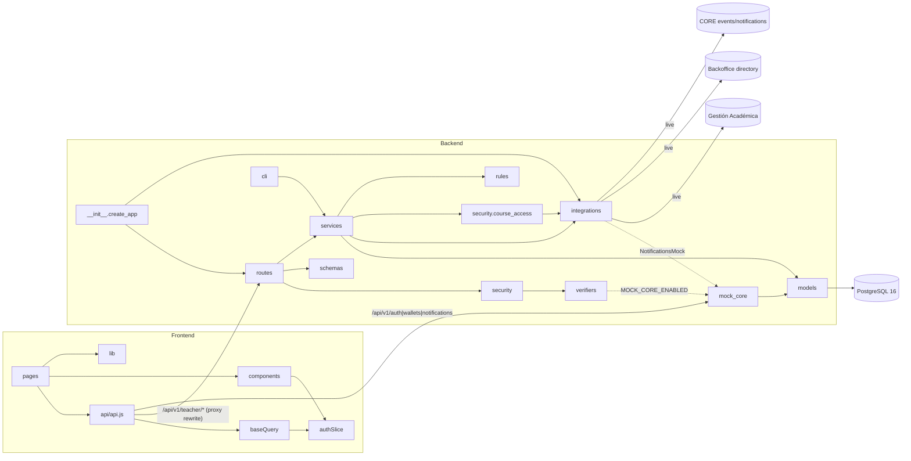

# ARCHITECTURE — Portal Docente · UADEnet (`teacher-service` + SPA)

> Generated by `/map-repo` on 2026-10-27 (branch `full_stack_integration`). Cite-first: every claim points to a file or `path:symbol`.
> _(inferred)_ marks conclusions not directly stated in code. Line numbers omitted on purpose (they drift); use symbols.

## 1. Overview

Module 2 "Portal del Docente" of the UADEnet ecosystem (TPO DEA II, 2Q 2026). A teacher logs in through CORE, then
manages their courses: attendance, exams, grades and official **actas** (signed course/final results). The backend
(`backend/`, Flask `teacher-service`) is a BFF over Gestión Académica (GA) plus a local store for teacher-owned data.
It publishes domain events and notifications to CORE via a transactional outbox. The SPA (`frontend/`, React) replicates
the 22 HTML mockups in `mockup_pantallas/` 1:1. **This delivery runs with no other module connected**: CORE is
simulated in-process (`backend/app/mock_core`) and every integration is in `mock` mode (`CLAUDE.md`, `ejecucion.md`).

## 2. Tech stack

| Layer | Tech | Version (source) |
|---|---|---|
| Backend language | Python | ≥3.12 (`backend/pyproject.toml`, `backend/Dockerfile`) |
| Web framework | Flask | ≥3.0,<4 (`backend/pyproject.toml`) |
| ORM / migrations | SQLAlchemy 2 + Flask-SQLAlchemy 3.1 + Flask-Migrate 4 (Alembic) | `backend/pyproject.toml` |
| DB | PostgreSQL | 16 (`backend/docker-compose.yml`) |
| DB driver | psycopg 3 (binary) | `backend/pyproject.toml` |
| Validation / OpenAPI | Pydantic 2 + spectree (Swagger at `/apidocs`) | `backend/pyproject.toml`, `app/extensions.py` |
| Auth | PyJWT[crypto] RS256 + JWKS | `app/security/verifiers/jwt.py` |
| HTTP out | requests + urllib3 Retry, cachetools TTLCache | `app/integrations/http.py` |
| App server | gunicorn, 3 sync workers, 60 s timeout | `backend/Dockerfile` |
| Backend tests | pytest 8, pytest-cov (gate 85 %), testcontainers PG16, requests-mock, freezegun | `backend/Makefile`, `tests/conftest.py` |
| Lint / types | ruff (line 110, rules E,F,I,B,UP,DTZ), mypy | `backend/pyproject.toml` |
| Frontend | React 19, React Router 7, Redux Toolkit 2 (RTK Query), react-redux 9 | `frontend/package.json` |
| Build / dev server | Vite 6 (dev 5173, preview 4173) | `frontend/vite.config.js` |
| PDF | jspdf 3 + jspdf-autotable 5 (lazy) | `frontend/src/lib/actaPdf.js` |
| Frontend tests | Vitest 3 + jsdom + Testing Library | `frontend/vite.config.js`, `src/test/` |
| Frontend serving | nginx 1.27 (alpine) on Node 22 build stage | `frontend/Dockerfile`, `frontend/nginx.conf` |
| CI | **none in repo** (no `.github/`) | `git ls-files` |

## 3. Repository layout

```
.
├── CLAUDE.md, .claude/          # agent instructions (root CLAUDE.md = project rules; .claude/ = workflow, agents, hooks)
├── HANDOFF.md                   # last session checkpoint (2026-10-26)
├── ejecucion.md                 # how to run everything (Docker / manual)
├── README.md                    # stale: 1st-delivery mockup README
├── backend/                     # teacher-service (Flask)
│   ├── app/                     # application package (see §4)
│   ├── migrations/              # Alembic env + hand-written versions 0001–0003
│   ├── tests/                   # unit / integration / contract / E2E (real PG16)
│   ├── docs/                    # BACKEND_DESIGN.md (2112 lines), openapi.json, sample-responses.json
│   ├── docker-compose.yml       # db + api + outbox-worker + web
│   ├── Dockerfile, Makefile, pyproject.toml, wsgi.py, .env.example
├── frontend/                    # React SPA
│   ├── src/                     # app/, api/, features/, components/, lib/, pages/, styles/, test/
│   ├── tools/extract_mockups.py # generates per-page CSS + icons from mockups
│   ├── Dockerfile, nginx.conf, vite.config.js, package.json
├── mockup_pantallas/            # 22 static HTML mockups (1st delivery) = UI source of truth
├── data/                        # TPO PDF + other modules' data-flow .xlsx + link_core (CORE /docs URL)
├── docs/                        # THIS file + SYSTEM-DESIGN.md
└── specs/                       # spec-driven workflow (_templates/ only so far)
```

## 4. Modules / components

### Backend (`backend/app/`)

| Module | Responsibility | Public interface | Depends on |
|---|---|---|---|
| `__init__.py` | App factory: settings, logging, db/migrate, verifier, integrations, CORS, blueprints under `/api/v1`, mock_core blueprint (no prefix), error handlers, inline outbox dispatch, CLI | `create_app(config_name, environ, settings)` | everything below |
| `config.py` | Frozen typed `Settings`; `from_env` collects **all** problems then raises `ConfigError` (fail-fast) | `Settings`, `Settings.from_env` | env |
| `constants.py` | Enums (Spanish values), `EVENT_TYPES` (6 `teacher.*.v1`), `EXAM_TYPE_CATALOG`, `DEGRADED_HEADER` | constants | — |
| `errors.py` | `AppError` hierarchy (`code`, `status`, `title`) → `application/problem+json`; `PublishError` (not an AppError) | `AppError`, `BadRequest`, `Unauthorized`, `Forbidden`, `NotFound`, `Conflict`, `TooManyRequests`, `ServiceUnavailable`, `UpstreamError`, `problem()` | flask |
| `extensions.py` | `db`, `migrate`, `spec` (SpecTree; malformed JSON/validation → 400) | singletons | — |
| `logging.py` | JSON logs, `X-Correlation-Id` (UUID or regenerated), redaction, security headers | middleware | — |
| `time.py` | **Only** clock source | `now_utc`, `now_local`, `today_local` | — |
| `cli.py` | `seed [--no-acta]`, `outbox-worker`, `outbox-once`, `outbox-requeue --failed`, `outbox-prune --days`, `openapi --out` | `register_cli` | services, seed |
| `seed.py` | Demo data (course 42) + simulator users/notifications | `load_seed`, `load_mock_core_seed` | models, mock_core |
| `security/` | AuthN (verifiers) + AuthZ (decorators, course ownership) | see below | integrations (GA, directory) |
| `routes/` | 9 thin blueprints (one per area) | 33 endpoints, see SYSTEM-DESIGN §5 | services, schemas, security |
| `schemas/` | Pydantic request/response DTOs (`ApiModel`: camelCase alias, `extra=forbid`) | DTOs, `json_response` | — |
| `services/` | Business rules, transactions, outbox enqueue, post-commit sync | `*_service` functions | models, integrations, security.course_access |
| `models/` | ORM mirroring hand-written migrations (Spanish table/column names) | `Clase`, `Asistencia`, `Examen`, `Calificacion`, `Acta`, `ActaDetalle`, views, `OutboxEvent`, `MockCore*` | extensions |
| `integrations/` | Ports & adapters for GA, Backoffice directory, CORE events/notifications, Campus (Eventos/Comedor/Tienda) | ABCs in `base.py`; `build_integrations`, `get_integrations` | http, config |
| `mock_core/` | CORE simulator: auth, JWKS, wallet, notifications, service tokens | 15 routes (SYSTEM-DESIGN §5.2) | models/mock_core, security |

**security/** detail:

| File | Role |
|---|---|
| `verifiers/__init__.py:build_verifier` | Picks `AUTH_VERIFIER` = `jwt` \| `introspect` \| `dev` (dev refused in production) |
| `verifiers/jwt.py:JwtVerifier` | RS256 via JWKS (remote `CORE_JWKS_URL` or `mock_core.keys.public_key_for`); rejects `typ=refresh` |
| `verifiers/introspect.py:CoreIntrospectionVerifier` | Calls CORE `/auth/me`, TTLCache |
| `verifiers/dev.py:DevVerifier` | `X-Dev-User` / `X-Dev-Roles` headers (tests, local) |
| `principal.py:Principal` | `user_id` (= JWT `sub`), roles, permissions, `is_service`; `principal_from_claims`, `principal_from_me` |
| `decorators.py` | `require_auth`, `require_teacher`, `require_service`, `require_service_token`; `InvalidTokenLimiter` (429) |
| `course_access.py` | `authorize_course(principal, course_id, write, fresh)` (GA lookup, ownership by `docenteId == sub`), `teacher_keys`, `teacher_name` |
| `gateway_hmac.py` | Placeholder: `verify()` always False; fails closed if enabled (TODO CORE) |

**services/** detail:

| Service | Owns |
|---|---|
| `course_service` | `me`, periods, exam turns/types, courses, roster (`load_roster(strict)`), prerequisites (BFF over GA + directory) |
| `attendance_service` | `put_attendance` (lock `clase` row), list/get, summary (view `asistencia_por_alumno`) |
| `exam_service` | create/patch/cancel/list/get; `list_my_exams` |
| `grade_service` | `upsert_grades` (ON CONFLICT), exam grades, course matrix; enqueues grade event + student notifications |
| `acta_service` | `generate_acta`, `annul_acta`, `resync_acta`, list/get; numbering `next_number` (advisory lock) |
| `acta_sync_service` | `targets_for`, `run_sync` → GA enrollment results, post-commit, thread pool |
| `result_service` | `student_results`, `course_results` (view `resultado_por_alumno`) — service-to-service |
| `calendar_service` | `calendar` aggregation (exams + GA turns + Eventos + Comedor, degraded per source), `purchases` (mock Tienda) |
| `event_service` | `build_envelope`, `enqueue`, `enqueue_notification`, `dispatch_due`, `requeue_failed`, `prune_sent`, `register_inline_dispatch` |
| `locks` | `exam_has_valid_acta`, `course_has_valid_cursada_acta` (gated by `LOCK_AFTER_ACTA`) |
| `rules` | Pure functions: `regularity`, `final_result`, `exam_phase`, `format_acta_number`, `mean` (round-half-up), `roster_sort_key` |

### Frontend (`frontend/src/`)

| Module | Responsibility |
|---|---|
| `main.jsx`, `App.jsx` | Root: `StrictMode > Provider(store) > BrowserRouter > App`; route table (23 routes, `PublicOnly` / `RequireAuth`) |
| `app/store.js` | `makeStore`; resets RTK cache (`api.util.resetApiState`) on authenticated→anonymous |
| `api/api.js` | **Single** RTK Query API: CORE endpoints (`/api/v1/auth|wallets|notifications`) + teacher (`/api/v1/teacher/*`), tags, exported hooks |
| `api/baseQuery.js` | `baseQueryWithReauth` (Bearer from Redux, `credentials: 'include'`, one shared refresh on 401), `refreshSession`, `toApiError` |
| `features/auth/authSlice.js` | `status`, `accessToken` (memory only), `user {id,email,roles,permissions}` |
| `features/ui/uiSlice.js` | Flash/toast messages |
| `components/` | `AppShell` (header/sidebar, logout, `pg pg-<id>` scope), `CourseNav`, `Pagination`, `RequireAuth` (`useBootstrapSession`, `PublicOnly`), `icons.generated.jsx` (GENERATED) |
| `lib/` | `format` (money/date/grade/uuid), `domain` (exam status, campus catalog TODO(GA)), `courses`, `purchases`, `actaPdf`, `useToast`, `useBodyClass` (exports `useLockScroll`) |
| `pages/` | 22 pages = 22 mockups (see SYSTEM-DESIGN §2.3) |
| `styles/` | `global.css` + `pages/<id>.css` (GENERATED, scoped `.pg-<id>`) |
| `tools/extract_mockups.py` | Reads `mockup_pantallas/pantalla-*.html` → scoped CSS + deduped SVG icons (`npm run extract-mockups`) |

## 5. Module dependency diagram



## 6. Patterns & conventions in use

| Pattern | Evidence |
|---|---|
| App factory + fail-fast typed config | `app/__init__.py:create_app`, `app/config.py:Settings.from_env` |
| Layered: routes → services → models | `routes/*.py` (decorators → `@spec.validate` → one service call → `json_response`) |
| Ports & adapters, live/mock per integration, single composition root | `integrations/base.py`, `integrations/factory.py:build_integrations` |
| Transactional outbox (enqueue in same tx; dispatch after commit, `SKIP LOCKED`) | `services/event_service.py:enqueue`, `dispatch_due`, `register_inline_dispatch` |
| Pre-flight network → short write tx → post-commit sync | `services/acta_service.py:generate_acta` + `acta_sync_service.run_sync` |
| DB invariants as partial unique indexes | `acta_vigente_uk`, `examen_curso_tipo_activo_uk` (`models/acta.py`, `models/examen.py`, `migrations/versions/0001_baseline.py`) |
| Derived reads via SQL views | `asistencia_por_alumno`, `resultado_por_alumno` (`0001_baseline.py`) |
| Advisory-lock sequence numbering | `acta_service.py:next_number` (`pg_advisory_xact_lock(hashtext('acta-number-YYYY'))`) |
| Pure business-rules module | `services/rules.py` (unit-tested in `tests/unit/test_rules.py`) |
| problem+json errors with stable `code` | `errors.py:problem`, handlers; `schemas/common.py:ProblemDetail` |
| Strategy for auth verification | `security/verifiers/base.py:TokenVerifier` + 3 impls |
| Spanish domain naming in DB, English in code/API | `models/*.py` (`examen`, `calificacion`, enum values `APROBADO`, `PRESENTE`) |
| Decimal internally; JSON numbers on wire | `schemas/common.py` (GradeOut/Pct serialize as float) |
| Frontend: one RTK Query API, tag invalidation, reauth wrapper | `frontend/src/api/api.js`, `api/baseQuery.js` |
| Frontend: generated, scoped mockup CSS + icons | `frontend/tools/extract_mockups.py` |

## 7. Boundaries & rules (what may import what)

From `CLAUDE.md` + observed code:

| From | May use | Must NOT |
|---|---|---|
| `routes/` | `services`, `schemas`, `security.decorators`, `errors`, `extensions.spec` | `db.session`, `requests`, ORM objects in responses. **Violation:** `routes/health.py` queries `db.session` directly |
| `services/` | `models`, `integrations.factory.get_integrations`, `security.course_access`, `rules`, `event_service`, `time` | `flask.request`; returning ORM objects; network inside write tx. _Soft deviation:_ services use `flask.g`/`current_app` (`event_service`, `locks`, `acta_service`) |
| `integrations/` | `http`, `token_provider`, `outbound_auth`, `config`, `errors` | business rules; only place where GA Spanish JSON → DTO mapping happens (`academic_live.py`) |
| `security/` | `verifiers`, `principal`, `integrations` (for `course_access`, `dev` fixtures) | — _(security → integrations is a known coupling)_ |
| `mock_core/` | own models/schemas/service, `security.decorators` | **any teacher business logic** (CLAUDE.md). Seed carries `teacher:*` permission strings only |
| `models/` | `extensions.db` | — ; every schema change = hand-written Alembic migration; `tests/test_schema_matches_models.py` must stay green |
| Anything | `app/time.py` for clock | `datetime.now()`, `date.today()`, `float` for grades/money |
| Frontend pages | `api/api.js` hooks, `lib`, `components` | direct `fetch`; demo/fallback data for teacher-service data (design §17.4); editing generated CSS/icons |

## 8. Build, test, run

| Task | Command (cwd) |
|---|---|
| Everything in Docker (db, api, worker, web:3000) | `cd backend && cp .env.example .env && make up` |
| Local venv | `cd backend && python3 -m venv .venv && .venv/bin/pip install -e '.[dev]' python-dotenv` |
| Migrate / seed | `make migrate` (= `flask db upgrade`) · `make seed` (= `flask seed`, `--no-acta` optional) |
| API dev | `flask run -p 8080 --debug` · prod-like: `gunicorn -b 0.0.0.0:8080 -w 2 --timeout 60 wsgi:app` |
| Outbox | `flask outbox-worker` (loop) · `make outbox` (= `flask outbox-once`) · `flask outbox-requeue --failed` · `flask outbox-prune --days 30` |
| Backend tests | `make test` (= `pytest --cov=app --cov-fail-under=85`; needs Docker for testcontainers or `TEST_DATABASE_URL`) |
| E2E only | `pytest tests/integration/test_e2e_*.py` |
| Lint | `make lint` (= `ruff check . && ruff format --check . && mypy app`) |
| OpenAPI dump | `make openapi` (= `flask openapi --out docs/openapi.json`, cwd-relative) |
| Health | `curl localhost:8080/api/v1/health` · `/api/v1/health/ready` |
| Frontend dev | `cd frontend && npm install && npm run dev` (5173; `BACKEND_URL=http://localhost:8090 npm run dev` to retarget) |
| Frontend test / build | `npm test` (Vitest) · `npm run build` |
| Regenerate mockup CSS/icons | `npm run extract-mockups` |
| Demo users | `maria.gomez@uade.edu.ar` (course 42), `carlos.diaz@uade.edu.ar` (43), `juan.perez@uade.edu.ar` (student), `secretaria.academica@uade.edu.ar` (ACADEMIC_ADMIN); password `Uade2026!` |

## 9. Known issues / tech debt

| # | Area | Issue | Evidence |
|---|---|---|---|
| 1 | Outbox | `dispatch_due` holds `FOR UPDATE SKIP LOCKED` row locks **while doing HTTP** calls; violates "network outside write tx" | `services/event_service.py:dispatch_due` |
| 2 | Outbox | Only `PublishError` is caught per row; any other exception rolls back the whole batch → already-delivered rows re-sent (needs CORE dedupe by `eventId`); a poison row at the head blocks the queue | `event_service.py:dispatch_due`; trigger path `token_provider.py` unguarded `resp.json()` |
| 3 | Outbox | Clock mix: `next_attempt_at`/`sent_at` use app clock, filters use DB `func.now()` | `event_service.py` |
| 4 | Outbox | Compose says "run exactly ONE worker" though design is SKIP LOCKED-safe; `requeue_failed` unbounded; `--failed` flag is a no-op | `backend/docker-compose.yml`, `cli.py` |
| 5 | HTTP | `HttpClient` retries once on 401 for any method, incl. POST (rule: POST never auto-retried) | `integrations/http.py` |
| 6 | Acta sync | `run_sync` uses `pool.shutdown(wait=False)`: POSTs still running after 20 s deadline are reported as errors but may land; `resync_acta` unlocked → double POST; GA idempotency unknown | `services/acta_sync_service.py:run_sync`, `acta_service.py:resync_acta` |
| 7 | Concurrency | Check-then-act (no lock) between grade/attendance/cancel-exam and `generate_acta`; only duplicate actas guarded by unique index | `locks.py`, `grade_service.upsert_grades`, `exam_service.cancel_exam` |
| 8 | Rules | Regularity threshold 75 hard-coded in view `asistencia_por_alumno`; `REGULAR_THRESHOLD` env only affects summary DTO; `rules.regularity` unused; `constants.PASSING_GRADE/REGULAR_THRESHOLD` dead | `0001_baseline.py`, `rules.py`, `config.py` |
| 9 | Results | `resultado_por_alumno` = latest GENERADA acta of **any type** → a later CURSADA can shadow a FINAL | `0001_baseline.py` |
| 10 | Events | No event on exam patch/cancel (TODO); annulment does not revert GA (`ANNUL_REVERTS_ACADEMIC=false`); FINAL LIBRE sent to GA but not as course-result event | `exam_service.py`, `acta_service.py:annul_acta` |
| 11 | Numbers | `float()` in event payloads, GA `notaFinal`, response serializers | `acta_service.py`, `grade_service.py`, `academic_live.py`, `schemas/common.py` |
| 12 | Security | Authz is role-only; permission strings parsed but never enforced; admin roles pass `require_teacher` | `security/decorators.py`, `principal.py` |
| 13 | Security | Invalid-token rate limiter is in-process, keyed by `remote_addr` (all clients share gateway IP), runs before verify | `decorators.py:InvalidTokenLimiter` |
| 14 | Security | Gateway HMAC is a fail-closed stub; introspect cache ignores `exp`/revocation; JWT iss/aud skipped when empty | `gateway_hmac.py`, `verifiers/introspect.py`, `verifiers/jwt.py` |
| 15 | Security | `MOCK_CORE_ENABLED` + non-empty `CORE_JWKS_URL` → remote JWKS wins silently, simulator tokens fail | `verifiers/__init__.py` |
| 16 | mock_core | `NotificationsMock` writes simulator tables (`commit=False`) inside the dispatcher's tx — cross-boundary coupling | `integrations/notifications.py` |
| 17 | mock_core | Private RSA PEM plaintext in DB; single `kid`, no rollover; per-process key cache | `mock_core/keys.py` |
| 18 | Layering | `routes/health.py` touches `db.session` | `routes/health.py` |
| 19 | Caching | GA TTLCache and token cache are per-process (3 gunicorn workers → 3 caches); `TokenProvider` holds lock during POST | `academic_live.py`, `token_provider.py` |
| 20 | Config | Live-mode validation checks only GA/directory URLs; `JSON_SORT_KEYS` no-op on Flask 3 | `config.py` |
| 21 | Tests | All tests (incl. unit/contract) need Postgres via autouse fixtures; `mock_core_signing_key` not truncated; E2E route sets hand-maintained; no CI; coverage gate global 85 % vs design ≥95 % per layer | `tests/conftest.py`, `Makefile` |
| 22 | Docs | `BACKEND_DESIGN.md` §8.2 / §19 stale vs §0.1 (JWT now, sub-only identity); 0001 baseline reconstructed (no `db/schema.sql`) | `backend/docs/BACKEND_DESIGN.md`, `backend/README.md` |
| 23 | Frontend | Profile PII in `localStorage`, not cleared on logout; module-level `refreshing` promise; `Date.now()` in reducer; `toApiError` not used in 6 pages; only 2 test files | `pages/Profile.jsx`, `api/baseQuery.js`, `features/ui/uiSlice.js` |
| 24 | Frontend | Role gate after CORE login → denied user keeps refresh cookie | `pages/Login.jsx` |
| 25 | Repo | Root `README.md` describes only 1st-delivery mockups; `data/` CORE xlsx tracked with NFD-accented name; `holaaaa.txt` deleted but unstaged | `README.md`, `git status` |
