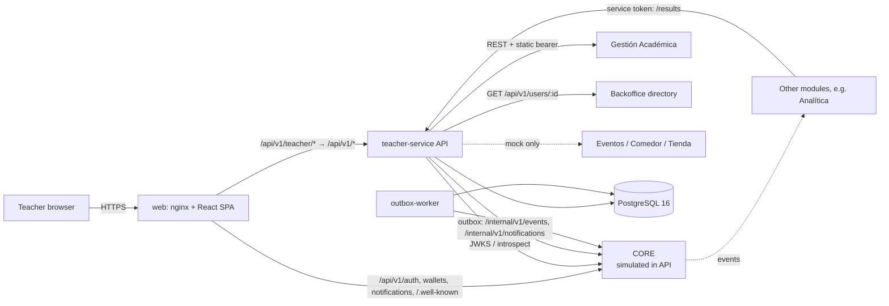
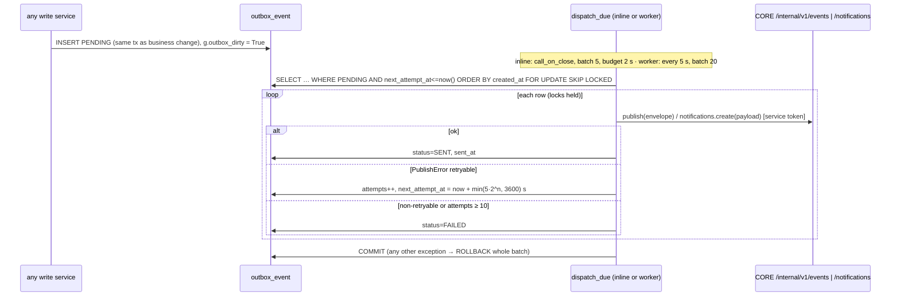
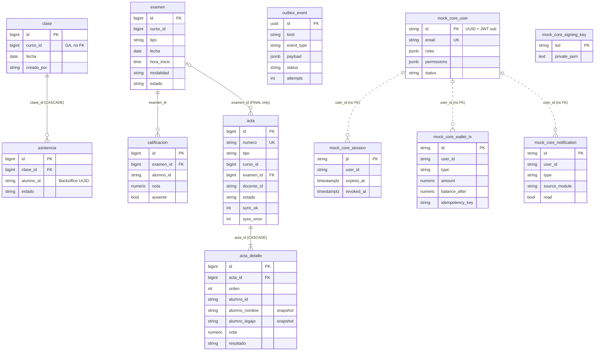

# SYSTEM DESIGN — Portal Docente · UADEnet

> Generated by `/map-repo` on 2026-10-27. Companion to `docs/ARCHITECTURE.md`. Long-form rationale lives in
> `backend/docs/BACKEND_DESIGN.md` (§0.1 = latest alignment; §20 = decision log D1–D26). _(inferred)_ = not stated in code.

## 1. Context

| Actor / system | Role | Status in this delivery |
|---|---|---|
| Teacher (`TEACHER`) | Main user: courses, attendance, exams, grades, actas, wallet, notifications | Real (SPA) |
| Academic admin (`ACADEMIC_ADMIN`), `ADMIN_STAFF` | Allowed into the portal (`frontend/src/pages/Login.jsx` `PORTAL_ROLES`); read fallback in `course_access.py` | Real |
| Student (`STUDENT`) | Receives notifications; rejected by portal login | Real (demo user) |
| **CORE** (Module 10) | IdP (login/refresh/JWKS), gateway `/api/v1/teacher/*`, wallet, notifications, event bus, service tokens | **Simulated** by `backend/app/mock_core` |
| **Gestión Académica (GA)** | Owner of periods, courses, enrollments, exam turns, prerequisites; receives enrollment results | `mock` (`integrations/academic_mock.py`); live adapter exists |
| **Backoffice** (Module 8) | User directory (names, legajo); UUIDs = person IDs | `mock`; live adapter exists |
| Eventos, Comedor (4), Tienda | Calendar events, dining menu, purchases | `mock` only (`integrations/campus_mock.py`, no live adapter) |
| Analítica (7), other student services | Consume `teacher.*.v1` events / call `/results` with service token | Not connected |



## 2. Deployables & runtime topology

### 2.1 Containers (`backend/docker-compose.yml`)

| Service | Image / build | Command | Port | Notes |
|---|---|---|---|---|
| `db` | `postgres:16` | — | 5432 | healthcheck `pg_isready` |
| `api` | `backend/Dockerfile` (python:3.12-slim, non-root uid 10001) | `flask db upgrade && flask seed && gunicorn -w 3 --timeout 60 wsgi:app` | 8080 | migrates + seeds on every start; HEALTHCHECK `/api/v1/health` |
| `outbox-worker` | same image | `flask outbox-worker` | — | compose comment: run exactly one (SKIP LOCKED would allow more) |
| `web` | `frontend/Dockerfile` (node:22 build → nginx:1.27) | nginx | 3000→80 | `nginx.conf` = local gateway: `/api/v1/teacher/` → `api:8080/api/v1/`; `/api/v1/`, `/.well-known/` → `api:8080`; SPA fallback |

### 2.2 Processes & threads

| Process | Work | Evidence |
|---|---|---|
| gunicorn sync worker ×3 | HTTP requests; per-process caches (GA TTLCache, JWKS, token, rate limiter, signing key) | `Dockerfile`, `academic_live.py`, `decorators.py` |
| Inline dispatch | `after_request` → `resp.call_on_close` → `dispatch_due(batch=5, budget_s=2)` in the same worker thread, only if `g.outbox_dirty` and `EVENTS_INLINE_DISPATCH` | `event_service.py:register_inline_dispatch` |
| Acta sync pool | `ThreadPoolExecutor(4)`, 20 s deadline, inside the request | `acta_sync_service.py:run_sync` |
| GA fan-out pool | `ACADEMIC_FANOUT_CONCURRENCY=6` (course-by-teacher) | `academic_live.py` |
| outbox-worker | loop: `dispatch_due` every `OUTBOX_POLL_SECONDS=5`, batch 20 | `cli.py` |

### 2.3 Environments & gateway emulation

| Env | Frontend | Gateway | CORE |
|---|---|---|---|
| Dev | Vite 5173 (`vite.config.js` proxy, `BACKEND_URL`) | Vite proxy rewrite `/api/v1/teacher` → `/api/v1` | `mock_core` in API |
| Docker local | nginx 3000 | `nginx.conf` | `mock_core` in API |
| Test | — | — | `AUTH_VERIFIER=dev` headers; E2E uses `jwt` + `mock_core` (`tests/conftest.py:e2e_app`) |
| Future live (Phase 5) | SPA behind CORE gateway | CORE real | `MOCK_CORE_ENABLED=false`, `CORE_JWKS_URL`, `INTEGRATIONS_MODE=live` (`HANDOFF.md`) |

SPA routes (`frontend/src/App.jsx`) ↔ mockup id: `/login` 01 · `/recuperar-contrasena` 01b · `/` 02 · `/cursos` 03 ·
`/cursos/:courseId` 05 · `/cursos/:courseId/estudiantes` 06 · `/asistencia` 07 · `/asistencia/historial` 08 ·
`/calificaciones` 09 · `/examenes` 10 · `/examenes/nuevo`, `/examenes/:examId/editar` 11 · `/examenes/:examId` 12 ·
`/actas` 15 · `/actas/nueva` 16 · `/actas/:actaId` 17 · `/calendario` 18 · `/notificaciones` 20 · `/compras` 22 ·
`/compras/:purchaseId` 23 · `/cuenta` 25 · `/cuenta/cargar-saldo` 26 · `/perfil` 27 · `*` → `/`.

## 3. Critical flows

### 3.1 Login + authenticated request (read path)

```mermaid
sequenceDiagram
  participant B as Browser (SPA)
  participant P as nginx / Vite proxy
  participant C as CORE (mock_core)
  participant A as teacher-service
  participant GA as GA (mock)
  B->>P: POST /api/v1/auth/login {email,password}
  P->>C: same path
  C-->>B: 200 {accessToken, user} + Set-Cookie refreshToken (httpOnly, path=/api/v1/auth)
  Note over B: Login.jsx checks role ∈ PORTAL_ROLES → authSlice.sessionStarted (token in memory only)
  B->>P: GET /api/v1/teacher/courses (Bearer)
  P->>A: GET /api/v1/courses (rewrite)
  A->>A: require_auth → JwtVerifier (RS256, kid via mock_core.keys) → Principal(sub)
  A->>A: require_teacher (roles) → course_service.list_courses
  A->>GA: list courses for docenteId = sub (TTLCache 60 s)
  A-->>B: 200 CourseList
  Note over B,A: On 401: baseQueryWithReauth → POST /api/v1/auth/refresh (cookie, rotates session) → retry once; fail → sessionEnded → /login
```

Evidence: `mock_core/routes.py`, `mock_core/service.py`, `frontend/src/api/baseQuery.js:baseQueryWithReauth`,
`security/decorators.py`, `security/verifiers/jwt.py`, `services/course_service.py`.

### 3.2 Generate acta (main write path)

```mermaid
sequenceDiagram
  participant B as SPA (ActaNew)
  participant R as routes/actas.py
  participant S as acta_service.generate_acta
  participant GA as GA
  participant D as Backoffice directory
  participant DB as PostgreSQL
  participant Y as acta_sync_service
  B->>R: POST /api/v1/teacher/actas {courseId, type, examId?}
  R->>S: generate_acta(principal, body)
  Note over S: A. Pre-flight (no write tx)
  S->>GA: authorize_course(write, fresh=True)
  S->>D: load_roster(strict) + teacher_name (502 if directory down)
  Note over S,DB: B–C. One short write tx
  S->>DB: ACTA_ALREADY_EXISTS check; read views / calificacion
  S->>S: rules.final_result (FINAL) or view condicion (CURSADA)
  S->>DB: pg_advisory_xact_lock(year) → next_number; INSERT acta + acta_detalle (snapshots)
  S->>DB: INSERT outbox_event acta-generated (+ course-result-published per APROBADO/DESAPROBADO if FINAL)
  S->>DB: COMMIT (IntegrityError on acta_vigente_uk → 409)
  Note over S,Y: D. After commit
  S->>Y: run_sync(targets) — 4 threads, 20 s, POST never retried
  Y->>GA: update enrollment result per student
  S->>DB: short tx: sync_ok / sync_error / sync_en
  R-->>B: 201 ActaCreatedDto + Location
  Note over R: after_request → inline dispatch of outbox (see 3.3)
```

Failure semantics: directory down → no acta row (502 `STUDENT_DIRECTORY_UNAVAILABLE`); GA sync failure → acta stays
`GENERADA` with `sync_error`, retried via `POST /actas/{id}/sync` (`resync_acta`). Evidence: `services/acta_service.py`,
`services/acta_sync_service.py`, `tests/integration/test_actas.py`.

### 3.3 Outbox delivery (async path)



Ops: `flask outbox-requeue --failed`, `flask outbox-prune --days 30`. Health: `/api/v1/health/ready` reports outbox counts.

## 4. Data model

### 4.1 Ownership

| Data | Owner | How we hold it |
|---|---|---|
| Periods, courses, enrollments, exam turns, prerequisites, subject | GA | Fetched on demand; only IDs stored (`curso_id`, `asignatura_id`, `periodo_id`, `alumno_id`), no FKs |
| Person names, legajo | Backoffice | Fetched; **snapshotted** into `acta` / `acta_detalle` at generation |
| Person identity | CORE/Backoffice | `docente_id` = JWT `sub` = Backoffice UUID = GA `docenteId` (D23) |
| Classes, attendance, exams, grades, actas | **teacher-service** | Local tables below |
| Outbox | teacher-service | `outbox_event` |
| Wallet, notifications, users, sessions, signing key | CORE | `mock_core_*` tables **only while simulated** |

### 4.2 Tables (`backend/migrations/versions/0001–0003`, mirrored in `backend/app/models/`)

| Table | Key columns / constraints |
|---|---|
| `clase` | `curso_id`, `fecha`; UNIQUE (`curso_id`, `fecha`) |
| `asistencia` | `clase_id`, `alumno_id`, `estado` ∈ `PRESENTE\|AUSENTE\|JUSTIFICADO` |
| `examen` | `curso_id`, `tipo`, `fecha`, `hora_inicio`, `duracion_minutos`, `modalidad` ∈ `PRESENCIAL\|VIRTUAL`, `estado` ∈ `PROGRAMADO\|CANCELADO`; partial UNIQUE `examen_curso_tipo_activo_uk` WHERE `estado<>'CANCELADO'` |
| `calificacion` | `examen_id`, `alumno_id`, `nota` NUMERIC(4,2) CHECK 0..10, `ausente` (CHECK no nota if ausente); UNIQUE (`examen_id`,`alumno_id`), upsert ON CONFLICT |
| `acta` | `numero` (per-year sequence via advisory lock), `curso_id`, `tipo` ∈ `FINAL\|CURSADA`, `examen_id` (required iff FINAL), `estado` ∈ `GENERADA\|ANULADA`, anulación fields, sync fields (`sync_ok`, `sync_error`, `sync_en`); partial UNIQUE `acta_vigente_uk(curso_id, tipo, coalesce(examen_id,0))` WHERE `GENERADA` |
| `acta_detalle` | `acta_id`, `alumno_id`, name/legajo snapshot, `nota`, `resultado` ∈ `APROBADO\|DESAPROBADO\|REGULAR\|LIBRE\|AUSENTE` |
| view `asistencia_por_alumno` | per course/student %, `condicion` REGULAR if ≥ 75 (hard-coded); JUSTIFICADO counts as present |
| view `resultado_por_alumno` | `DISTINCT ON (curso, alumno)` latest GENERADA acta (any type) |
| `outbox_event` | `id` UUID, `kind` ∈ `EVENT\|NOTIFICATION`, `event_type`, `subject`, `payload` JSONB, `status` ∈ `PENDING\|SENT\|FAILED`, `attempts`, `next_attempt_at`, `last_error`, `sent_at`; partial index `outbox_event_due_idx` WHERE PENDING |
| `mock_core_signing_key`, `mock_core_user`, `mock_core_session`, `mock_core_wallet_tx` (UNIQUE user+idempotency_key, `balance_after`), `mock_core_notification` (UNIQUE user+type+source_module+source_reference) | simulator only (0003) |

RLS is enabled on all tables with no policies → works only because the app role owns the tables _(inferred)_.
Schema drift guard: `tests/test_schema_matches_models.py` (models vs DB, partial indexes, `security_invoker` views, downgrade/upgrade roundtrip).

### 4.3 ER diagram

Only 4 real FKs (`asistencia→clase` CASCADE, `calificacion→examen`, `acta→examen`, `acta_detalle→acta` CASCADE).
`curso_id`, `alumno_id`, `docente_id` are logical references to GA/Backoffice (no FK). `mock_core_*` tables have no FKs; `user_id` = `mock_core_user.id` by convention.



### 4.4 Live DB snapshot (2026-10-28, `make up` with `MOCK_DATASET=demo`, read-only queries)

Alembic head `0003`. Tables/indexes/FKs match `app/models/` (no schema drift found).
Two seed datasets (`MOCK_DATASET`, also drives the GA/Backoffice mocks): `base` = `app/seed.py` (tests, Appendix B:
course 42 with 3 students, acta `2026-001`) and `demo` = `app/seed_demo.py` + `integrations/fixtures_demo.py`
(docker compose default; deterministic).

| Table | Rows (demo) | What is there |
|---|---|---|
| `clase` | 36 | course 42 (10 Mondays), 43 (11 Tuesdays), 30 (15 Fridays, 1Q); holidays skipped |
| `asistencia` | 710 | 25 / 20 / 16 students per course; some JUSTIFICADO with reason; a few LIBRE students |
| `examen` | 13 | 42: PARCIAL_1/2, RECUP_1 graded, FINAL scheduled · 43: PARCIAL_1, TP_1 graded, RECUP_1 CANCELADO, PARCIAL_2 (VIRTUAL), FINAL · 30: all graded |
| `calificacion` | 141 | integer grades 1..10, some `ausente` |
| `acta` | 3 | course 30: `2026-001` CURSADA, `2026-002` FINAL ANULADA (typo), `2026-003` FINAL |
| `acta_detalle` | 48 | results computed with `services.rules`; match GA mock enrollments (guarded in the seed) |
| `outbox_event` | 28 | SENT history: acta-generated, course-result-published, acta-annulled |
| `mock_core_user` | 48 | 45 STUDENT (`nombre.apellido@uade.edu.ar`), 2 TEACHER, 1 ACADEMIC_ADMIN |
| `mock_core_wallet_tx` / `_notification` / `_signing_key` | 2 / 8 / 1 | teacher top-ups, demo notifications, RS256 key |

Code vs data gaps (found on the `base` dataset; the `demo` dataset fixes the first three):
- `base` acta is inserted directly by `app/seed.py`: FINAL exam has **no** `calificacion` rows, yet `acta_detalle` holds grades.
- `base` acta dates (2026-12-03) are in the future vs `now`.
- `base` seed enqueues no outbox rows although an acta exists.
- `outbox-worker` container reports `unhealthy`: its healthcheck curls `localhost:8080`, but the worker serves no HTTP.
- App and migrations connect as `postgres` (superuser + owner) → RLS (enabled, 0 policies) is bypassed anyway.
- `acta.numero` has no DB sequence; number comes from `format_acta_number` (`YYYY-NNN`).

### 4.5 Key business rules (`services/rules.py`, design §11)

| Rule | Implementation |
|---|---|
| Regularity | attendance ≥ 75 % (unrounded, JUSTIFICADO = present) → REGULAR else LIBRE |
| Final result | grade ≥ `PASSING_GRADE` (4) → APROBADO; `FINAL_REQUIRES_REGULAR=true`; absent → AUSENTE |
| CURSADA acta | attendance only (D12) |
| APROBADO (course) | attendance ≥ 75 % AND grade ≥ 4 (D21) |
| Lock after acta | `LOCK_AFTER_ACTA`: grades/attendance edits blocked once valid acta exists (`locks.py`) → 409 |
| Acta number | `format_acta_number`, per-year sequence under advisory lock |
| Mean | round-half-up Decimal |

## 5. Integrations

### 5.1 Inbound API (teacher-service, prefix `/api/v1`; via gateway `/api/v1/teacher/*`)

"T" = `require_auth` + `require_teacher`; "S" = `require_service` (static `SERVICE_TOKENS` or CORE `kind=service` in `SERVICE_MODULES`).

| Method | Path | Auth | Service |
|---|---|---|---|
| GET | `/health`, `/health/ready` | none | direct DB (layering violation) |
| GET | `/me` | auth only | `course_service.me` |
| GET | `/periods`, `/exam-turns`, `/exam-types` | T | `course_service` |
| GET | `/courses`, `/courses/{id}`, `/courses/{id}/students`, `/courses/{id}/prerequisites` | T | `course_service` (students may set degraded header) |
| GET/POST | `/courses/{id}/exams` | T | `exam_service` (POST → 201 + Location) |
| GET/PATCH | `/courses/{id}/exams/{examId}` | T | `exam_service` |
| POST | `/courses/{id}/exams/{examId}/cancellation` | T | `exam_service.cancel_exam` |
| GET | `/exams` (from/to/phase/include_cancelled/limit) | T | `exam_service.list_my_exams` |
| GET/PUT | `/courses/{id}/exams/{examId}/grades` | T | `grade_service` |
| GET | `/courses/{id}/grades` | T | `grade_service.course_matrix` |
| GET | `/courses/{id}/attendances`, `/attendance-summary` | T | `attendance_service` |
| GET/PUT | `/courses/{id}/attendances/{day}` | T | `attendance_service` (PUT 200/201) |
| GET/POST | `/actas` (limit 1–200, offset) | T | `acta_service` |
| GET | `/actas/{id}` | T | `acta_service.get_acta` |
| POST | `/actas/{id}/annulment`, `/actas/{id}/sync` | T | `acta_service` |
| GET | `/students/{id}/results`, `/courses/{id}/results` | S | `result_service` |
| GET | `/calendar`, `/purchases` | T | `calendar_service` |

Conventions: Pydantic DTOs with camelCase and `extra=forbid`; OpenAPI at `/apidocs` and `backend/docs/openapi.json`;
paging only on `/actas` (limit/offset/total) and `/exams` (limit). No idempotency keys on teacher routes; PUT = upsert.

### 5.2 CORE (simulated by `mock_core/routes.py`; same paths as real CORE)

| Method | Path | Notes |
|---|---|---|
| POST | `/api/v1/auth/login` · `/refresh` · `/logout` · `/password/forgot` · GET `/api/v1/auth/me` | refresh cookie `refreshToken` (httpOnly, SameSite=Lax, path `/api/v1/auth`), rotation per session row |
| GET | `/.well-known/jwks.json` | single RSA-2048 key in DB |
| POST | `/internal/v1/service-auth/token` | `MOCK_CORE_SERVICE_CLIENTS` (`clientId:secret`) → `kind=service` token |
| GET/POST | `/api/v1/wallets/me`, `/me/transactions`, `/me/top-ups` (Idempotency-Key) | ARS only; magic tokens `mock-rejected`/`mock-pending` |
| GET/PATCH/POST | `/api/v1/notifications`, `/unread-count`, `/{id}`, `/read-all`; POST `/internal/v1/notifications` | |
| — | `/internal/v1/events` | **not simulated**; `CoreEventsMock` records in memory |

Access-token claims: `sub, kind=user, email, name, roles, permissions, careerIds, status, typ=access, iss, aud, iat, exp (900 s), jti` + `kid` header.

### 5.3 Outbound (`integrations/`)

| Port (ABC in `base.py`) | Live adapter → target | Auth (default) | Mock |
|---|---|---|---|
| `AcademicClient` | `academic_live.py` → GA `/planificacion/periodos`, `/turnos-examen`, `/cursos[/{id}[/inscripciones/{alumnoId}]]`, `/academica/asignaturas/{id}/correlatividades` | static bearer | `academic_mock.py` (+ `down`/`fail_for` hooks) |
| `StudentDirectoryClient` | `student_directory_live.py` → Backoffice `GET /api/v1/users/{userId}` (one call per id, thread pool) | static bearer | `student_directory_mock.py` |
| `CoreEventsClient` | `core_events_live.py` → CORE `POST /internal/v1/events` | service token | `core_events_mock.py` |
| `NotificationsClient` | `notifications.py:NotificationsLive` → `POST /internal/v1/notifications` | service token | `NotificationsMock` → writes `mock_core_notification` |
| `CampusClient` | — (none) | — | `campus_mock.py` (Eventos, Comedor, Tienda) |

Mode: `INTEGRATIONS_MODE` (global) overridden by `ACADEMIC_MODE`, `CORE_EVENTS_MODE`, `STUDENT_DIRECTORY_MODE`,
`NOTIFICATIONS_MODE` (`config.py`). Service token: `TokenProvider` caches CORE token (`CORE_SERVICE_CLIENT_ID/SECRET`).
HTTP policy (`http.py:HttpClient`): timeouts 3 s connect / 8 s read, `HTTP_MAX_RETRIES=2` on 502–504 for GET/PUT only,
correlation header propagated, final 5xx → `UpstreamError` (502/504).

### 5.4 Events (`constants.py:EVENT_TYPES`, `event_service.py:build_envelope`)

Envelope: `specVersion "1.0", eventId, eventType, source "teacher", occurredAt, subject, correlationId, causationId, actor {type,id}, data`.

| Event | Emitted by |
|---|---|
| `teacher.attendance-recorded.v1` | `attendance_service.put_attendance` |
| `teacher.grade-published.v1` (+ notification `TEACHER_EXAM_RESULT_PUBLISHED` per student) | `grade_service.upsert_grades` |
| `teacher.exam-created.v1` | `exam_service.create_exam` |
| `teacher.acta-generated.v1` | `acta_service.generate_acta` |
| `teacher.course-result-published.v1` (per APROBADO/DESAPROBADO, FINAL only) | `acta_service.generate_acta` |
| `teacher.acta-annulled.v1` | `acta_service.annul_acta` |

## 6. Cross-cutting concerns

| Concern | Design | Evidence |
|---|---|---|
| AuthN | Bearer JWT RS256 validated locally (JWKS); alternatives `introspect` (CORE `/auth/me`, 60 s cache) and `dev` headers (blocked in production) | `security/verifiers/*` |
| AuthZ | Roles (`TEACHER_ROLES`, `ADMIN_ROLES`, `SERVICE_ROLES`) via decorators; course ownership via GA `docenteId == sub` in `authorize_course(write=True)` on every write; permission strings not enforced | `decorators.py`, `course_access.py` |
| Service-to-service | Static `SERVICE_TOKENS` (constant-time compare) or CORE `kind=service` tokens | `decorators.py:require_service` |
| Abuse | `InvalidTokenLimiter` → 429 per remote IP, per process | `decorators.py` |
| Config & secrets | Env only (`.env.example`); fail-fast `Settings.from_env`; no secrets manager; simulator private key in DB | `config.py`, `mock_core/keys.py` |
| Errors | `application/problem+json`: `type, title, status, code, detail (es), instance, correlationId, errors[]`; catalog in design §13.3 | `errors.py` |
| Observability | JSON logs, `X-Correlation-Id` (UUID) propagated to outbound calls and event `correlationId`; key redaction; `/health`, `/health/ready` (DB + outbox counts + integration modes). No metrics/tracing | `logging.py`, `routes/health.py` |
| Security headers / CORS | Security headers in middleware; CORS allows `Idempotency-Key` | `logging.py`, `app/__init__.py` |
| Time | `app/time.py` only; tests freeze `2026-10-19 15:00 UTC` | `time.py`, `tests/conftest.py` |
| Caching | GA courses TTLCache 60 s; introspection cache; JWKS client cache; service-token cache; RTK Query cache in SPA (reset on logout) | `academic_live.py`, `token_provider.py`, `frontend/src/app/store.js` |
| Frontend session | Access token in Redux memory; refresh via httpOnly cookie; single in-flight refresh | `features/auth/authSlice.js`, `api/baseQuery.js` |
| Degradation | Roster/calendar return partial data + degraded header/list when a source is down | `constants.DEGRADED_HEADER`, `calendar_service.py` |

## 7. Non-functional

| Aspect | Observation |
|---|---|
| Scaling | Stateless API except in-process caches/limiter → horizontally scalable _(inferred)_, with per-process cache inconsistency. Outbox workers are safe to scale via SKIP LOCKED, but compose pins one |
| Throughput bottlenecks | GA fan-out for teacher course list (`ACADEMIC_SUPPORTS_TEACHER_FILTER=false`); Backoffice directory = 1 HTTP call per student; acta generation does network pre-flight + post-commit sync **inside the request** (gunicorn sync worker blocked up to ~20 s+; 60 s timeout) |
| Inline dispatch cost | Up to ~2 s (+ one row's HTTP time) on the worker thread after each write request |
| Failure modes | GA down → reads 502/504, acta sync errors stored and retryable; directory down → roster degraded / acta refused; CORE events down → outbox retries with backoff for ≈1 h (10 attempts) then FAILED; batch-level exception → redelivery duplicates (consumers must dedupe by `eventId`) |
| Consistency | At-least-once events; DB invariants by partial unique indexes; TOCTOU between lock checks and acta generation |
| Data volume | Small (per-course rosters); `/exams` and most lists unpaginated |
| Security posture | No gateway HMAC yet; refresh rotation without family revocation (simulator); PII in browser `localStorage` (profile) |

## 8. Key design decisions (inferred ADRs)

| # | Decision | Evidence | Trade-off |
|---|---|---|---|
| 1 | Local RS256 JWT validation via JWKS (D20) | `verifiers/jwt.py`, design §0.1 | No per-request CORE call; revocation only at `exp` (900 s) |
| 2 | Simulate CORE in-process with real contracts (D22) | `app/mock_core`, `MOCK_CORE_ENABLED` | Switch to real CORE = config change; simulator shares DB/process and leaks into `NotificationsMock` |
| 3 | Identity = JWT `sub` = Backoffice UUID = GA `docenteId` (D23) | `principal.py`, `course_access.py` | No email/legajo matching; depends on all modules agreeing |
| 4 | BFF over GA; store only teacher-owned data | `integrations/academic_*`, models without FKs | Fresh source data; latency + availability coupling to GA |
| 5 | Transactional outbox for events + notifications (D6, D25) | `event_service.py`, `outbox_event` | Atomic with business change; at-least-once, needs dispatcher ops |
| 6 | Acta first, GA sync after commit (D8) | `acta_service.generate_acta` | Acta never lost; GA may lag → explicit resync |
| 7 | Advisory lock for acta numbering (D7) | `acta_service.next_number` | Gap-free per year; serializes acta creation |
| 8 | Business invariants in DB (partial unique indexes, CHECKs, views) | `0001_baseline.py` | Race-safe; logic split between SQL and Python (threshold duplication) |
| 9 | Hand-written Alembic migrations + schema test | `migrations/versions/*`, `tests/test_schema_matches_models.py` | Full control (partial indexes, views); manual effort |
| 10 | Real PostgreSQL in tests (testcontainers) | `tests/conftest.py` | High fidelity; every test needs Docker/PG |
| 11 | Ports & adapters with per-integration mode | `integrations/factory.py` | Easy mock/live mix; tolerant parsers hide contract drift |
| 12 | SPA = mockups 1:1 with generated scoped CSS | `frontend/tools/extract_mockups.py` | Pixel fidelity; large page components, CSS not hand-editable |
| 13 | Token in memory + httpOnly refresh cookie | `authSlice.js`, `baseQuery.js` | XSS can't steal refresh token; reload requires refresh round-trip |

## 9. Open questions for the team

1. **GA idempotency**: is the enrollment-result POST idempotent? (`run_sync` can double-send on timeout/resync.)
2. **CORE dedupe**: does CORE deduplicate events by `eventId`? (batch rollback re-sends.)
3. **CORE contracts**: exact service-token request/response fields (`token_provider.py` TODO(CORE)); JWT claim names (`roles`, `permissions`, `kind`, `careerIds`); `JWT_ISSUER`/`JWT_AUDIENCE` values; gateway HMAC header format.
4. Should `resultado_por_alumno` prefer FINAL over a later CURSADA acta?
5. Should AUSENTE / LIBRE students in a FINAL acta be sent to GA and/or emitted as `course-result-published`?
6. Should exam patch/cancel emit events (`teacher.exam-updated/cancelled.v1`)? Should annulment revert GA (`ANNUL_REVERTS_ACADEMIC`)?
7. Should permission strings (`teacher:courses:*`) be enforced, and should admins have write access?
8. Is `REGULAR_THRESHOLD` meant to be configurable? (view hard-codes 75.)
9. Does the DB app role own the tables (RLS enabled with no policies)?
10. Run more than one outbox worker in production? (SKIP LOCKED allows it; compose says one.)
11. Who owns modules 6 and 9 in `data/`, and does the `CORRECIONES PROFESOR` sheet (Module 6 xlsx) change requirements?
12. Are mockup numbering gaps (04, 13, 14, 19, 21, 24) intentionally out of scope?
13. Should Profile contact data stay in `localStorage` until Backoffice exposes an endpoint (TODO(Backoffice)), and be cleared on logout?
14. Stale `BACKEND_DESIGN.md` sections (§8.2, §19 CORE items): update or mark superseded by §0.1?
