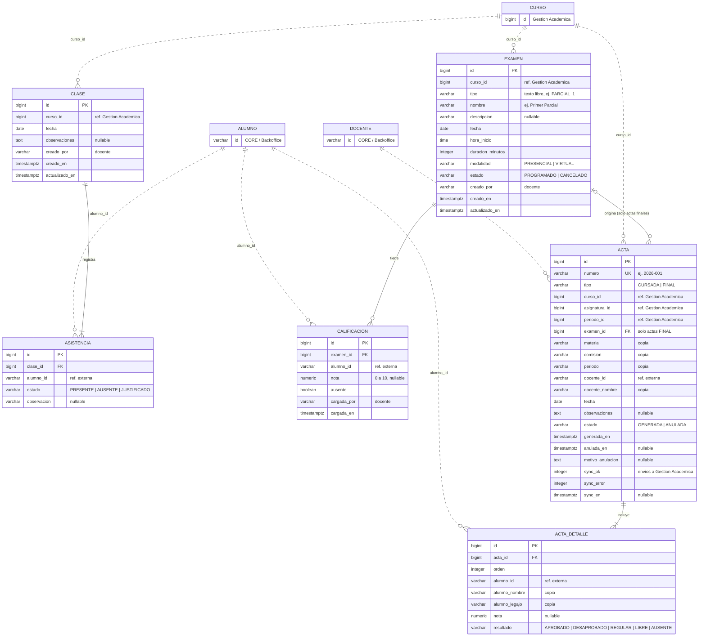

# Modelo de datos — Portal Docente

Base de datos propia del microservicio `teacher` (PostgreSQL en Supabase). Guarda **asistencia, exámenes, calificaciones y actas**. Las actas son la fuente oficial de la nota final y la condición de cada alumno. Todo lo demás lo consultamos a otros módulos y se guarda solo como un identificador.

- Script de tablas (fuente de verdad de columnas y reglas): [../db/schema.sql](../db/schema.sql)
- Datos de prueba: [../db/seed.sql](../db/seed.sql)
- Cómo pasar las tablas a entities de Spring Boot: [guia-backend-entities.md](guia-backend-entities.md)

## Diagrama entidad-relación

Las cajas `CLASE`, `ASISTENCIA`, `EXAMEN`, `CALIFICACION`, `ACTA` y `ACTA_DETALLE` son nuestras tablas. `CURSO`, `ALUMNO` y `DOCENTE` son de otros módulos: **no son tablas**, están para mostrar a qué apunta cada id. Las líneas punteadas son esas referencias externas, sin clave foránea real.

Además hay dos **vistas** de solo lectura:

| Vista | Qué devuelve | Quién la usa |
| --- | --- | --- |
| `asistencia_por_alumno` | Por curso y alumno: clases, presentes, justificados, inasistencias, porcentaje y condición (`REGULAR` / `LIBRE`) | Portal Docente (pantallas de asistencia y estudiantes) |
| `resultado_por_alumno` | Por curso y alumno: materia, período, nota y resultado del acta vigente más reciente | Portal del Estudiante (historial de materias) y Analítica |

## Qué guardamos y qué no

| Dato | Dónde vive | Cómo lo usamos |
| --- | --- | --- |
| Asistencia por clase y regularidad | **Portal Docente** | Tablas `clase` y `asistencia`, vista `asistencia_por_alumno` |
| Exámenes parciales, recuperatorios, TPs y final | **Portal Docente** | Tablas `examen` y `calificacion` |
| Actas, nota final y condición del alumno | **Portal Docente** | Tablas `acta` y `acta_detalle`, vista `resultado_por_alumno` |
| Copia del resultado final | Gestión Académica | Al generar el acta se envía `PUT .../inscripciones/{alumnoId}`; si falla, el acta queda igual y se registra en `sync_error` |
| Cursos, horarios, aulas, inscriptos | Gestión Académica | Guardamos `curso_id`, `asignatura_id`, `periodo_id`; el resto se consulta |
| Nombre, legajo, DNI y mail de alumnos y docentes | CORE / Backoffice (a confirmar) | Guardamos los ids; el acta copia nombre y legajo |
| Notificaciones, login, saldo | CORE | No se guarda nada |
| Compras | Tienda | No se guarda nada |
| Eventos y turnos de comedor | Eventos / Comedor | No se guarda nada |

## Decisiones tomadas

- **Actas y resultado final:** los guarda el Portal Docente, incluido el cierre y la anulación. Gestión Académica no se hace cargo; igual le enviamos el resultado con el `PUT` que ya existe, para que su base quede al día.
- **Copias en el acta:** materia, comisión, período, docente y nombre y legajo de cada alumno se copian como texto al generar el acta. Es un documento oficial: no debe cambiar si cambian los datos en otro módulo, y el historial del alumno se arma sin consultar a nadie más.
- **Un acta vigente por curso y tipo.** Para corregir un acta, se anula (con motivo) y se genera otra.
- **Regularidad:** 75% de asistencia mínima. Un `JUSTIFICADO` no cuenta como inasistencia. Se calcula sobre las clases registradas hasta el momento.
- **Tipos de examen:** texto libre en `tipo`, con `nombre` para mostrar.
- **Aprobación:** se aprueba con 4 o más (mismo criterio que el frontend).
- **Datos calculados, no guardados:** porcentaje de asistencia, promedio y avance de carga de notas, "próximo" o "realizado" de un examen, hora de fin de un examen.

## Pendiente

- **Confirmar por escrito con Gestión Académica** que no se encargan de actas ni de regularidad, para poder justificarlo ante el profe (el TPO les asigna el motor de regularidad).
- **Avisar al Portal del Estudiante y a Analítica** que el resultado final y la condición los obtienen de nosotros.
